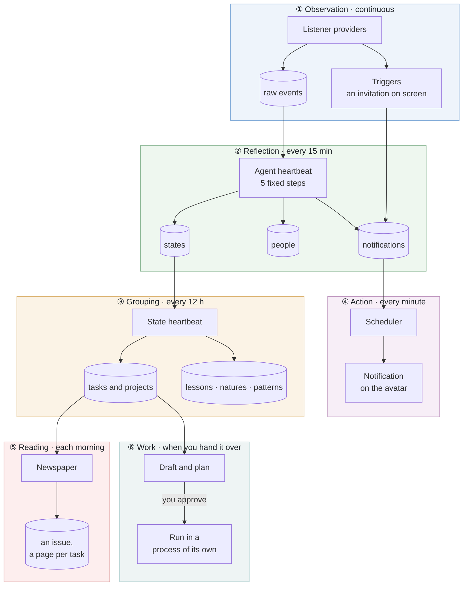
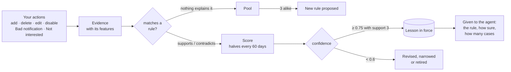
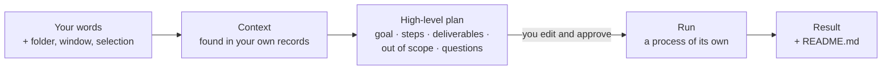
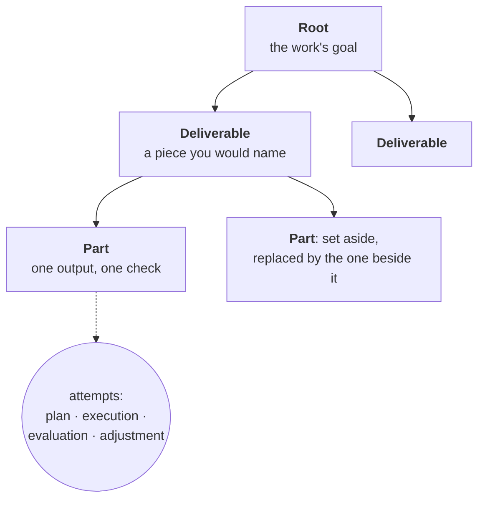
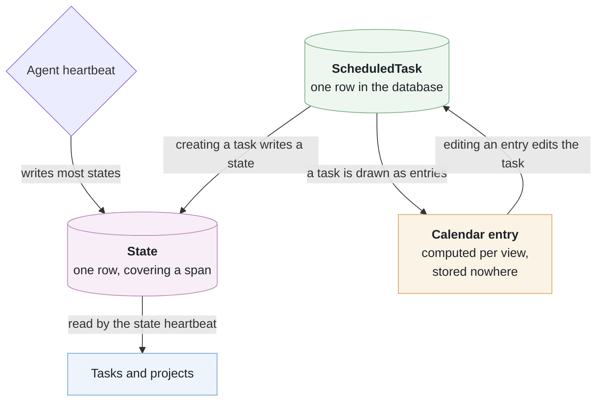
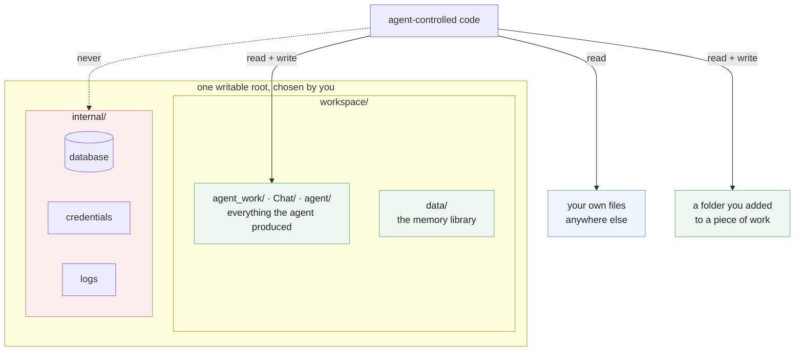

# How Personal Agent works

A desktop agent that watches how you work — with your consent, on your own
machine — builds a picture of what you do, and acts on it. Nothing it learns
leaves the computer it learns it on, except what is sent to the model you
chose.

**This page is the map. [`docs/design-doc.md`](docs/design-doc.md) is the
territory**: 130-odd numbered sections, each decision with the reasoning and
the measurements behind it. What follows is the shape of the thing; when you
want to know *why* it is that shape, the section numbers point at the answer.
For installing and using it, see the [README](README.md).

---

## The loops

Not one pipeline. Several loops running at different speeds over shared
storage, and almost every behaviour is one of them.



The names are **duties, not modules**; the second column is what to grep for.

| | in the code | what wakes it | what it writes |
| --- | --- | --- | --- |
| **① Observation** | `listener/`, `heartbeat/core/triggers.py` | each provider's own poll; a trigger on what just appeared | raw events; at once, the notification step for one window |
| **② Reflection** | `heartbeat/core/`: the **agent heartbeat** | every 900 s | states, people, notifications, ticks on task next steps |
| **③ Grouping** | `heartbeat/states/`: the **state heartbeat** | every 12 h, and after a round left work | tasks, projects, English copies, lessons |
| **④ Action** | `scheduler/` | every 60 s | the notifications that fall due |
| **⑤ Reading** | `heartbeat/reading/`, `heartbeat/connections/recommend.py` | its own clock, 08:00 by default | the reading log, topics, a Newspaper issue |
| **⑥ Work** | `agent/work/` | only you | whatever the work makes, in its folder, with a README |

The agent heartbeat's steps are fixed and read-only: **states** (what you
were doing in the window it just read), **people** (who you dealt with),
**nature** (paused), **notifications** (what needs a reminder, and why), and
**next steps** (ticking a task's next step the activity shows done). A step
whose Function is switched off in Settings is skipped. §35, §36.

**Triggers** act between heartbeats: a meeting invitation, or a time being
agreed, appearing on screen runs only the notification step, on that window
alone. They match only what is new in a window, never the agent's own
windows, and nothing runs when nobody is at the keyboard.

---

## Each reader has its own window

Nothing searches everything. Every reader is given **its own window**, and
nothing beyond it:

- the **agent heartbeat** reads the activity since it last looked, all of it,
  in turns when there is much;
- the **state heartbeat** reads the states of the tasks it is grouping;
- **chat** answers from what you ask and the conversation it is asked in. A
  long conversation's older part is summarised once and kept; the latest
  turns stay word for word. A new chat starts with nothing;
- **a piece of work you delegate** is the one place a search runs. One model
  call turns your request (in any language) into English keywords, and BM25
  ranks your states, tasks and projects against them, weighted by recency
  (halving every 21 days). What passes the relevance bar is shown to you in
  the draft, and the run can search the same records again with a tool
  (`agent/work/context_search.py`).

Raw activity is kept for `raw_activity_keep_days` (8) and then let go, by age.

---

## What the agent keeps

Folders of files, under your workspace, where you can open them.

```
PersonalizedAgent/
├── workspace/            the only place the agent may write
│   ├── agent_work/       each piece of work, a folder of its own
│   ├── Chat/             files made in chat, one folder per conversation
│   ├── agent/            the agent's scratch (.agent_runtime)
│   └── data/             the memory library
│       ├── user_nature/    who you are, how you work
│       ├── user_feedback/  what you thought of what it did
│       ├── states/         what was true over a span
│       └── state_tasks/    what a run of states adds up to
└── internal/             database, settings, credentials, logs: never the agent's
```

One record is one file: a short front matter block, then the text.

```
---
id: rec_1459a009
title: The user checks every UI change on the live page in dark mode
summary: ...
source: experience
references: stage: stage_3f1c...
created_at: 2026-09-02T02:11:09+00:00
---

What it is, how it shows, and what it means for doing their work...
```

- **Every folder carries an `intro.txt`** saying where its contents come from
  (§39.1).
- **Every record says where it came from**: `source`, `references`, and
  timestamps for when it was written, last changed, and what stretch it is
  *about*.
- **The parser is forgiving**, because a file you edited by hand is the normal
  case. A note with no front matter at all is still a record.

The **file listener does not listen to the workspace at all**: everything in
it is the agents' own, and a run's thousands of writes recorded as your
activity would bury what you did.

**Records are written in English, shown in your language.** Tasks, projects
and stories carry an English copy beside the words you see, made in the
background when the display language is not English, so that search and
comparison work whatever language you read in. Every model call is told, at
the top of its prompt, which language to answer in (`common/languages.py`).

**The interface's words come from fixed tables, one per language.** Every
text the screens can show - a tab, a button, a setting's explanation, the
avatar's and the tray's menus - is an entry in
`personalized_agent/api/web/lang/<code>.json`, with numbered places for the
numbers and names inside it. The page (`api/web/i18n.js`) and the desktop
(`common/interface_words.py`) both read them; nothing is translated on the
fly. `scripts/interface_words.py` lists any text the sources can show that
is not in every table, and a test fails until it is.

---

## Only what you do teaches it

Everything the agent learns about how you want things done goes through one
**lessons engine** (`heartbeat/lessons/`), for three kinds: notifications,
connections, and how you work.



- **A lesson is never written from one event.** It is a rule with conditions,
  the evidence for it and the evidence against it.
- **Only your own actions are evidence**, weighted more when you gave a
  reason. What the agents do (a reviewer reopening work, a decision you left
  alone) never moves a lesson. Otherwise the agent would grow surer of
  whatever it already did.
- **Your say wins.** Confirm, reject, pin or reword any lesson in the Lessons
  tab.
- **Portable.** A lessons package carries your actions, not the rules; loaded
  on another computer, it is learned from again there.

---

## Delegating work

Nothing starts by itself. You hand a piece of work over: from Explorer's
right-click menu, the button beside text you selected, the avatar's menu,
the To do list, or the Experience panel. Every start goes through a draft:



- **The draft shows what it found** (each record with its kind, date and
  relevance) and **a plan you can edit** before anything runs. The plan comes
  from those records alone, in one quick call; the run itself may then search
  the web, your files and your records for more detail.
- **Each run is a process of its own** (`agent/work/child.py`), so a run that
  crashes or is stopped takes nothing else with it. A **governor**
  (`agent/work/governor.py`) decides how many run at once from the cores and
  free memory (one per 4 cores and 1.5 GB, at most 4). When the computer is
  busy, new runs wait their turn at low priority; when memory runs short, the
  newest run is paused and resumed when there is room again.
- **Two agents take turns**, after a builder–reviewer loop: the work agent
  works one piece at a time and claims what it did, with evidence. Code checks
  the evidence exists, then a reviewer in a fresh context, with your own past
  work as what it judges by, reviews it. A contract (goal, scope,
  deliverables, acceptance criteria) is agreed first and then locked. The work
  agent never sees your experience directly, only the criteria.
- **Every run that makes something writes a `README.md`** saying what was
  made, where, and how to check it (`README-deliverable.md` if your folder
  already has a README of its own).
- **Live, pausable, versioned.** A live session shows every model turn and
  tool call. Pause stops at the next safe point; Resume goes on exactly
  there. At each key point a version is saved (content-addressed, every
  file's bytes once), and you can continue from any version, as a branch.
- **When the model is away, a run waits** rather than failing, and goes on
  when it is back. *Try again now* checks at once.
- **Where they may write**: the work's own folder, `workspace/agent_work/<name
  of the work>/` unless you chose one, and folders you add to it. Everywhere
  else is read-only.

### Each piece of work is a tree of cards

**Learning** a project (Start learning, then Update learning, from its row in
the Experience panel) writes it as a tree. A **card** is a piece of the
result: what is true when it is done, what you required of it, how it is
judged (by a test, by you, or by an agent), and why the card above needs it.



- **Learned when you ask, project by project.** Nothing learned is ever
  cleared.
- **A stage is an attempt inside a card**: its input, one decision and who
  made it, its output, the verdict. Retries and dropped routes stay in the
  card they were attempts at.
- **A card is found in the work, never invented.** Work that never broke down
  is a root with its attempts.
- This is what the reviewer judges a run by: the stages most like the work,
  and the natures (how you judge, what you want the output to be) reached
  through them.

---

## People and reading

**Connections** (`heartbeat/connections/`): the people in your work, from
three places only. The first is what you had in front of you: the agent
heartbeat's people step finds who you *dealt with* (wrote to, met, worked
with), not every name on a page. The second is the public web: a person whose
news is old and matters to your current work is looked up, with no sign-in,
no cookies, and never a message to anyone. The third is you: adding, editing,
merging and deleting. Your own profile is protected: what the agent finds
about you goes to an inbox for you to accept or dismiss.

**Newspaper**: a newspaper made for you each morning. What
you read (pages, how long each was in front, the words on screen) becomes a
**reading log** of topics. Each current task, project and topic gets a page,
searched on the public web *from its detail*, never from its heading. Stories
are kept only if close to the page's own detail on this computer's embedding
model, and not near anything you already read. They are ranked by what you
would learn from them, not by how much you watched of one kind. *More like
this*, *Not interested* and *Already knew* tune the next issue.

---

## State, task, calendar entry

Three things that describe time and are constantly mistaken for each other.



| | what it is | who ends it |
| --- | --- | --- |
| **Scheduled task** | a notification to be shown at a time | showing it, or you |
| **Calendar entry** | a drawing of a task: a view, stored nowhere | it is redrawn |
| **State** | what is true over a span; **internal**, visible only in the Debugger | the agent |

**Every one of them says why it exists.** A notification the agent adds must
say why it was worth interrupting you for, or it is not added. Your own entry
needs no reason. An agreement whose time is not known yet is kept as
*waiting for a time* rather than given a guessed one (§52.7).

**Every button says what happens**: *Got it (no more notifications)*,
*Remind me in N minutes* (it moves the event itself, so one reminder stays
one row however often it is put off), *Add to to-do (listed in To do on the
Overview)*, *Bad notification (fewer similar ones in future)*. The **To do**
list is yours: the agent never marks an item done; only you remove one.

---

## Where data lives, and who may touch it



Generated code runs under a guard that enforces this from inside: the
filesystem calls are replaced, and network connections are refused except to
the servers the run itself starts on this computer (§110, §110.1). A whole
drive, your home folder itself, and the app's own state can never be granted.

A guard inside Python can be taken apart from inside Python, and native code
never meets it. So the same boundary is also kept by the **operating system**,
around the whole child process (`runtime/isolation.py`):

| | writes | reads closed | network |
| --- | --- | --- | --- |
| **Windows**: AppContainer (no administrator) | only the folders granted to the child, each by its own capability | everything not granted; under your home, `AppData`, dot-folders and the app's internal state | none out; each run reaches only its own servers on loopback; pip alone gets `internetClient` |
| **macOS**: Seatbelt (`sandbox-exec`) | only those folders | credential stores (`~/.ssh`, Keychains, browser profiles …) and internal state | none, loopback included; pip: outbound TCP 443 only |
| **Linux**: bubblewrap, else Landlock (5.13+) | only those folders (filesystem read-only, private `/tmp`) | bubblewrap: credential stores and internal state hidden | bubblewrap: its own empty network with its own loopback; Landlock ABI 4+: TCP 443 only for pip |

Python packages a run asks for come from PyPI only, wheels only, into the
run's own folder, after you approve (or automatically, if you chose Auto and
the OS isolation holds). Where no isolation backend is available, the run
says *not OS-isolated* and why, and automatic installs are refused.

**Nothing of yours is signed in to.** Web pages are read through a fetch that
carries none of your cookies. A browser for testing what a run builds is a
separate *Chrome for Testing* with an empty profile per run, installed only
when you click Install. **Passwords, one-time codes and keys** are cut out of
everything the listener records before it is kept, by keywords and the shapes
keys have, with no model deciding (`common/credentials_guard.py`).
Pictures and scanned documents are read by the operating system's own OCR,
and a picture is sent only to a model that can see pictures.

The **local API** answers only whoever holds the installation's key, or the
browser signed in with a single-use link from it (`api/access.py`).

---

## Models

Models are **one ordered list** (Settings → General → Models). The first that
can answer does; a call passes to the next when one needs you to sign in again
or states a usage limit. A timeout is retried, not passed on. Providers:
Anthropic, any OpenAI-compatible service (OpenAI, Gemini, DeepSeek, Kimi,
Qwen, GLM, Mistral, OpenRouter …, or your own address), and the Claude Code
and Codex command-line tools, which are given the agent's tools natively.
Each call records its model, tokens and estimated cost, which the Debugger
charts and Settings → Functions shares out per function, over the last 72
hours.

---

## The Debugger

A **build-time** choice, not a setting: a build made without it does not
contain the panels, the routes, or the way in (§14.34).

- **Run from source, or built with `python build.py`**: the Debugger and its
  tabs are there.
- **Built with `python build.py --no-debugger`**, as every released download
  is: they are not.

What it shows that nothing else does:

- **Token usage and cost over time**, by kind of work or by Function (§14.35);
- **States**, laid out like a calendar. They are internal; this is where they
  are looked at (§11.1);
- **What each heartbeat step was given**, verbatim, and what it answered;
- **The chat, nature, reading, language and Experience debuggers**: each a tab
  of its own that shows one part of the agent step by step, with what each
  model call was given and what it answered.

---

## Layout

```
personalized_agent/
├── listener/        observe: windows, screen text, screenshots, files, browser history, assistants
├── heartbeat/       the agent heartbeat (core/), the state heartbeat (states/), lessons/,
│                    connections/ and recommendation, reading/, experience/
├── agent/           chat core, work runs (work/), notifications and to-do (feedback/),
│                    the avatar (character/), the Overview
├── scheduler/       notifications in time
├── models/          providers, the model list, prices, which see pictures
├── runtime/         the sandbox, its guard, OS isolation, documents
├── data_manage/     raw storage and the memory library
├── api/             local HTTP API and the web interface
├── ui/              the desktop avatar, tray, selection button
├── platform_layer/  per-OS: autostart, Explorer menu, OCR, windows
├── protocol/        signed ingest for local integrations
├── common/          settings, languages, observability
└── debugger/        the Debugger's panels (left out of release builds)

deprecated/          the knowledge graph, kept and not run
docs/                the specification and its reader
tests/               the suite
build/, build.py     packaging for Windows, macOS and Linux
```

---

## Running it

```bash
pip install -r requirements.txt
python run.py                        # the agent
python scripts/run_tests.py          # the suite
python build.py                      # a packaged build, with the Debugger
python build.py --no-debugger        # as released, without it
```

Everything is local. The only network calls are to the model provider you
configure, web searches and public pages when a task needs them, and the
package index when you approve an install.
