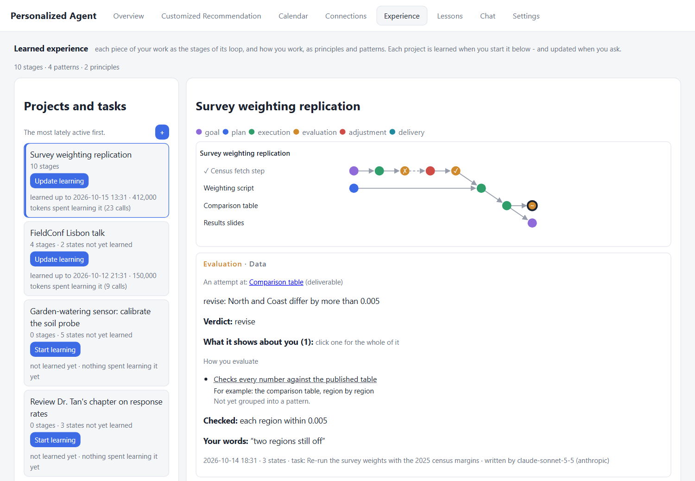

<p align="center">
  
</p>

<h1 align="center">Personal Agent WaterMelon</h1>

<p align="center">
<b>An agent that learns you.</b> It watches how you work - with as little
instruction from you as possible - learns your patterns and habits, keeps
refining its understanding of you, and in time learns to work for you the
way you would want it done. All on your own computer.
</p>

<p align="center">
<b>Download v0.2.0:</b> <a href="https://github.com/fhbzc/Personal-Agent-WaterMelon/releases/download/v0.2.0/PersonalAgentWaterMelon-Setup-windows-x64.exe"><b>Windows</b></a> ·
<a href="https://github.com/fhbzc/Personal-Agent-WaterMelon/releases/download/v0.2.0/PersonalAgentWaterMelon-macos.dmg"><b>macOS</b></a> ·
<a href="https://github.com/fhbzc/Personal-Agent-WaterMelon/releases/download/v0.2.0/PersonalAgentWaterMelon-linux-x86_64.deb"><b>Linux</b></a>
<sub>(a <a href="#pre-releases">pre-release</a> · <a href="#install">other formats</a>)</sub>
</p>

<p align="center">
<a href="#your-privacy">Privacy</a> ·
<a href="#install">Install</a> ·
<a href="#using-it">Using it</a> ·
<a href="#build-it-from-source">Build from source</a> ·
<a href="#check-that-a-download-is-genuine">Verify a download</a> ·
<a href="#update-log">Update log</a> ·
<a href="DESIGN.md">How it works</a>
</p>

---

## The idea

Most assistants wait to be told. This one learns by watching, and needs
very little telling.

1. **It learns your patterns and habits, not your commands.** From the
   windows, documents and pages you work with (only the sources you allow),
   it writes down what you were doing, groups it into your tasks and
   projects, and learns *how* you work: how you break work into steps, how
   you judge a result, what you want a finished piece to look like.
2. **Its understanding of you keeps evolving.** Every day of activity adds
   to it, and so does every small thing you do with what it shows you: a
   notification kept or called bad, a story you want more of, a contact
   corrected, a plan changed. Only your own actions change what it has
   learned. You never have to write a profile or a prompt about yourself.
3. **In time, it works for you the way you would.** Hand it a piece of work
   and it plans from what it has learned; a second agent reviews the result
   against how *you* judge your own work. The more it has seen, the closer
   its work comes to your taste.

Everything it learns stays on your computer, in plain files you can read,
and goes only to the model you choose.

## What it does

**It learns what you are doing, not what you type.** It notices which
applications, documents and web pages you work with, only the sources you
leave switched on. Every 15 minutes it writes down, in a sentence or two,
what you were doing; every 12 hours it writes those notes up as the tasks
you did, and groups the week's tasks into the projects they serve. What it learns is stored only on your computer, as
plain files you can open, and sent only to the model you choose
([Your privacy](#your-privacy)).

**An Overview of your work.** Your projects as bars over time, with how
long you worked on each, and a **To do** list you keep yourself, each with a
**Delegate work** button.

<p align="center">
  <br>
  <sub>The Overview: your projects over the last week, and your To do list.</sub>
</p>

**Calendar and notifications that learn from you.** It adds reminders it
thinks you need (an invitation in an email, a deadline in a document) and
says why each was worth interrupting you for. Every notification's buttons say
exactly what they do: *Got it*, *Remind me in N minutes*, *Add to to-do*, or
*Bad notification*. What you do with them, and only what *you* do, teaches it
which notifications to send next time.

<p align="center">
  <br>
  <sub>A reminder the agent added: why it was scheduled, and when you postponed it.</sub>
</p>
<p align="center">
  <br>
  <sub>Every button on a notification says what it does.</sub>
</p>

**Delegate work.** Hand it a piece of work from wherever you are:

- right-click a folder, a file or the desktop → **Delegate work** (Windows;
  on Windows 11 it is under **Show more options**, or right-click with
  **Shift** held),
- select text in any window and click the small Watermelon button beside it,
- the avatar's menu, or the **Delegate work** button in To do.

<p align="center">
  <br>
  <sub>Right-click a folder → <b>Delegate work</b>.</sub>
</p>

A small **Delegate work** window opens, always in three steps:

1. **Your instruction.** What you handed over is shown, with a box for what
   you want done (or anything to add).
2. **Create.** It looks through its own records of your work for what is
   relevant, and drafts a short plan: the goal, the steps, what you will get,
   what is left out. You can change any of it.
3. **Start.** Nothing runs before you press it.

<p align="center">
  
  <br>
  <sub>Left: your instruction for what was handed over. Right, after <b>Create</b>: the drafted plan, to change and then <b>Start</b>.</sub>
</p>

Two agents
then take turns, one doing the work and one reviewing it against how you
judge your own work. You see the run live, can pause or stop it, can go back
to any saved version, and get a `README.md` with the result saying what was
made and how to check it.

**Experience.** Ask it to *learn* a project and it writes down how the work
was broken into pieces and how each piece was judged. That is what the
reviewer uses when it works on that project for you.

<p align="center">
  <br>
  <sub>A project learned into stages: each deliverable's attempts, reviews and fixes, one review opened.</sub>
</p>

**Connections.** The people in your work and what they are doing, from what
you had in front of you and from public pages only. It never signs in to
any of your accounts.

<p align="center">
  <br>
  <sub>The people in your work, and one person's card: public profiles, what happened, and the changes you made.</sub>
</p>

**Newspaper.** Each day, things worth reading for your
current projects and interests, chosen to tell you something you do not already
know. *More like this* and *Not interested* tune it.

<p align="center">
  <br>
  <sub>Today's issue: the front page, a page for each topic, why each story is there and what in it is new to you.</sub>
</p>

**Chat.** Ask it about your work, or ask it to do something. Files it makes
in a conversation are kept in `workspace/Chat/<conversation title>/`. The ×
beside a conversation in the list deletes it, after asking once; the files it
made stay.

<p align="center">
  <br>
  <sub>Ask about your work, or ask it to do something; select words in a reply to ask about them in the margin.</sub>
</p>

**The Watermelon.** A small avatar on your desktop. It shows notifications in
a speech bubble, looks at your pointer, and turns to face the middle of the
screen. You can rename it, move it, or hide it.

<p align="center">
  
</p>
<p align="center">
  <br>
  <sub>Its moods, and a notification in its speech bubble, waiting until you answer.</sub>
</p>

**In your language.** English, 中文, Español, 日本語, 한국어, Русский, Français,
Deutsch and Italiano, chosen when you install and changeable in Settings. The
whole interface changes with it: every tab, menu, button and explanation, the
avatar's and the tray's menus, and the notifications' buttons. The agent
writes and speaks in it too.

<p align="center">
  <br>
  <sub>The same screen in English, 中文 and Français.</sub>
</p>

---

## Your privacy

An agent that sees your work has to earn that. Personal Agent is built so
that your data is **stored only on your computer** and **sent only to the
model you choose**, never to any server of ours or anyone else's. **You
choose what it watches and what it does**, passwords and codes are
**filtered out before anything is kept or sent**, and **it cannot act
outside the limits you set**. All of this comes from how it is built, not
from a promise.

### Stored only on your computer

- **No account, no server of ours, no telemetry.** There is no service your
  data is uploaded to, and nothing is collected about you or about how you
  use it.
- **Everything it keeps is in one folder you own** (`PersonalAgentWaterMelon/`;
  an installation from before v0.2.0 keeps `PersonalizedAgent/`):
  what it learned as plain Markdown files in `workspace/data/` that you can
  open, edit or delete, and its database and settings in `internal/`. Delete
  the folder, and everything it ever kept is gone.
- **Raw activity is short-lived.** What the listener records is deleted after
  8 days; only the short notes made from it are kept.
- **Comparing and reading happen on your computer**: the embedding model that
  groups your notes runs locally, and pictures and scanned documents are read
  by your system's own OCR.

### Sent only to the model you choose

To understand your activity, the agent has to show it to a model: every 15
minutes, the text it read in that window of time is sent to **the model you
picked** to be summarised, and so are your chat messages and the files a
piece of work uses. That model is your choice, in **Settings → Models**:

- **A service you trust**: Anthropic, OpenAI, Google, DeepSeek, Mistral or
  any other you add, under its own privacy terms; or the Claude Code or Codex
  tool already signed in on your computer.
- **A model on your own machine** (Ollama, LM Studio, or anything with an
  OpenAI-compatible address): then your activity is never sent to a model
  service. **The only thing that still goes out is web searches**:
  Connections and Newspaper look things up on the web on
  their own, with search words drawn from your current tasks and the people
  in them, so a search engine can see those topics. Turn those two off in
  Settings → Functions, and with a local model **nothing leaves your
  computer at all**.

Before anything is sent, the **smart filter** has already taken out
passwords, one-time codes and keys (see below).

### Exactly what leaves your computer

| What | Where to | When |
| --- | --- | --- |
| The text a step needs (a window of recent activity, your chat message, the files a piece of work uses), with passwords and codes already filtered out | **Only the model you chose**: nowhere, with a local model | When a step runs |
| Pictures | Only to a model that can see pictures | A model that reads text only gets the words, read locally |
| Web searches (the words come from your current tasks and the people in them) and the public pages they find | Brave Search (with your key) or DuckDuckGo, then the pages themselves, **with no cookies and no sign-in** | When Connections or Newspaper run (turn them off and they stop), or when a piece of work you started needs the web |
| One-time downloads | Hugging Face (the embedding model, once), Google (the testing browser), PyPI (packages a piece of work needs) | Only the first time, or **only when you click Install / Approve** |

### You choose what it watches

**Settings → Privacy** has one switch per source, each saying what the agent
loses without it and what it costs your computer:

- the window in front (which program, which title),
- the text in that window,
- screenshots (the words in slides and pictures),
- your browser's history,
- files created and changed,
- coding assistants' sessions, and, separately, what was said in them.

Beyond the switches:

- **Windows it never reads**: password managers, private and incognito
  browsing, authenticators, banking and payment pages, by default, and any
  you add.
- **Folders it never watches**, and the agent's own folders are never
  watched at all, so its work is never mistaken for yours.
- **The smart filter for passwords, one-time codes and keys** takes them out
  of everything the listener records (screen text, window titles,
  addresses, assistant conversations, the words read off a picture) **before
  it is stored or sent to any model**. It finds them by their labels, in all
  nine languages, and by the shapes keys and tokens have, on your computer,
  so no password is ever shown to a model to ask whether it is one. The
  value becomes `[hidden]` and the label stays, so the agent still knows a
  sign-in happened, not what was typed. A screenshot showing one is not kept
  at all. On by default (*Hide passwords and codes*).
- **Never its own folder.** The data folder is never listened to, whatever
  the list of excluded folders says; Settings shows it there, locked.

<p align="center">
  <br>
  <sub>Settings → Privacy: one switch per source, each saying what the agent loses without it and what it costs your computer.</sub>
</p>

<p align="center">
  <br>
  <sub>Settings → Others: the folders it never watches. Its own data folder is always first, locked.</sub>
</p>

### You choose what it does

**Settings → Functions** lists what runs by itself, each with its own switch
and **what it cost over the last 72 hours**:

- **Task organisation**: grouping your notes into tasks and projects.
- **Calendar management**: notifications and reminders.
- **Connections**: the people in your work.
- **Newspaper**: the daily reading.
- **Experience learning**: learning projects you choose.

Turn one off and it stops, along with its model calls. Only the core
(noting what you are doing) is always on, because everything else is built
on it. What you start yourself (chat, a piece of work) is counted apart.

<p align="center">
  <br>
  <sub>Settings → Functions: each with its own switch and what it cost over the last 72 hours.</sub>
</p>

### What it will never do

- **Sign in as you.** It never signs in to your accounts, never clicks
  anything in them, and never posts, sends or replies for you. What it knows
  about other people comes from what you had in front of you and from public
  pages.
- **Write anywhere you did not allow.** The agent writes only in its own
  workspace and in folders you add to a piece of work. This is enforced by
  code and, around every piece of code it runs, by the operating system's
  own sandbox (AppContainer on Windows, Seatbelt on macOS, bubblewrap on
  Linux). Your other files are read-only to it, and its own database and
  credentials are closed to it.
- **Start work by itself.** Every piece of work waits for your instruction
  and your approval of its plan.
- **Learn from itself.** Only what *you* do (a notification you call bad, an
  event or a person you delete, a story you are not interested in) changes
  what it learns about you.
- **Be reached by anything else.** Its page is served on `127.0.0.1` only,
  and answers only with this installation's key, so other programs and
  websites cannot read it.

### What you need

- Windows 10/11, macOS 11 or later (Apple Silicon), or Linux (x86-64).
- A model to think with: an API key for Anthropic (Claude), OpenAI, Google
  Gemini, DeepSeek, Kimi, Qwen, GLM, Mistral, OpenRouter or any
  OpenAI-compatible service, **or** the Claude Code or Codex command-line
  tool signed in on this computer. You add it in Settings → Models on first
  start. Several can be added in order; when one cannot answer, the next does.

---

## Install

The newest version is **[v0.2.0](https://github.com/fhbzc/Personal-Agent-WaterMelon/releases/tag/v0.2.0)**, still a
[pre-release](#pre-releases):

| System | Installer (recommended) | Portable (no install) |
| --- | --- | --- |
| **Windows** 10/11, x64 | [PersonalAgentWaterMelon-Setup-windows-x64.exe](https://github.com/fhbzc/Personal-Agent-WaterMelon/releases/download/v0.2.0/PersonalAgentWaterMelon-Setup-windows-x64.exe) | [PersonalAgentWaterMelon-portable-windows-x64.zip](https://github.com/fhbzc/Personal-Agent-WaterMelon/releases/download/v0.2.0/PersonalAgentWaterMelon-portable-windows-x64.zip) |
| **macOS** 11+, Apple Silicon | [PersonalAgentWaterMelon-macos.dmg](https://github.com/fhbzc/Personal-Agent-WaterMelon/releases/download/v0.2.0/PersonalAgentWaterMelon-macos.dmg): open it and drag the app into Applications | [PersonalAgentWaterMelon-macos.pkg](https://github.com/fhbzc/Personal-Agent-WaterMelon/releases/download/v0.2.0/PersonalAgentWaterMelon-macos.pkg): an installer instead, which needs your password and cannot update itself |
| **Linux** x86-64 | [PersonalAgentWaterMelon-linux-x86_64.deb](https://github.com/fhbzc/Personal-Agent-WaterMelon/releases/download/v0.2.0/PersonalAgentWaterMelon-linux-x86_64.deb) | [PersonalAgentWaterMelon-linux-x86_64.AppImage](https://github.com/fhbzc/Personal-Agent-WaterMelon/releases/download/v0.2.0/PersonalAgentWaterMelon-linux-x86_64.AppImage) · [tar.gz](https://github.com/fhbzc/Personal-Agent-WaterMelon/releases/download/v0.2.0/PersonalAgentWaterMelon-portable-linux-x86_64.tar.gz) |

### Pre-releases

A pre-release is a version published for trying out before it is marked as
a release. It is tested like any release, but it is not yet what the
program offers as an update: install it from the links here, and the
program then offers you the releases that come after it.

| Version | Published | Status | Downloads |
| --- | --- | --- | --- |
| [v0.2.0](https://github.com/fhbzc/Personal-Agent-WaterMelon/releases/tag/v0.2.0) | 2026-10-18 | pre-release | above, or on [its release page](https://github.com/fhbzc/Personal-Agent-WaterMelon/releases/tag/v0.2.0) |
| [v0.1.0](https://github.com/fhbzc/Personal-Agent-WaterMelon/releases/tag/v0.1.0) | 2026-10-16 | release (the latest) | [Windows](https://github.com/fhbzc/Personal-Agent-WaterMelon/releases/download/v0.1.0/PersonalizedAgent-Setup-windows-x64.exe) · [macOS](https://github.com/fhbzc/Personal-Agent-WaterMelon/releases/download/v0.1.0/PersonalizedAgent-macos.dmg) · [Linux](https://github.com/fhbzc/Personal-Agent-WaterMelon/releases/download/v0.1.0/PersonalizedAgent-linux-x86_64.deb) · [all files](https://github.com/fhbzc/Personal-Agent-WaterMelon/releases/tag/v0.1.0) |

Every release also has **`SHA256SUMS.txt`**, the checksum of each file; see
[Check that a download is genuine](#check-that-a-download-is-genuine).

**Updates.** Once a day the program looks for newer releases here and tells
you. **Settings → General → Updates** lists every newer version with what it
says is new; press **Install this version** on the one you want, and it is
downloaded, checked against that release's `SHA256SUMS.txt`, and installed -
never while a piece of work is running - and the program starts again on it
and shows what is new. Only published releases count: nothing reaches you
from the code until it is released. You can instead have the newest
installed by itself (also a box in the Windows installer, unticked), or
nothing looked for. The Windows installer, the macOS app dragged in from the
`.dmg` and the Linux AppImage update themselves; the portable folder, the
`.deb` and the macOS `.pkg` are told there is a new version and where it is.

### Installer or portable?

They are the **same program**, built from the same commit by the same
workflow. Only how it gets onto your computer differs.

| | Installer | Portable |
| --- | --- | --- |
| How | Run it. It asks for your language and where to keep your data, installs, and adds a Start menu / Applications entry | Unzip anywhere and run `PersonalAgentWaterMelon` |
| Language, start at sign-in, Explorer's *Delegate work* entry | Set up by the installer | Set up by the program on its first start |
| Removing it | Uninstall from Settings → Apps (Windows) or the usual way; the extra entries go with it | Delete the folder. Turn off *Start at sign-in* in Settings first, or the entry stays |
| Best for | Most people | Trying it out, or keeping it on a USB drive |

**Your data folder.** The installer asks where to keep your data: one folder
for everything the agent learns and makes.

- **By default it is a `data` folder inside the program's folder.** A folder
  that needs administrator rights to write to (Program Files, the Windows
  folder) cannot be used, because the program works as you, without them: the
  installer says so and will not go on until you choose another.
- **Choose an empty folder, or one that holds only an earlier Personal
  Agent's data** (its `workspace` and `internal` folders). Everything in the
  data folder belongs to the agent and is never listened to, so a folder with
  other things in it (Documents, a whole drive, a project) would hide the
  work kept there. The installer refuses such a folder, and the program will
  not start in one.
- **Reusing earlier data:** if the folder holds an earlier agent's data, the
  installer asks whether to use it; say No and pick another folder.
- **A different folder is a different agent**, with its own calendar,
  contacts and keys, so you can try a new version on a fresh folder without
  touching your usual one.
- Uninstalling leaves the data folder where it is, even inside the
  program's folder.
- **Where your API keys are kept.** On Windows, in Windows' own credential
  store. On macOS (the downloaded app is not signed by an Apple developer,
  so macOS would ask again after every update) and on Linux without a
  keyring, they are kept encrypted in the data folder, with the key that
  opens them beside them. So keep that folder out of iCloud Drive, Dropbox
  and other synced folders, and don't send it to anyone whole.
- **One copy starts at sign-in.** If another copy of the program already
  does (one run from the source, say), the installer's last page will not
  finish with *Start at sign-in* ticked, and Settings will not save it on,
  until you untick it or turn it off in the other copy.

Neither contains the developer **Debugger** tabs; see
[Build it from source](#build-it-from-source) if you want them.

### First start: the "unknown publisher" warning

The builds are **not code-signed**. Signing needs a paid certificate, and
this is a free, open-source project, so your system will warn once:

- **Windows.** SmartScreen shows *"Windows protected your PC"*. Click
  **More info → Run anyway**. Some antivirus programs are wary of unsigned
  Python applications; you can check the file as below.
- **macOS.** *"Personal Agent WaterMelon can't be opened because Apple cannot check
  it."* Right-click the app (or the `.pkg`) → **Open** → **Open**, or allow it
  in **System Settings → Privacy & Security**. Then **Settings → Privacy →
  macOS permissions** lists what macOS needs you to allow, with a button to
  each; allow **Full Disk Access** first, and macOS will not ask about your
  Desktop, Documents and Downloads folders one by one. Because the app is not
  signed by an Apple developer, macOS forgets these permissions after each
  update, and the same page shows which to allow again.
- **Linux.** No warning. For the AppImage, `chmod +x` it first.

Nothing about the program depends on being signed. To know the file is the
one built from this code, check it.

---

## Check that a download is genuine

Two checks, the second stronger than the first.

**1. The checksum: is this the file that was published?** Compare your
download with `SHA256SUMS.txt` from the same release:

```powershell
# Windows (PowerShell)
Get-FileHash .\PersonalAgentWaterMelon-Setup-windows-x64.exe -Algorithm SHA256
```
```bash
# macOS
shasum -a 256 PersonalAgentWaterMelon-macos.pkg
# Linux
sha256sum PersonalAgentWaterMelon-linux-x86_64.deb
# or check every file you downloaded at once
sha256sum --check --ignore-missing SHA256SUMS.txt
```

The value must match the line for that file exactly. (SHA-256, not MD5: MD5
can be forged, so a matching MD5 proves little.)

**2. The build attestation: was this file built from this source code?**
Every release file is built by GitHub Actions from the tagged commit, in the
open, and GitHub signs a statement of which commit and which workflow made
it. With the [GitHub CLI](https://cli.github.com/):

```bash
gh attestation verify PersonalAgentWaterMelon-Setup-windows-x64.exe --repo fhbzc/Personal-Agent-WaterMelon
```

It prints the commit the file was built from; open that commit on GitHub to
read the exact code. You can also read the build's log under the repository's
**Actions** tab.

> **Why not rebuild it and compare?** A build of a Python application with
> PyInstaller is not byte-for-byte reproducible (it records build times and
> paths), so a file you build yourself will have a different checksum even
> from identical code. The attestation is what ties the published file to the
> code.

---

## Using it

1. **Start it.** The Watermelon appears on your desktop and the app opens in
   your browser (an address on `127.0.0.1` only your computer can reach). The
   tray icon brings it back.
2. **Add a model.** Settings → Models → **Add**. Put the one you prefer
   first.

   

3. **Choose what it may notice.** Settings → Privacy. Each source (the window
   in front and its text, screenshots, browser history, files, coding
   assistants' sessions) can be switched off, each with what is lost without
   it and what it costs the computer. Passwords and one-time codes are hidden
   before anything is kept.
4. **Let it watch for a while.** After an hour or so the Overview shows what
   you were doing. Tasks and projects appear after the first grouping round.
5. **Hand it work.** Use any of the *Delegate work* entries. In the window
   that opens, say what you want and click **Create**; it collects the
   context and drafts a plan. Check the plan, change what you like, and click
   **Start**. Nothing runs before that. Without a folder, it works in
   `workspace/agent_work/<name of the work>/`. Follow it in the Experience
   tab.
6. **Tell it when it gets things wrong.** *Bad notification*, *Not
   interested*, deleting a person or an event: each is kept as a lesson, and
   only your own actions change what it learns.

Where things are. The data folder is chosen when you install it (on
Windows a `data` folder inside the program's folder by default) or, from
source, with
`python run.py --root <folder>`; Settings → General shows it, and the
listener never reads it:

```
PersonalAgentWaterMelon/
├── workspace/          everything the agent makes, and the only place it may write
│   ├── agent_work/     work you delegated, one folder each
│   ├── Chat/           files made in chat, one folder per conversation
│   └── data/           what it learned: states, tasks, your nature, as plain files
└── internal/           its database, settings and logs; the agent cannot touch it
```

---

## Build it from source

You need Python 3.10 or later (3.12 recommended) and Git.

```bash
git clone https://github.com/fhbzc/Personal-Agent-WaterMelon.git
cd Personal-Agent-WaterMelon
python -m venv .venv
# Windows: .venv\Scripts\activate     macOS/Linux: source .venv/bin/activate
pip install -r requirements.txt
```

**Run it without building:**

```bash
python run.py
```

**Build the program and its installer:**

```bash
pip install pyinstaller
python build.py                    # with the Debugger tabs (a developer's build)
python build.py --no-debugger      # without them: the same as the released downloads
```

> **The Debugger.** The released installers and portable downloads are built
> **without** the Debugger: the panels that show every model call, token use,
> what each step was given, and test runners. A build from source **includes
> it unless you add `--no-debugger`**. It is a build-time choice, not a
> setting: a build without it does not contain the panels, the routes, or the
> code.

The result is in `dist/<platform>/`:

| Platform | What `build.py` makes | Also needs |
| --- | --- | --- |
| Windows | `PersonalAgentWaterMelon.exe` in a folder, a portable `.zip`, and `PersonalAgentWaterMelon-Setup.exe` | [Inno Setup 6](https://jrsoftware.org/isinfo.php) for the installer |
| macOS | `Personal Agent WaterMelon.app`, a `.dmg` and a `.pkg` | Xcode command-line tools |
| Linux | a folder, a `.tar.gz`, a `.deb` and an AppImage | `dpkg-deb`, `appimagetool` |

Other options: `--fast` (skip the tests and checks), `--no-installer`
(only the program folder), `--platform windows|macos|linux`.

**Run the tests:** `python scripts/run_tests.py`.

**Changed what a screen says?** Every text of the interface is in a fixed
table for each language (`personalized_agent/api/web/lang/`). Run
`python scripts/interface_words.py` to list what is missing, translate it into
every language, and merge it with `--merge`; a test fails until each table
has it.

---

## Update log

The newest version first. Each earlier version links to its release, where
everything it changed is written down.

### [v0.2.0](https://github.com/fhbzc/Personal-Agent-WaterMelon/releases/tag/v0.2.0) (2026-10-18, a [pre-release](#pre-releases))

- **Tasks and projects.** Each time the agent looks at what you have done
  (every 12 hours, or when you press Update tasks now), it writes down the
  separate things you did in that stretch as tasks, with how long you
  actually worked on each. Tasks that serve the same thing, such as the same
  paper, the same product or the same application, are grouped into
  projects. The Overview shows your projects over time, ordered by how long
  you worked on them. Filter them by the last days and by time worked (at
  least 15 minutes, an hour, six hours or a day). Click one to see what it is,
  what is being worked on, since when, and where. Leisure projects appear
  under your work, apart from it, when you show full activity. The first run
  writes the last week at once. The tasks of the earlier grouping are kept
  as they were.
- **Tasks no longer have next steps**, and the agent no longer ticks them.
  Your own To do list on the Overview stays as it is.
- **Newspaper: only stories close to what you are doing.** The stories a step
  to the side are gone. Stories are still ranked by what is new to you, how
  close they are, and how fresh. The pages are made from your latest 24
  hours of activity, counted back state by state, each with its time. Every
  project you worked on for an hour or more in them gets a page of its own,
  and the pages are searched four at a time, so an issue is ready sooner.
- **macOS:** the app reaches the web over a secure connection again, which
  update checks and downloads need. Settings → Privacy looks again only when
  you press Check again, and shows when it last looked. If Screen Recording
  still says not allowed, a button quits the app and opens it again.
- **Every piece of work is checked twice before it is called done.** A
  quality check and a privacy check read the finished work, documents and
  slides included. The privacy check looks for anything private that is
  shown, sent away, or left on your computer. Each check may send the work
  back up to three times; if it still fails, the run ends saying which check
  it failed.
- **Work is not "done" while something you asked for is unchecked.** A core
  promise the tester could not try for real goes back to be fixed, and the
  run never reports success without it.
- **Search your files.** The agents can search the folders you work in by
  their words: every Work project's folders, the folders you add in
  Settings → Search your files, and, with one click, your Claude Code and
  Codex conversation records. It is built at the lowest priority your system
  has and waits while the computer is on battery. Caches, keys and files
  only in the cloud are never read.
- **A simpler Work tab.** It no longer shows the graph of what was learned
  from a project. The panel on the right shows the steps of the agent's own
  work.
- **Codex runs with none of your own Codex setup** (your plugins, rules and
  servers are left out), uses the agent's tools for reading and writing, and
  is checked to offer no other tool before it is trusted with work that must
  stay sealed.
- **What the agent learns of your work is written in English**, whatever
  language you read in, so it is searched in one language. Your own words
  are kept as you wrote them. The same goes for a run's own notes on the
  Work tab (its cards, steps and findings). What it delivers to you is in
  your language, unless your instruction asks for another.
- **The web, checked whichever search is used.** A search may not carry
  anything that looks like a key or a password, and a page is opened only
  when nothing of yours can travel in its address. Allowed: addresses
  found in a search, on a page read, or in your own files; any page of a
  site you named; documentation and reference sites; and short addresses
  with none of your own words in them. Claude Code's own search is checked
  before and after every search and page. Codex's own search reads only
  OpenAI's saved copy of the web. The Connections round is held to the same
  checks.
- **Lesson cards.** Before the reviewer writes what each part of your work
  must meet, it first asks itself what it needs to know about you: your
  preferences, your naming habits, the tools you use, the formats you must
  follow. It answers from your own files and past work, with no web at all.
  Your own work keeps each answer, with what it rests on, and later work is
  shown it. A question it can only answer from the web is answered for that
  work and never kept. You can see the cards in the Lessons debugger.
- **Full reviews when they are due, and versions only at checkpoints.** The
  reviewer decides when to check everything since the last checkpoint: when
  a part is finished, when a core promise first holds, after a large change.
  A version is kept only when such a review passes, when the contract is
  approved or changed by your words, and when the work is done. If the app
  closes in the middle of a run, the run goes back to the last checkpoint. A
  pause still goes on from where it stopped.
- **What you did not say, shown as added.** The reviewer lists what you
  would expect but did not ask for, and the builder can propose what the
  work shows you need. Each one is marked "Added - not your words" on the
  Work tab, with who added it and why, and you can take it out. None of them
  ever becomes a core promise.
- **A new name: Personal Agent WaterMelon**, on screen and in the files you
  download. An existing installation is updated in place; your data and
  settings stay where they are. On a Mac, if you drag the new app in by hand,
  delete the old *Personalized Agent* app from Applications.
- **Updates from inside the app.** Settings → General → Updates lists every
  newer release with what it changes; install the one you choose, or let the
  newest install by itself (off by default). Each download is checked against
  the release's checksums, nothing is installed while a piece of work runs,
  and after an update the app shows what is new.
- **macOS: the app no longer closes as soon as it starts.** Keys are kept in
  the encrypted file in your data folder, and Settings → Privacy lists the
  permissions macOS needs, each with a button to its pane - Full Disk Access
  first. The `.dmg` is now the main Mac download.
- **Windows installer.** The data folder defaults to a `data` folder inside
  the program's folder, and a folder that needs administrator rights is
  refused. Only one copy can start at sign-in. The Start menu no longer has
  an entry without a window.
- **Chat:** each conversation has a ⋯ menu to pin, rename or delete it, and a
  follow-up note folds from its whole top row.
- **Newspaper** (formerly Customized Recommendation): each story opens with how it ties to what
  you are doing. Work and study topics count after a short time; pastimes
  only once they last, and a page about a pastime recommends more of what you
  enjoy, not lessons in it.
- **Settings → Privacy shows what your system must allow** beside each switch -
  allowed or not, with a link that opens the exact place to switch it on (on a
  Mac: Full Disk Access, Accessibility, Automation, Screen Recording,
  Notifications; on Windows: notifications).
- **Lessons are no longer a tab of their own**; the Lessons package stays on the
  Overview.
- **Record log**, a new tab: the latest 100 things the agent recorded, each
  with the Privacy switch that recorded it - open one to see all of it -
  where a password or code was hidden (marked in place), and what the
  Privacy rules kept out, by rule.
- **Work runs can watch videos**: frames and what is said, read on your
  computer and kept in the run's own folder.
- **Update tasks now** writes your tasks at once. The last model on the
  list can now be removed.
- **Ctrl+Alt+D (Windows)** pops up a Delegate work box at once, from any
  program: a title, a description, the folders and files - then Create shows
  the plan to approve. Change the keys, or turn the button
  beside selected text off, in Settings → Shortcuts.
- **Work learning updates itself** each day at the times you choose (03:00
  unless you change it): every project whose tasks or folders changed is
  learned again. Untick a project to leave it to its button. While it runs,
  Start and Update wait; if the app closes, it carries on at the next start.
- **Remove a project** from Work (top right of its row, after you confirm):
  what was learned from it is deleted and no longer used in work. What it
  showed about how you work stays.
- **Work gets less, and closer, of your experience** - only past steps that
  really share the step's words, and those from projects like this one first:
  about a third of what it was given before.
- **One pool for everything that runs side by side** - runs of your work,
  projects being learned, the grouping of your tasks, Newspaper - shared out
  evenly first, then by what matters most, within what your computer has
  free. Automatic learning runs several projects at once, and groups the new
  natures it found when it is done.
- **Your own programs come first.** Everything the app starts runs a step
  below them: with nothing else wanting the processors it still has them all.
  Anything left running after the app was ended is ended at its next start.
- **Work debugger:** a try can be removed (its folder, runs and sessions), and
  each way keeps its own package cache. Its ways wait their turn in the same
  pool, and start by themselves. A new **Resource debugger** (in builds from
  source) shows what the app and everything it started cost in processors,
  memory, graphics and disk. No more console windows flashing on
  the taskbar while the app reads your git history.
- **Work:** opening a project is quick even while projects are being learned
  (a turning wheel shows while it loads), and the two columns keep the same
  width whichever project is open.
- **Work (formerly Experience) and the Work debugger.** The debugger tries
  the same instruction again in tries - `try_1`, `try_2`, ... of the project's
  folder - and each try cannot read any other try, nor Claude Code or Codex
  sessions started in one. "Try the retrieval" moved into the Work debugger.
  A run's token chart can be read across clock time or across the time the
  run actually spent running, pauses left out.
- **Codex does Work with the agent's tools.** The agent's tools are handed
  to Codex as real tools, as they are to Claude Code, so a builder or reviewer
  on Codex reads and writes the work. The agent's calls no longer load your own
  Codex setup - its plugins, MCP servers, browser and computer use; Codex's own
  web search is used when Settings > Web search says the model's own. Your
  sign-in, model and effort are still yours.
- **Fixes:** a refresh keeps the panel you were on; a run's token chart
  shows from the start; Hide/Show avatar now says the right thing, and the avatar comes
  back on screen after an external monitor is unplugged; a notification is
  shown once, not twice; Claude Code or Codex installed after the agent
  started is found; a port already in use is reported by name; the local
  embedding model stays loaded between pieces of work; a run no longer fails when
  a busy computer slows the start of a model call.

### Earlier versions

- [v0.1.0](https://github.com/fhbzc/Personal-Agent-WaterMelon/releases/tag/v0.1.0) -
  the first public release.

---

## How it works

[**DESIGN.md**](DESIGN.md) is the map: the loops that observe, reflect,
group and act, what the agent keeps and where, how a delegated piece of work
runs, and how the sandbox holds. [`docs/design-doc.md`](docs/design-doc.md) is
the full design, with the reasoning behind each decision.

## Initial contributors

- Hongbo Fang ([@fhbzc](https://github.com/fhbzc))
- Junyi Chen ([@jychen23](https://github.com/jychen23))
- Zoey Feng ([@ZoeyFeng0110](https://github.com/ZoeyFeng0110))
- Daniela Chen ([@Daniela-miaut](https://github.com/Daniela-miaut))
- James Evans ([@jamesallenevans](https://github.com/jamesallenevans))

## License

[MIT](LICENSE) © 2026 the Personal Agent WaterMelon contributors
