<p align="center">
  
</p>

<h1 align="center">Personal Agent WaterMelon</h1>

<p align="center">
<b>An agent that learns you.</b> It watches how you work - with as little
instruction from you as possible - learns your patterns and habits, keeps
refining its understanding of you, and in time learns to work for you the
way you would want it done. All on your own computer.
</p>

<p align="center">
<b>Download v0.3.7:</b> <a href="https://github.com/fhbzc/Personal-Agent-WaterMelon/releases/latest/download/PersonalAgentWaterMelon-Setup-windows-x64.exe"><b>Windows</b></a> ·
<a href="https://github.com/fhbzc/Personal-Agent-WaterMelon/releases/latest/download/PersonalAgentWaterMelon-macos.dmg"><b>macOS</b></a> ·
<a href="https://github.com/fhbzc/Personal-Agent-WaterMelon/releases/latest/download/PersonalAgentWaterMelon-linux-x86_64.deb"><b>Linux</b></a>
<sub>(<a href="#install">other formats</a> · <a href="#versions">every version</a>)</sub>
</p>

<p align="center">
<a href="#your-privacy">Privacy</a> ·
<a href="#install">Install</a> ·
<a href="#using-it">Using it</a> ·
<a href="#build-it-from-source">Build from source</a> ·
<a href="#check-that-a-download-is-genuine">Verify a download</a> ·
<a href="#update-log">Update log</a> ·
<a href="DESIGN.md">How it works</a>
</p>

<p align="center">
  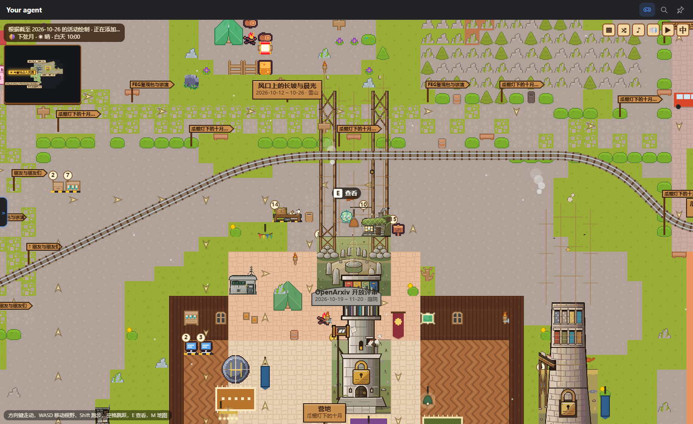<br>
  <sub><b>Play</b> (new in v0.3.10): a world your agent grows from your days, to walk in - <a href="#play">more below</a>.</sub>
</p>

---

## The idea

Most assistants wait to be told. This one learns by watching, and needs
very little telling.

1. **It learns your patterns and habits, not your commands.** From the
   windows, documents and pages you work with (only the sources you allow),
   it writes down what you were doing, groups it into your tasks and
   projects, and learns *how* you work: how you break work into steps, how
   you judge a result, what you want a finished piece to look like.
2. **Its understanding of you keeps evolving.** Every day of activity adds
   to it, and so does every small thing you do with what it shows you: a
   notification kept or called bad, a story you want more of, a contact
   corrected, a plan changed. Only your own actions change what it has
   learned. You never have to write a profile or a prompt about yourself.
3. **In time, it works for you the way you would.** Hand it a piece of work
   and it plans from what it has learned; a second agent reviews the result
   against how *you* judge your own work. The more it has seen, the closer
   its work comes to your taste.

Everything it learns stays on your computer, in plain files you can read,
and goes only to the model you choose.

## What it does

**It learns what you are doing, not what you type.** It notices which
applications, documents and web pages you work with, only the sources you
leave switched on. Every 15 minutes it writes down, in a sentence or two,
what you were doing; every 12 hours it writes those notes up as the tasks
you did, groups them into the projects they serve, and follows each project
over time, under a name the model gives it. What it learns is stored only on
your computer, as plain files you can open, and sent only to the model you
choose ([Your privacy](#your-privacy)).

**An Overview of your work.** Each project a fruit, growing along the days you
worked on it, with how long you spent, a **To do** list that groups itself,
each item with a **Delegate work** button, and **Work assigned**: everything
you delegated, with where it stands. Open a project to see the notifications,
to-dos and assigned work that belong to it; each says what it is part of. You
can rename or delete a task or a project, and a name you gave stays.

**What is left to do.** On each active project the model works out what must
still be done, as far as the records show, as a list you can tick. Every step
needs proof: a record it read and the exact words in it, shown under the step
with why it is there. It may look as many times as it needs. Steps with a date
get a reminder, and a step done takes its reminder with it.

**Merge by dragging.** Drag a project onto another: it waits under it until you
**Confirm**. The work is then gone through again, and grouping never pulls it
apart.

**Right-click "Delegate work" almost anywhere.** A web page, selected text, a
link or a picture (the agent's extension, from the Chrome Web Store and
Firefox Add-ons - Settings > General links to it), a
file in VS Code, Sublime Text or a JetBrains IDE, a file or folder in your
file manager - or select text in any program and click the small watermelon
beside it. The box says exactly what you picked.

<p align="center">
  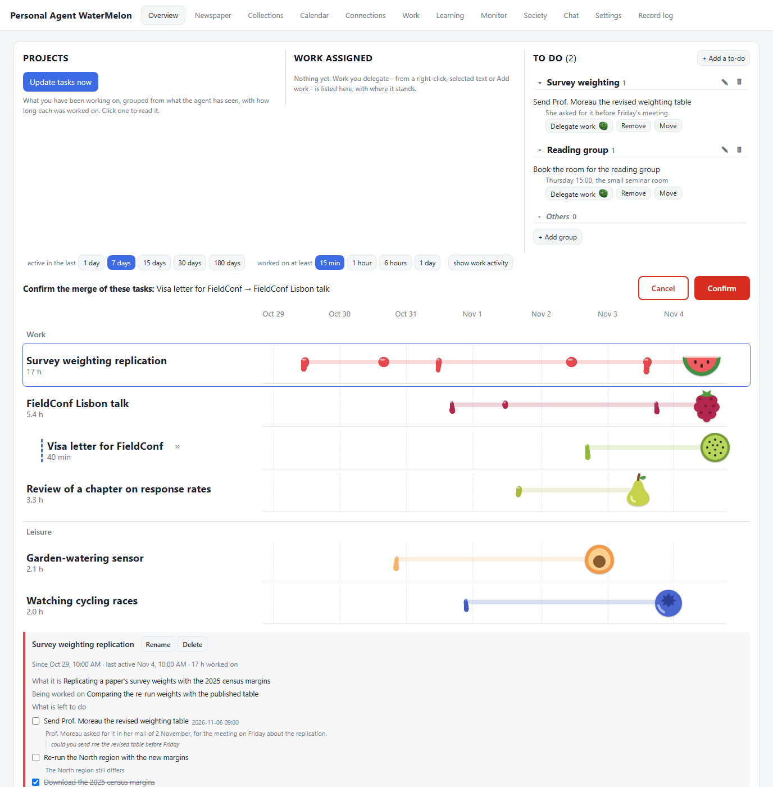<br>
  <sub>The Overview: your projects, one dragged onto another and waiting for <b>Confirm</b>, and one opened with what is left to do, why, and the words it came from.</sub>
</p>

**Calendar and notifications that learn from you.** It adds reminders it
thinks you need (an invitation in an email, a deadline in a document) and
says why each was worth interrupting you for. Every notification's buttons say
exactly what they do: *Got it*, *Remind me in N minutes*, *Add to to-do*, or
*Bad notification*. Its words can be selected and copied, and under each is a
box to tell the agent for next time: the notification closes and your words
become a lesson. What you do with them, and only what *you* do, teaches it
which notifications to send next time.

<p align="center">
  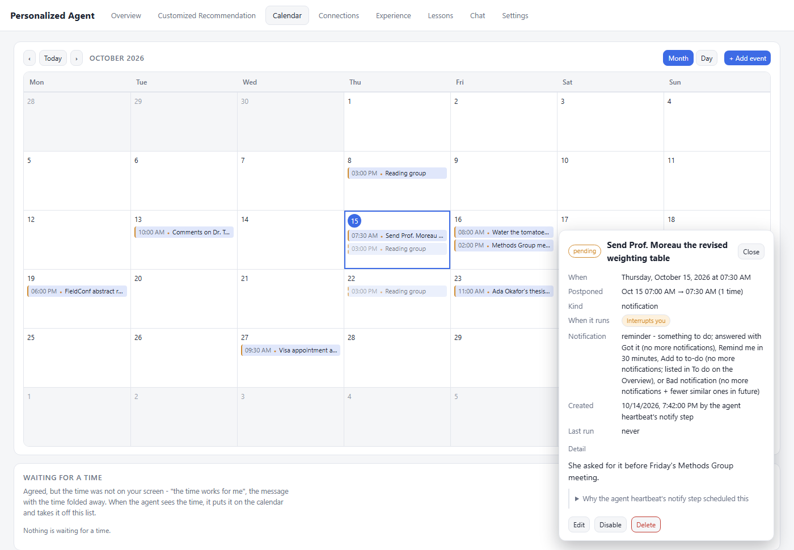<br>
  <sub>A reminder the agent added: why it was scheduled, and when you postponed it.</sub>
</p>
<p align="center">
  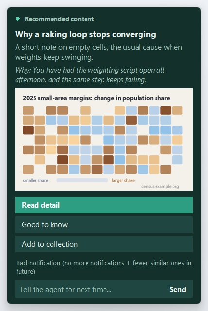<br>
  <sub>Recommended content: why it was sent, a picture, and every button saying what it does.</sub>
</p>

**The Monitor.** It reads your day every few seconds, by code and without a
model: what is in front of you, how long you have worked, whether the screen is
locked, a presentation is on, or you are in a meeting (the microphone in use and
a meeting's web address, not just a browser being open). Two layers act on that.
**Activators** say when to act and what to do: tell you at once, ask the model,
or both, so code can warn you the moment it sees a scam's words and the model
take a closer look after, neither overwriting the other. **Recommended content**
comes this way, at a moment that suits. **Blockers** hold every reminder while
you present or sit in a meeting; what waits is one line you can open. The agent
writes and changes Activators itself when you tell it in Chat or mark a
notification as bad, and one you protect it never touches.

<p align="center">
  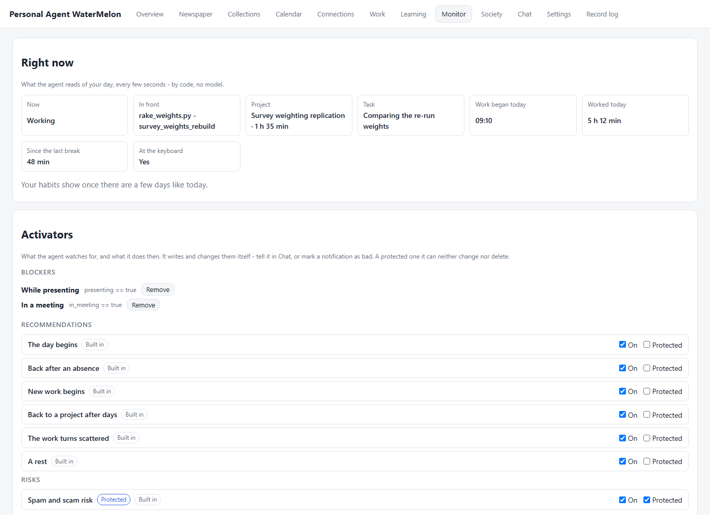<br>
  <sub>The Monitor: right now, the blockers, and each Activator with its switch.</sub>
</p>

**Delegate work.** Hand it a piece of work from wherever you are:

- right-click a folder, a file or the desktop → **Delegate work** (Windows;
  on Windows 11 it is under **Show more options**, or right-click with
  **Shift** held),
- select text in any window and click the small Watermelon button beside it,
- press **Ctrl+Alt+D** in any program, for a box that takes folders and files,
- the avatar's menu, or the **Delegate work** button in To do.

What is on your screen goes with it as context, as a picture and as words, and
the model is told it may have nothing to do with the work.

<p align="center">
  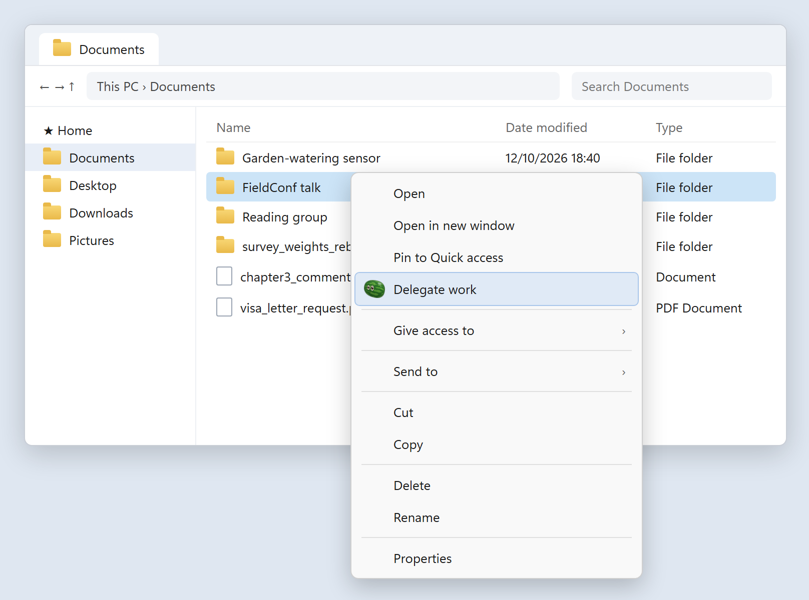<br>
  <sub>Right-click a folder → <b>Delegate work</b>.</sub>
</p>
<p align="center">
  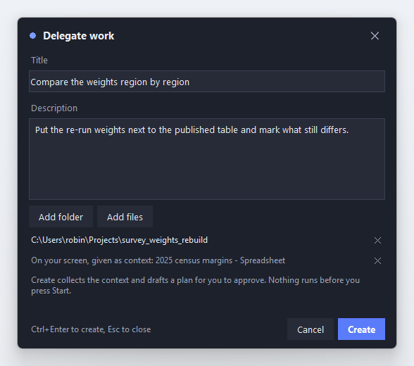<br>
  <sub>Ctrl+Alt+D, from any program: what you want done, and what was on your screen.</sub>
</p>

A small **Delegate work** window opens, always in three steps:

1. **Your instruction.** What you handed over is shown, with a box for what
   you want done (or anything to add).
2. **Create.** It looks through its own records of your work for what is
   relevant, and drafts a short plan: the goal, the steps, what you will get,
   what is left out. You can change any of it.
3. **Start.** Nothing runs before you press it.

<p align="center">
  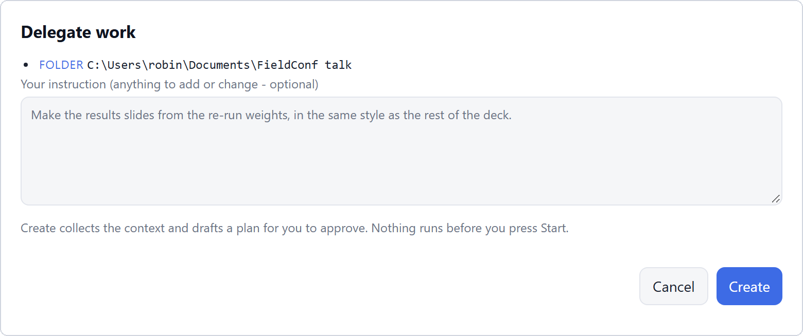
  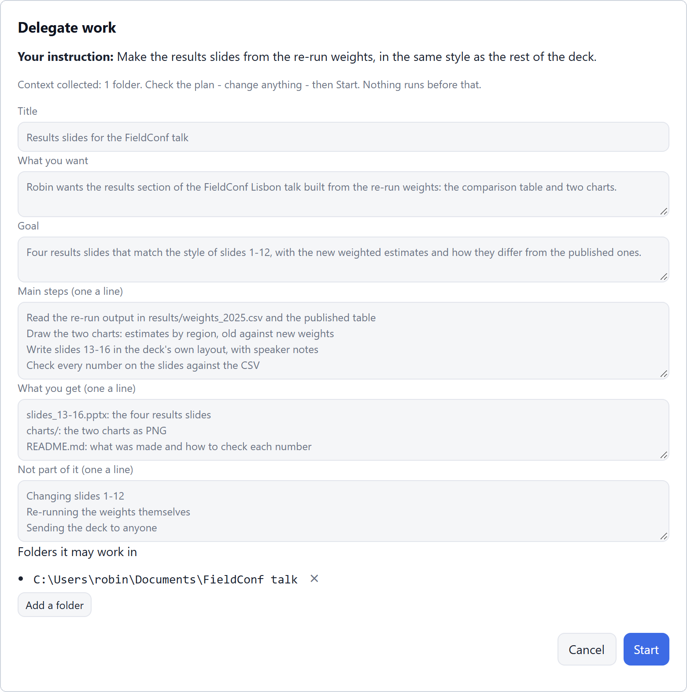<br>
  <sub>Left: your instruction for what was handed over. Right, after <b>Create</b>: the drafted plan, to change and then <b>Start</b>.</sub>
</p>

Two agents
then take turns, one doing the work and one reviewing it against how you
judge your own work. You see the run live, can pause or stop it, can go back
to any saved version, and get a `README.md` with the result saying what was
made and how to check it.

**Work.** Your projects, and what the agent learns from your own work. It
reads your Work projects, the folders you list, and your Claude Code and
Codex conversations - only the ones you had, never one a program started -
into cases: what you made, how, and how you judged it, with the reasons
behind those judgments. When the agents work for you, their reviewer asks
of these before it checks the work. Learning runs when you press **Update
now**, or by itself at the times you set; you can pause it and cap the
tokens it spends a day. A project can be handed to the agents from here.

<p align="center">
  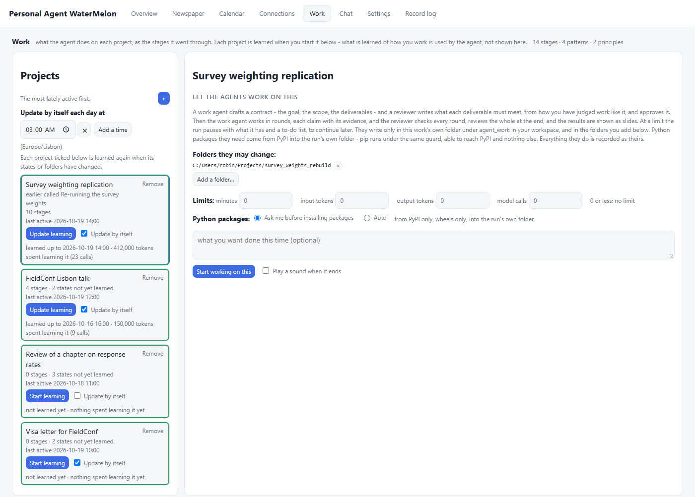<br>
  <sub>The Work tab: your projects, one opened to let the agents work on it, and below them Learning - an update going, where it reads, and what it spent.</sub>
</p>

**Connections.** The people in your work and what they are doing, from what
you had in front of you and from public pages only. It never signs in to
any of your accounts.

<p align="center">
  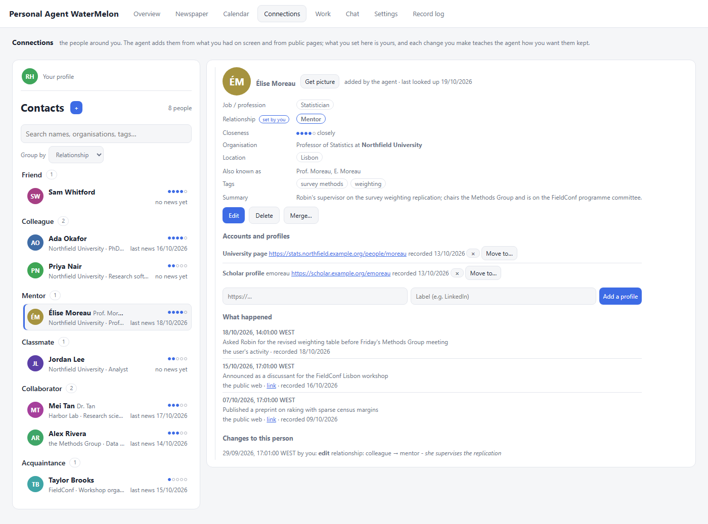<br>
  <sub>The people in your work, and one person's card: public profiles, what happened, and the changes you made.</sub>
</p>

**Newspaper.** Each day, things worth reading for your
current projects and interests, chosen to tell you something you do not already
know. *More like this*, *Add to collection* and *Not interested* are lessons:
they tune the next issue, and what the model recommends.

<p align="center">
  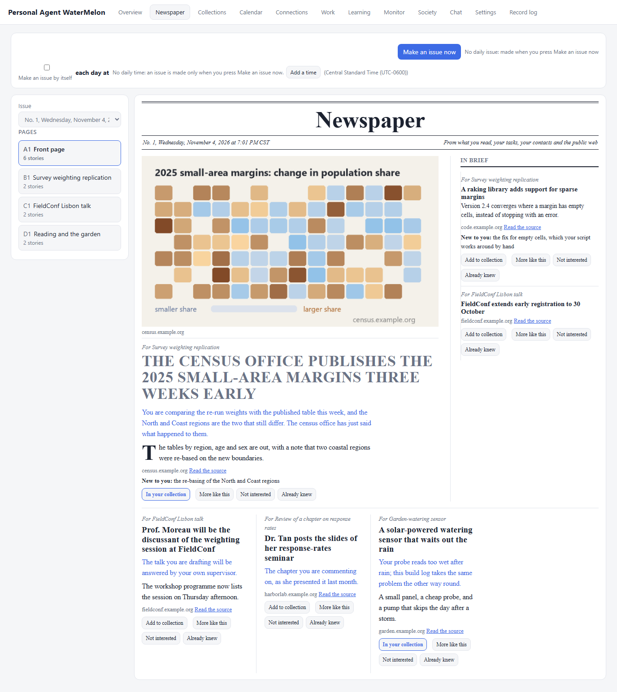<br>
  <sub>Today's issue: the front page, a page for each project, how each story ties to your work and what in it is new to you.</sub>
</p>

**Collections.** What you keep from the newspaper and from recommended content,
in a tab of its own. It groups itself as it grows, you can add and move groups,
and you can search by word and by the date you added something.

<p align="center">
  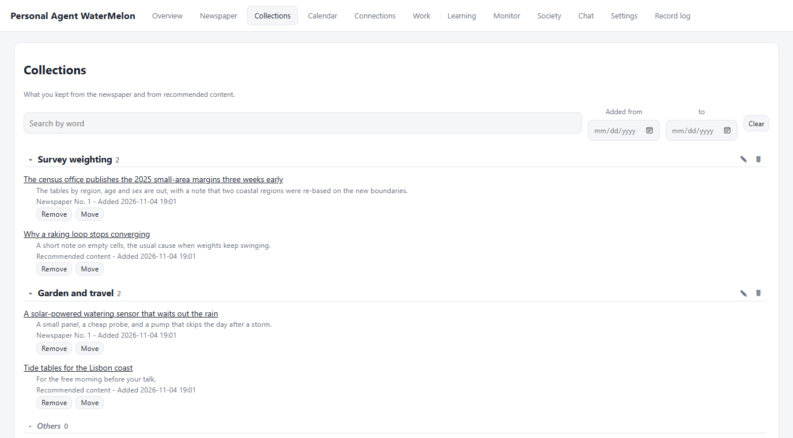<br>
  <sub>What you kept, in groups, with search by word and by date.</sub>
</p>

**Chat.** Ask it about your work, or ask it to do something. It sees what is
on your screen, as a picture and as words. Close the chat and the reply still
comes, as a notification; a draft you did not send is there when you come back.
Click the avatar, or press **Ctrl+Alt+C** in any program. Files it makes
in a conversation are kept in `workspace/Chat/<conversation title>/`. The ×
beside a conversation in the list deletes it, after asking once; the files it
made stay.

<p align="center">
  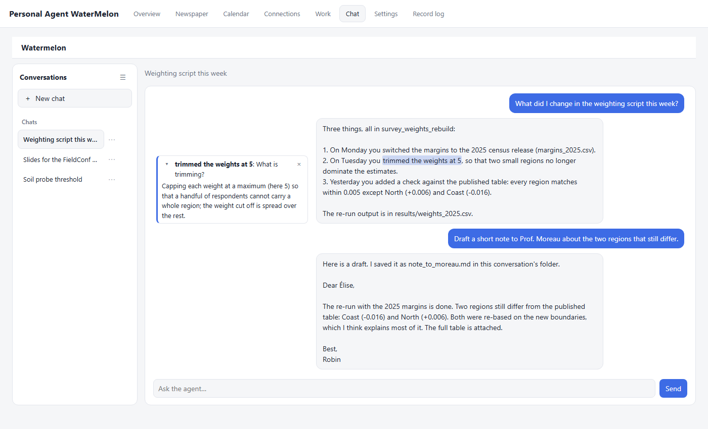<br>
  <sub>Ask about your work, or ask it to do something; select words in a reply to ask about them in the margin.</sub>
</p>

<a id="play"></a>**Play.** A small world your agent grows from your days, to walk in, in the
side panel. Each stretch of time becomes a land of the scene it felt like -
a river journey, a glasshouse, a launch site, windy highlands, under the sea,
in the sky, in space or in a city. Each project is a place built from its own
work: a long one a great ground with a landmark, every room designed card by
card, and arrows and signs walking you through it in the order you lived it.
Trains, metros, buses and planes - or submarines, balloons and rockets, as
the land suits - stop at great stations between the lands. Arrow keys walk,
WASD moves the view, Space jumps (hold it to keep jumping), E looks at a
thing - its card says what it is, a task it belongs to and, now and then, a
fun fact.

<p align="center">
  <br>
  <sub>A land from a stretch of your days: the railway, a project's great ground and the signs on the way.</sub>
</p>

<p align="center">
  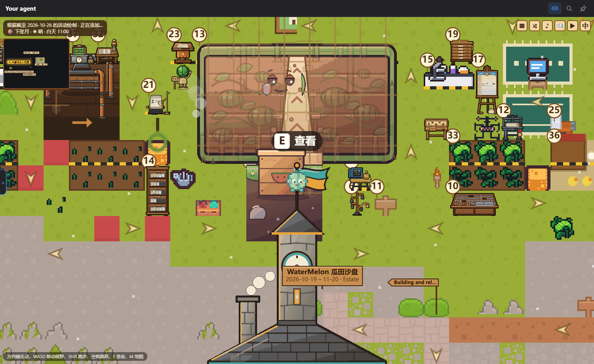
  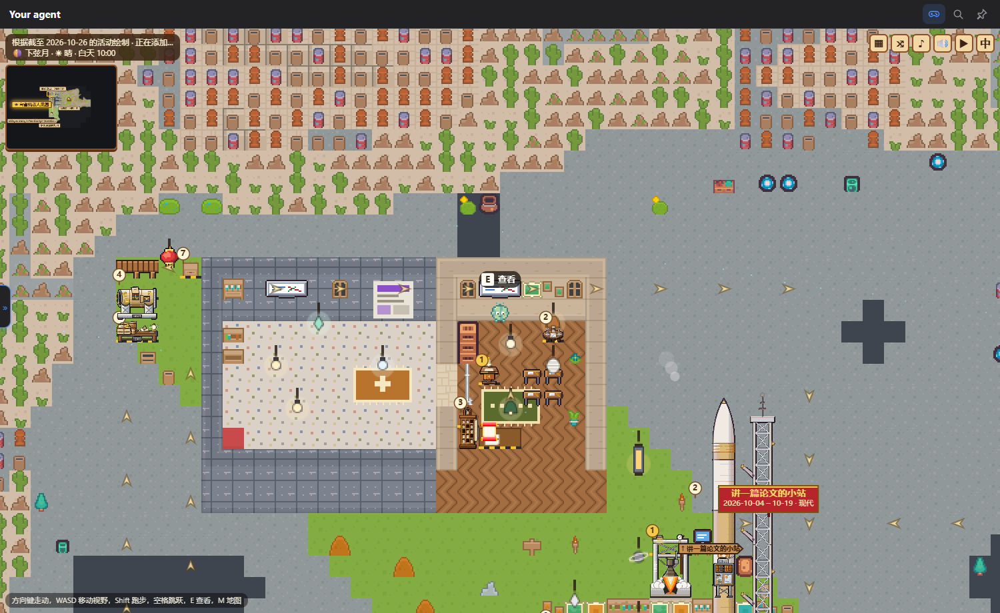<br>
  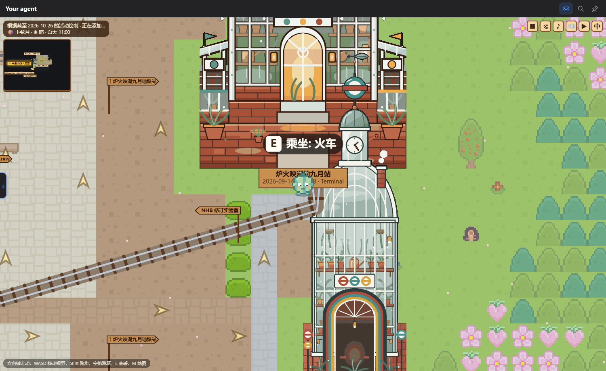
  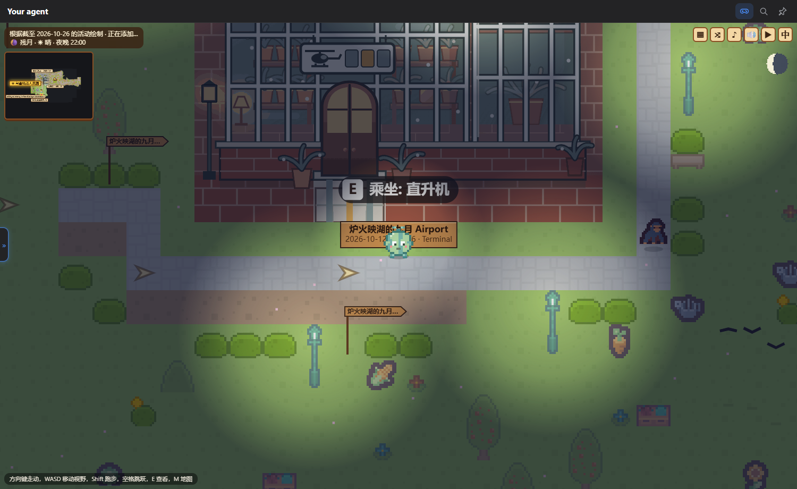<br>
  <sub>A project's estate, numbered in the order you worked; a land of its own scene; a great station; and the night, each land lit its own way.</sub>
</p>

**The Watermelon.** A small avatar on your desktop. It shows notifications in
a speech bubble, looks at your pointer, and turns to face the middle of the
screen. Left at the side of the screen it tiptoes in and hides, its leaves
holding on to the edge; the pointer on them brings its head out, and a click
brings it back. You can rename it, move it, or hide it.

One click opens the chat. Tucked into a side, a green vine grows out of it with
a chat button at its end. **To do** and **Collections** are in its right-click
menu. Each opens a small panel with no web page: search at the top, groups that
fold, *Add* and *Add group*, *Open*, *Remove*, *Move* and *Delegate work* on each
item, edges to pull to the size you like, and right-click to copy. What you add
and where you move things are lessons too.

Every panel, here and in the app's pages, has its own size of words: pointer on
it, Ctrl with + and - or the wheel. It is remembered, with nothing to set.

<p align="center">
  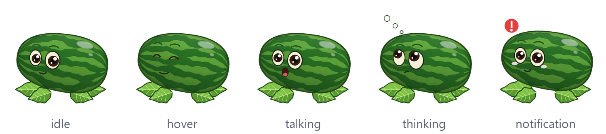
</p>
<p align="center">
  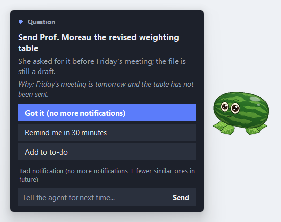<br>
  <sub>Its moods, and a notification in its speech bubble, waiting until you answer.</sub>
</p>
<p align="center">
  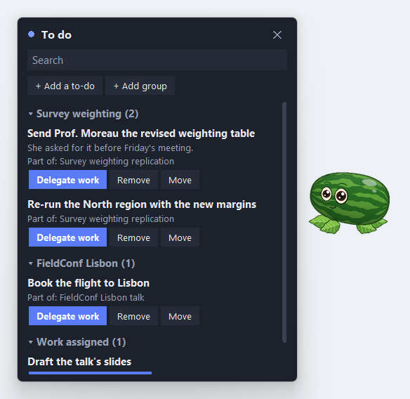<br>
  <sub>To do, from the avatar's right-click menu, with what each item is part of.</sub>
</p>
<p align="center">
  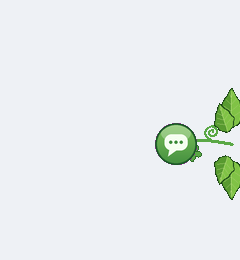<br>
  <sub>Tucked into a side: the vine and its chat button.</sub>
</p>

**In your language.** English, 中文, Español, 日本語, 한국어, Русский, Français,
Deutsch and Italiano, chosen when you install and changeable in Settings. The
whole interface changes with it: every tab, menu, button and explanation, the
avatar's and the tray's menus, and the notifications' buttons. The agent
writes and speaks in it too.

<p align="center">
  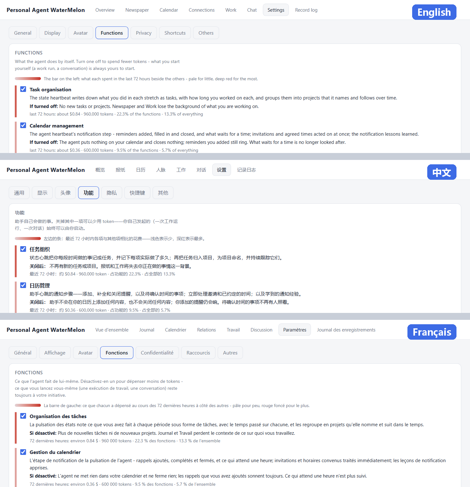<br>
  <sub>The same screen in English, 中文 and Français.</sub>
</p>

---

## Your privacy

> [!CAUTION]
> **This open-source software aggressively collects data on your local machine and from your
> screen. Before you use it, always assume that every action on your machine may be collected.**
>
> **Our privacy policy**
>
> 1. **This software does not require you to upload any data.** All of your data is stored
>    locally, on your own computer.
> 2. **Even so, your data is processed by large language models, so the model you connect may
>    see all of your activity.**
>    1. If you have the resources, we recommend deploying an open-source model on a local server
>       or a server you trust. This is likely the most effective way to prevent privacy
>       violations.
>    2. If you connect an API or a subscription service, please check its privacy policy. For
>       example, if you use Claude or ChatGPT with this software, we highly recommend turning
>       off the setting that allows your data to be used for model improvement:
>       - **Claude** (this also covers Claude Code signed in with a Pro or Max plan, since the
>         setting covers both chats and coding sessions): on [claude.ai](https://claude.ai), click
>         your name or initials at the bottom left, choose **Settings**, open **Privacy**, and turn
>         **off** the **"Help improve Claude"** switch. You can also go straight to
>         [claude.ai/settings/data-privacy-controls](https://claude.ai/settings/data-privacy-controls).
>         ([Anthropic's instructions](https://privacy.claude.com/en/articles/12109829-how-do-i-change-my-model-improvement-privacy-settings))
>       - **ChatGPT** (this also covers Codex signed in with a ChatGPT plan): on
>         [chatgpt.com](https://chatgpt.com), click your profile picture, choose **Settings**, open
>         **Data controls**, and turn **off** **"Improve the model for everyone"**. You can also go
>         straight to [chatgpt.com/#settings/DataControls](https://chatgpt.com/#settings/DataControls).
>
>       Turning it off applies to what you send from then on. What was sent while it was on may
>       already have been used.

An agent that sees your work has to earn that. Personal Agent is built so
that your data is **stored only on your computer** and **sent only to the
model you choose**, never to any server of ours or anyone else's. **You
choose what it watches and what it does**, passwords and codes are
**filtered out before anything is kept or sent**, and **it cannot act
outside the limits you set**. All of this comes from how it is built, not
from a promise.

### Stored only on your computer

- **No account, no server of ours, no telemetry.** There is no service your
  data is uploaded to, and nothing is collected about you or about how you
  use it.
- **Everything it keeps is in one folder you own** (`PersonalAgentWaterMelon/`;
  an installation from before v0.2.0 keeps `PersonalizedAgent/`):
  what it learned as plain Markdown files in `workspace/data/` that you can
  open, edit or delete, and its database and settings in `internal/`. Delete
  the folder, and everything it ever kept is gone.
- **Raw activity is short-lived.** What the listener records is deleted after
  8 days; only the short notes made from it are kept.
- **Comparing and reading happen on your computer**: the embedding model that
  groups your notes runs locally, and pictures and scanned documents are read
  by your system's own OCR.

### Sent only to the model you choose

To understand your activity, the agent has to show it to a model: every 15
minutes, the text it read in that window of time is sent to **the model you
picked** to be summarised, and so are your chat messages and the files a
piece of work uses. That model is your choice, in **Settings → Models**:

- **A service you trust**: Anthropic, OpenAI, Google, DeepSeek, Mistral or
  any other you add, under its own privacy terms; or the Claude Code or Codex
  tool already signed in on your computer.
- **A model on your own machine** (Ollama, LM Studio, or anything with an
  OpenAI-compatible address): then your activity is never sent to a model
  service. **The only thing that still goes out is web searches**:
  Connections and Newspaper look things up on the web on
  their own, with search words drawn from your current tasks and the people
  in them, so a search engine can see those topics. Turn those two off in
  Settings → Functions, and with a local model **nothing leaves your
  computer at all**.

Before anything is sent, the **smart filter** has already taken out
passwords, one-time codes and keys (see below).

### Exactly what leaves your computer

| What | Where to | When |
| --- | --- | --- |
| The text a step needs (a window of recent activity, your chat message, the files a piece of work uses), with passwords and codes already filtered out | **Only the model you chose**: nowhere, with a local model | When a step runs |
| Pictures | Only to a model that can see pictures | A model that reads text only gets the words, read locally |
| Web searches (the words come from your current tasks and the people in them) and the public pages they find | The model's own search (Claude Code, Codex), or DuckDuckGo for a model without one, then the pages themselves, **with no cookies and no sign-in** | When Connections or Newspaper run (turn them off and they stop), or when a piece of work you started needs the web |
| One-time downloads | Hugging Face (the embedding model, once), Google (the testing browser), PyPI (packages a piece of work needs) | Only the first time, or **only when you click Install / Approve** |

### You choose what it watches

**Settings → Privacy** has one switch per source, each saying what the agent
loses without it and what it costs your computer:

- the window in front (which program, which title),
- the text in that window,
- screenshots (the words in slides and pictures),
- your browser's history,
- files created and changed,
- coding assistants' sessions, and, separately, what was said in them.

Beyond the switches:

- **Windows it never reads**: password managers, private and incognito
  browsing, authenticators, banking and payment pages, by default. Run from
  source, you can add your own in Settings → Others.
- **Folders it never watches**: caches, package and build folders by default,
  and, run from source, any you add in Settings → Others. The agent's own
  folders are never watched at all, so its work is never mistaken for yours.
- **The smart filter for passwords, one-time codes and keys** takes them out
  of everything the listener records (screen text, window titles,
  addresses, assistant conversations, the words read off a picture) **before
  it is stored or sent to any model**. It finds them by their labels, in all
  nine languages, and by the shapes keys and tokens have, on your computer,
  so no password is ever shown to a model to ask whether it is one. The
  value becomes `[hidden]` and the label stays, so the agent still knows a
  sign-in happened, not what was typed. A screenshot showing one is not kept
  at all. On by default (*Hide passwords and codes*).
- **Never its own folder.** The data folder is never listened to, whatever
  the list of excluded folders says.

<p align="center">
  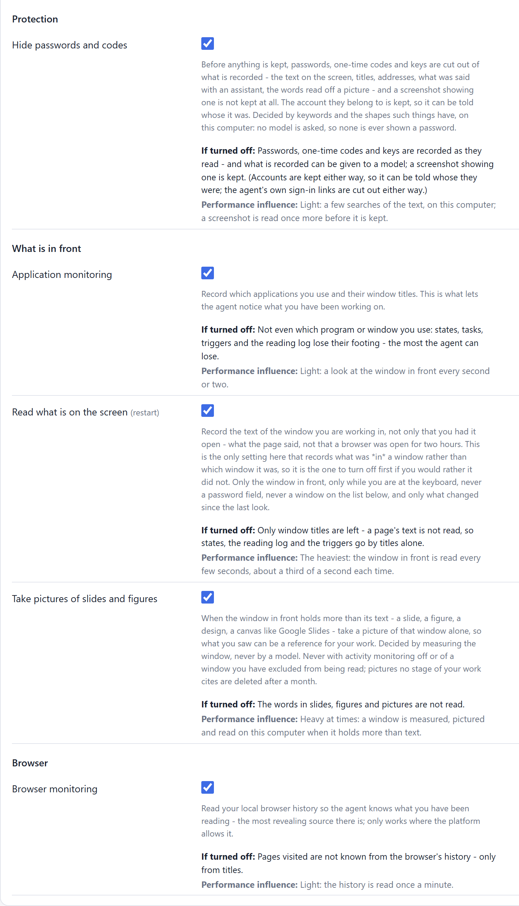<br>
  <sub>Settings → Privacy: one switch per source, each saying what the agent loses without it and what it costs your computer.</sub>
</p>

<p align="center">
  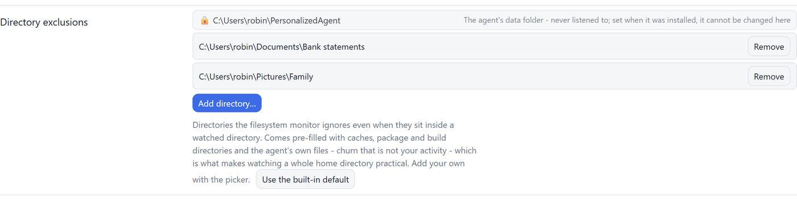<br>
  <sub>Settings → Others, run from source: the folders it never watches. Its own data folder is always first, locked.</sub>
</p>

### You choose what it does

**Settings → Functions** lists what runs by itself, each with its own switch
and **what it cost over the last 72 hours**:

- **Task organisation**: writing down what you did as tasks and grouping them into projects.
- **Calendar management**: notifications and reminders.
- **Connections**: the people in your work.
- **Newspaper**: the daily reading.
- **Work learning**: your own work read into cases and the reasons behind how you judge it.

Turn one off and it stops, along with its model calls. Only the core
(noting what you are doing) is always on, because everything else is built
on it. What you start yourself (chat, a piece of work) is counted apart.

<p align="center">
  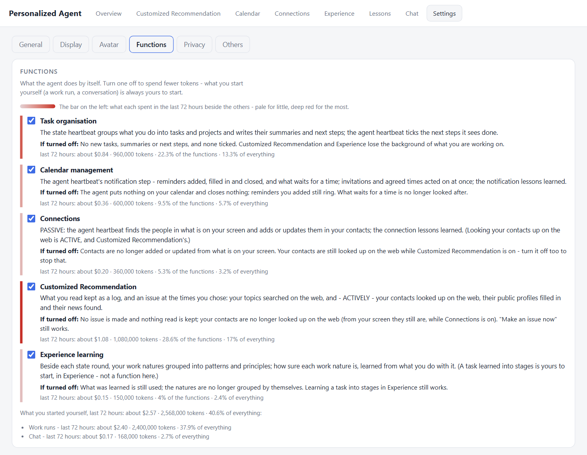<br>
  <sub>Settings → Functions: each with its own switch and what it cost over the last 72 hours.</sub>
</p>

### What it will never do

- **Sign in as you.** It never signs in to your accounts, never clicks
  anything in them, and never posts, sends or replies for you. What it knows
  about other people comes from what you had in front of you and from public
  pages.
- **Write anywhere you did not allow.** The agent writes only in its own
  workspace and in folders you add to a piece of work. This is enforced by
  code and, around every piece of code it runs, by the operating system's
  own sandbox (AppContainer on Windows, Seatbelt on macOS, bubblewrap on
  Linux). Your other files are read-only to it, and its own database and
  credentials are closed to it.
- **Start work by itself.** Every piece of work waits for your instruction
  and your approval of its plan.
- **Learn from itself.** Only what *you* do (a notification you call bad, an
  event or a person you delete, a story you are not interested in) changes
  what it learns about you.
- **Be reached by anything else.** Its page is served on `127.0.0.1` only,
  and answers only with this installation's key, so other programs and
  websites cannot read it.

### What you need

- Windows 10/11, macOS 11 or later (Apple Silicon), or Linux (x86-64).
- A model to think with: an API key for Anthropic (Claude), OpenAI, Google
  Gemini, DeepSeek, Kimi, Qwen, GLM, Mistral, OpenRouter or any
  OpenAI-compatible service, **or** the Claude Code or Codex command-line
  tool signed in on this computer. You add it in Settings → Models on first
  start. Several can be added in order; when one cannot answer, the next does.

---

## Install

The newest version is **[v0.3.7](https://github.com/fhbzc/Personal-Agent-WaterMelon/releases/tag/v0.3.7)**:

> **On Windows, with 0.2.7 or earlier: install this version yourself, once.** Updating from inside the program quit it and never came back - the installer was never started. Run the installer below over your copy: your data and settings stay. From 0.2.8 on, updates are quiet: made ready in the background, used at the next start.

| System | Installer (recommended) | Portable (no install) |
| --- | --- | --- |
| **Windows** 10/11, x64 | [PersonalAgentWaterMelon-Setup-windows-x64.exe](https://github.com/fhbzc/Personal-Agent-WaterMelon/releases/latest/download/PersonalAgentWaterMelon-Setup-windows-x64.exe) | [PersonalAgentWaterMelon-portable-windows-x64.zip](https://github.com/fhbzc/Personal-Agent-WaterMelon/releases/latest/download/PersonalAgentWaterMelon-portable-windows-x64.zip) |
| **macOS** 11+, Apple Silicon | [PersonalAgentWaterMelon-macos.dmg](https://github.com/fhbzc/Personal-Agent-WaterMelon/releases/latest/download/PersonalAgentWaterMelon-macos.dmg): open it and drag the app into Applications | - (the app in the `.dmg` runs from wherever you put it) |
| **Linux** x86-64 | [PersonalAgentWaterMelon-linux-x86_64.deb](https://github.com/fhbzc/Personal-Agent-WaterMelon/releases/latest/download/PersonalAgentWaterMelon-linux-x86_64.deb) | [PersonalAgentWaterMelon-linux-x86_64.AppImage](https://github.com/fhbzc/Personal-Agent-WaterMelon/releases/latest/download/PersonalAgentWaterMelon-linux-x86_64.AppImage) · [tar.gz](https://github.com/fhbzc/Personal-Agent-WaterMelon/releases/latest/download/PersonalAgentWaterMelon-portable-linux-x86_64.tar.gz) |

### Versions

Every version, the newest first. The program offers the latest release as an
update by itself.

| Version | Published | Status | Downloads |
| --- | --- | --- | --- |
| [v0.3.12](https://github.com/fhbzc/Personal-Agent-WaterMelon/releases/tag/v0.3.12) | 2026-11-21 | pre-release | on [its release page](https://github.com/fhbzc/Personal-Agent-WaterMelon/releases/tag/v0.3.12) |
| [v0.3.11](https://github.com/fhbzc/Personal-Agent-WaterMelon/releases/tag/v0.3.11) | 2026-11-21 | pre-release | on [its release page](https://github.com/fhbzc/Personal-Agent-WaterMelon/releases/tag/v0.3.11) |
| [v0.3.10](https://github.com/fhbzc/Personal-Agent-WaterMelon/releases/tag/v0.3.10) | 2026-11-20 | pre-release | on [its release page](https://github.com/fhbzc/Personal-Agent-WaterMelon/releases/tag/v0.3.10) |
| [v0.3.9](https://github.com/fhbzc/Personal-Agent-WaterMelon/releases/tag/v0.3.9) | 2026-11-18 | pre-release | on [its release page](https://github.com/fhbzc/Personal-Agent-WaterMelon/releases/tag/v0.3.9) |
| [v0.3.8](https://github.com/fhbzc/Personal-Agent-WaterMelon/releases/tag/v0.3.8) | 2026-11-18 | pre-release | on [its release page](https://github.com/fhbzc/Personal-Agent-WaterMelon/releases/tag/v0.3.8) |
| [v0.3.7.1](https://github.com/fhbzc/Personal-Agent-WaterMelon/releases/tag/v0.3.7.1) | 2026-11-16 | pre-release | on [its release page](https://github.com/fhbzc/Personal-Agent-WaterMelon/releases/tag/v0.3.7.1) |
| [v0.3.7](https://github.com/fhbzc/Personal-Agent-WaterMelon/releases/tag/v0.3.7) | 2026-11-15 | release (the latest) | above, or on [its release page](https://github.com/fhbzc/Personal-Agent-WaterMelon/releases/tag/v0.3.7) |
| [v0.3.5](https://github.com/fhbzc/Personal-Agent-WaterMelon/releases/tag/v0.3.5) | 2026-11-14 | release | [Windows](https://github.com/fhbzc/Personal-Agent-WaterMelon/releases/download/v0.3.5/PersonalAgentWaterMelon-Setup-windows-x64.exe) · [macOS](https://github.com/fhbzc/Personal-Agent-WaterMelon/releases/download/v0.3.5/PersonalAgentWaterMelon-macos.dmg) · [Linux](https://github.com/fhbzc/Personal-Agent-WaterMelon/releases/download/v0.3.5/PersonalAgentWaterMelon-linux-x86_64.deb) · [all files](https://github.com/fhbzc/Personal-Agent-WaterMelon/releases/tag/v0.3.5) |
| [v0.3.4](https://github.com/fhbzc/Personal-Agent-WaterMelon/releases/tag/v0.3.4) | 2026-11-14 | pre-release | on [its release page](https://github.com/fhbzc/Personal-Agent-WaterMelon/releases/tag/v0.3.4) |
| [v0.3.3](https://github.com/fhbzc/Personal-Agent-WaterMelon/releases/tag/v0.3.3) | 2026-11-09 | release | [Windows](https://github.com/fhbzc/Personal-Agent-WaterMelon/releases/download/v0.3.3/PersonalAgentWaterMelon-Setup-windows-x64.exe) · [macOS](https://github.com/fhbzc/Personal-Agent-WaterMelon/releases/download/v0.3.3/PersonalAgentWaterMelon-macos.dmg) · [Linux](https://github.com/fhbzc/Personal-Agent-WaterMelon/releases/download/v0.3.3/PersonalAgentWaterMelon-linux-x86_64.deb) · [all files](https://github.com/fhbzc/Personal-Agent-WaterMelon/releases/tag/v0.3.3) |
| [v0.3.2](https://github.com/fhbzc/Personal-Agent-WaterMelon/releases/tag/v0.3.2) | 2026-11-06 | release | [Windows](https://github.com/fhbzc/Personal-Agent-WaterMelon/releases/download/v0.3.2/PersonalAgentWaterMelon-Setup-windows-x64.exe) · [macOS](https://github.com/fhbzc/Personal-Agent-WaterMelon/releases/download/v0.3.2/PersonalAgentWaterMelon-macos.dmg) · [Linux](https://github.com/fhbzc/Personal-Agent-WaterMelon/releases/download/v0.3.2/PersonalAgentWaterMelon-linux-x86_64.deb) · [all files](https://github.com/fhbzc/Personal-Agent-WaterMelon/releases/tag/v0.3.2) |
| [v0.3.1](https://github.com/fhbzc/Personal-Agent-WaterMelon/releases/tag/v0.3.1) | 2026-11-06 | pre-release | on [its release page](https://github.com/fhbzc/Personal-Agent-WaterMelon/releases/tag/v0.3.1) |
| [v0.3.0](https://github.com/fhbzc/Personal-Agent-WaterMelon/releases/tag/v0.3.0) | 2026-11-04 | release | [Windows](https://github.com/fhbzc/Personal-Agent-WaterMelon/releases/download/v0.3.0/PersonalAgentWaterMelon-Setup-windows-x64.exe) · [macOS](https://github.com/fhbzc/Personal-Agent-WaterMelon/releases/download/v0.3.0/PersonalAgentWaterMelon-macos.dmg) · [Linux](https://github.com/fhbzc/Personal-Agent-WaterMelon/releases/download/v0.3.0/PersonalAgentWaterMelon-linux-x86_64.deb) · [all files](https://github.com/fhbzc/Personal-Agent-WaterMelon/releases/tag/v0.3.0) |
| [v0.2.20](https://github.com/fhbzc/Personal-Agent-WaterMelon/releases/tag/v0.2.20) | 2026-11-03 | release | [Windows](https://github.com/fhbzc/Personal-Agent-WaterMelon/releases/download/v0.2.20/PersonalAgentWaterMelon-Setup-windows-x64.exe) · [macOS](https://github.com/fhbzc/Personal-Agent-WaterMelon/releases/download/v0.2.20/PersonalAgentWaterMelon-macos.dmg) · [Linux](https://github.com/fhbzc/Personal-Agent-WaterMelon/releases/download/v0.2.20/PersonalAgentWaterMelon-linux-x86_64.deb) · [all files](https://github.com/fhbzc/Personal-Agent-WaterMelon/releases/tag/v0.2.20) |
| [v0.2.19](https://github.com/fhbzc/Personal-Agent-WaterMelon/releases/tag/v0.2.19) | 2026-11-02 | pre-release | on [its release page](https://github.com/fhbzc/Personal-Agent-WaterMelon/releases/tag/v0.2.19) |
| [v0.2.16](https://github.com/fhbzc/Personal-Agent-WaterMelon/releases/tag/v0.2.16) | 2026-10-30 | release | [Windows](https://github.com/fhbzc/Personal-Agent-WaterMelon/releases/download/v0.2.16/PersonalAgentWaterMelon-Setup-windows-x64.exe) · [macOS](https://github.com/fhbzc/Personal-Agent-WaterMelon/releases/download/v0.2.16/PersonalAgentWaterMelon-macos.dmg) · [Linux](https://github.com/fhbzc/Personal-Agent-WaterMelon/releases/download/v0.2.16/PersonalAgentWaterMelon-linux-x86_64.deb) · [all files](https://github.com/fhbzc/Personal-Agent-WaterMelon/releases/tag/v0.2.16) |
| [v0.2.15](https://github.com/fhbzc/Personal-Agent-WaterMelon/releases/tag/v0.2.15) | 2026-10-29 | release | [Windows](https://github.com/fhbzc/Personal-Agent-WaterMelon/releases/download/v0.2.15/PersonalAgentWaterMelon-Setup-windows-x64.exe) · [macOS](https://github.com/fhbzc/Personal-Agent-WaterMelon/releases/download/v0.2.15/PersonalAgentWaterMelon-macos.dmg) · [Linux](https://github.com/fhbzc/Personal-Agent-WaterMelon/releases/download/v0.2.15/PersonalAgentWaterMelon-linux-x86_64.deb) · [all files](https://github.com/fhbzc/Personal-Agent-WaterMelon/releases/tag/v0.2.15) |
| [v0.2.11](https://github.com/fhbzc/Personal-Agent-WaterMelon/releases/tag/v0.2.11) | 2026-10-29 | release | [Windows](https://github.com/fhbzc/Personal-Agent-WaterMelon/releases/download/v0.2.11/PersonalAgentWaterMelon-Setup-windows-x64.exe) · [macOS](https://github.com/fhbzc/Personal-Agent-WaterMelon/releases/download/v0.2.11/PersonalAgentWaterMelon-macos.dmg) · [Linux](https://github.com/fhbzc/Personal-Agent-WaterMelon/releases/download/v0.2.11/PersonalAgentWaterMelon-linux-x86_64.deb) · [all files](https://github.com/fhbzc/Personal-Agent-WaterMelon/releases/tag/v0.2.11) |
| [v0.2.10](https://github.com/fhbzc/Personal-Agent-WaterMelon/releases/tag/v0.2.10) | 2026-10-29 | pre-release | on [its release page](https://github.com/fhbzc/Personal-Agent-WaterMelon/releases/tag/v0.2.10) |
| [v0.2.9](https://github.com/fhbzc/Personal-Agent-WaterMelon/releases/tag/v0.2.9) | 2026-10-28 | pre-release | on [its release page](https://github.com/fhbzc/Personal-Agent-WaterMelon/releases/tag/v0.2.9) |
| [v0.2.8](https://github.com/fhbzc/Personal-Agent-WaterMelon/releases/tag/v0.2.8) | 2026-10-27 | release | [Windows](https://github.com/fhbzc/Personal-Agent-WaterMelon/releases/download/v0.2.8/PersonalAgentWaterMelon-Setup-windows-x64.exe) · [macOS](https://github.com/fhbzc/Personal-Agent-WaterMelon/releases/download/v0.2.8/PersonalAgentWaterMelon-macos.dmg) · [Linux](https://github.com/fhbzc/Personal-Agent-WaterMelon/releases/download/v0.2.8/PersonalAgentWaterMelon-linux-x86_64.deb) · [all files](https://github.com/fhbzc/Personal-Agent-WaterMelon/releases/tag/v0.2.8) |
| [v0.2.7](https://github.com/fhbzc/Personal-Agent-WaterMelon/releases/tag/v0.2.7) | 2026-10-26 | release | [Windows](https://github.com/fhbzc/Personal-Agent-WaterMelon/releases/download/v0.2.7/PersonalAgentWaterMelon-Setup-windows-x64.exe) · [macOS](https://github.com/fhbzc/Personal-Agent-WaterMelon/releases/download/v0.2.7/PersonalAgentWaterMelon-macos.dmg) · [Linux](https://github.com/fhbzc/Personal-Agent-WaterMelon/releases/download/v0.2.7/PersonalAgentWaterMelon-linux-x86_64.deb) · [all files](https://github.com/fhbzc/Personal-Agent-WaterMelon/releases/tag/v0.2.7) |
| [v0.2.6](https://github.com/fhbzc/Personal-Agent-WaterMelon/releases/tag/v0.2.6) | 2026-10-24 | release | [Windows](https://github.com/fhbzc/Personal-Agent-WaterMelon/releases/download/v0.2.6/PersonalAgentWaterMelon-Setup-windows-x64.exe) · [macOS](https://github.com/fhbzc/Personal-Agent-WaterMelon/releases/download/v0.2.6/PersonalAgentWaterMelon-macos.dmg) · [Linux](https://github.com/fhbzc/Personal-Agent-WaterMelon/releases/download/v0.2.6/PersonalAgentWaterMelon-linux-x86_64.deb) · [all files](https://github.com/fhbzc/Personal-Agent-WaterMelon/releases/tag/v0.2.6) |
| [v0.2.5](https://github.com/fhbzc/Personal-Agent-WaterMelon/releases/tag/v0.2.5) | 2026-10-24 | pre-release | on [its release page](https://github.com/fhbzc/Personal-Agent-WaterMelon/releases/tag/v0.2.5) |
| [v0.2.4](https://github.com/fhbzc/Personal-Agent-WaterMelon/releases/tag/v0.2.4) | 2026-10-23 | pre-release | on [its release page](https://github.com/fhbzc/Personal-Agent-WaterMelon/releases/tag/v0.2.4) |
| [v0.2.3](https://github.com/fhbzc/Personal-Agent-WaterMelon/releases/tag/v0.2.3) | 2026-10-23 | release | [Windows](https://github.com/fhbzc/Personal-Agent-WaterMelon/releases/download/v0.2.3/PersonalAgentWaterMelon-Setup-windows-x64.exe) · [macOS](https://github.com/fhbzc/Personal-Agent-WaterMelon/releases/download/v0.2.3/PersonalAgentWaterMelon-macos.dmg) · [Linux](https://github.com/fhbzc/Personal-Agent-WaterMelon/releases/download/v0.2.3/PersonalAgentWaterMelon-linux-x86_64.deb) · [all files](https://github.com/fhbzc/Personal-Agent-WaterMelon/releases/tag/v0.2.3) |
| [v0.2.2](https://github.com/fhbzc/Personal-Agent-WaterMelon/releases/tag/v0.2.2) | 2026-10-23 | pre-release | on [its release page](https://github.com/fhbzc/Personal-Agent-WaterMelon/releases/tag/v0.2.2) |
| [v0.2.1](https://github.com/fhbzc/Personal-Agent-WaterMelon/releases/tag/v0.2.1) | 2026-10-22 | release | [Windows](https://github.com/fhbzc/Personal-Agent-WaterMelon/releases/download/v0.2.1/PersonalAgentWaterMelon-Setup-windows-x64.exe) · [macOS](https://github.com/fhbzc/Personal-Agent-WaterMelon/releases/download/v0.2.1/PersonalAgentWaterMelon-macos.dmg) · [Linux](https://github.com/fhbzc/Personal-Agent-WaterMelon/releases/download/v0.2.1/PersonalAgentWaterMelon-linux-x86_64.deb) · [all files](https://github.com/fhbzc/Personal-Agent-WaterMelon/releases/tag/v0.2.1) |
| [v0.2.0](https://github.com/fhbzc/Personal-Agent-WaterMelon/releases/tag/v0.2.0) | 2026-10-21 | release | [Windows](https://github.com/fhbzc/Personal-Agent-WaterMelon/releases/download/v0.2.0/PersonalAgentWaterMelon-Setup-windows-x64.exe) · [macOS](https://github.com/fhbzc/Personal-Agent-WaterMelon/releases/download/v0.2.0/PersonalAgentWaterMelon-macos.dmg) · [Linux](https://github.com/fhbzc/Personal-Agent-WaterMelon/releases/download/v0.2.0/PersonalAgentWaterMelon-linux-x86_64.deb) · [all files](https://github.com/fhbzc/Personal-Agent-WaterMelon/releases/tag/v0.2.0) |
| [v0.1.0](https://github.com/fhbzc/Personal-Agent-WaterMelon/releases/tag/v0.1.0) | 2026-10-16 | release | [Windows](https://github.com/fhbzc/Personal-Agent-WaterMelon/releases/download/v0.1.0/PersonalizedAgent-Setup-windows-x64.exe) · [macOS](https://github.com/fhbzc/Personal-Agent-WaterMelon/releases/download/v0.1.0/PersonalizedAgent-macos.dmg) · [Linux](https://github.com/fhbzc/Personal-Agent-WaterMelon/releases/download/v0.1.0/PersonalizedAgent-linux-x86_64.deb) · [all files](https://github.com/fhbzc/Personal-Agent-WaterMelon/releases/tag/v0.1.0) |

Every release also has **`SHA256SUMS.txt`**, the checksum of each file; see
[Check that a download is genuine](#check-that-a-download-is-genuine).

**Updates.** Once a day the program looks for newer releases here and tells
you. **Settings → General → Updates** lists every newer version with what it
says is new; press **Install this version** on the one you want, and it is
downloaded, checked against that release's `SHA256SUMS.txt`, and installed -
never while a piece of work is running - and the program starts again on it
and shows what is new. Only published releases count: nothing reaches you
from the code until it is released. You can instead have the newest
installed by itself (also a box in the Windows installer, unticked), or
nothing looked for. From v0.3.7 on, a release marked as a **required fix** is
installed whatever you chose here - Off too - and you are told when it is;
the version before an update is kept a day, to go back to, then removed.
The Windows installer, the macOS app dragged in from the
`.dmg` and the Linux AppImage update themselves; the portable folder and the
`.deb` are told there is a new version and where it is.

### Installer or portable?

They are the **same program**, built from the same commit by the same
workflow. Only how it gets onto your computer differs.

| | Installer | Portable |
| --- | --- | --- |
| How | Run it. It asks for your language and where to keep your data, installs, and adds a Start menu / Applications entry | Unzip anywhere and run `PersonalAgentWaterMelon` |
| Language, start at sign-in, Explorer's *Delegate work* entry | Set up by the installer | Set up by the program on its first start |
| Removing it | Uninstall from Settings → Apps (Windows) or the usual way; the extra entries go with it | Delete the folder. Turn off *Start at sign-in* in Settings first, or the entry stays |
| Best for | Most people | Trying it out, or keeping it on a USB drive |

**Your data folder.** The installer asks where to keep your data: one folder
for everything the agent learns and makes.

- **By default it is the folder this copy used before** - and for a copy
  installed anew, a `data` folder inside the program's folder. A folder
  that needs administrator rights to write to (Program Files, the Windows
  folder) cannot be used, because the program works as you, without them: the
  installer says so and will not go on until you choose another.
- **Choose an empty folder, or one that holds only an earlier Personal
  Agent's data** (its `workspace` and `internal` folders). Everything in the
  data folder belongs to the agent and is never listened to, so a folder with
  other things in it (Documents, a whole drive, a project) would hide the
  work kept there. The installer refuses such a folder, and the program will
  not start in one.
- **Reusing earlier data:** every folder found that already holds the
  agent's data is listed under the box, each with when it was last used and
  its size; click one to use it. Nothing else is chosen for you, so a copy
  installed to try something never takes the data of the one you use. If the
  folder in the box holds an earlier agent's data, the installer asks whether
  to use it; say No and pick another folder. An update always keeps the
  folder you use.
- **A different folder is a different agent**, with its own calendar,
  contacts and keys, so you can try a new version on a fresh folder without
  touching your usual one.
- Uninstalling never deletes the agent's data: the data folder stays where
  it is, even inside the program's folder (for a copy installed with the
  0.2.11 installer or later; a copy that updated itself gets this by running
  the installer over it once). The program's own folder cannot be the data
  folder.
- **Where your API keys are kept.** On Windows, in Windows' own credential
  store. On macOS and on Linux without a keyring, they are kept encrypted in the data folder, with the key that
  opens them beside them. So keep that folder out of iCloud Drive, Dropbox
  and other synced folders, and don't send it to anyone whole.
- **One copy starts at sign-in.** If another copy of the program already
  does (one run from the source, say), the installer's last page will not
  finish with *Start at sign-in* ticked, and Settings will not save it on,
  until you untick it or turn it off in the other copy.

Neither contains the developer **Debugger** tabs; see
[Build it from source](#build-it-from-source) if you want them.

### First start: the "unknown publisher" warning

The Windows build is **not code-signed** (that needs a paid Windows
certificate), so Windows warns once. The macOS build is signed by Apple:

- **Windows.** SmartScreen shows *"Windows protected your PC"*. Click
  **More info → Run anyway**. Some antivirus programs are wary of unsigned
  Python applications; you can check the file as below.
- **macOS.** From v0.2.15 the app and the `.dmg` are signed with
  an Apple Developer ID and notarized by Apple: they open with no warning.
  (Up to v0.2.11: *"Apple cannot check it"* - right-click the app
  → **Open** → **Open**.) Then **Settings → Privacy →
  macOS permissions** lists what macOS needs you to allow, with a button to
  each; allow **Full Disk Access** first, and macOS will not ask about your
  Desktop, Documents and Downloads folders one by one. Up to v0.2.2 macOS
  forgot these permissions after each update, and the same page shows which
  to allow again. From v0.2.3 the app is signed with the project's own
  certificate, the same for every version, so they stay on after an update;
  coming to v0.2.3 from an earlier version, allow them once more. From
  v0.2.15 it is signed by Apple's Developer ID: coming from an earlier
  version, macOS sees a new developer once - allow them one last time, and
  they stay on through every update after.
- **Linux.** No warning. For the AppImage, `chmod +x` it first.

Nothing about the program depends on being signed. To know the file is the
one built from this code, check it.

---

## Check that a download is genuine

Two checks, the second stronger than the first.

**1. The checksum: is this the file that was published?** Compare your
download with `SHA256SUMS.txt` from the same release:

```powershell
# Windows (PowerShell)
Get-FileHash .\PersonalAgentWaterMelon-Setup-windows-x64.exe -Algorithm SHA256
```
```bash
# macOS
shasum -a 256 PersonalAgentWaterMelon-macos.dmg
# Linux
sha256sum PersonalAgentWaterMelon-linux-x86_64.deb
# or check every file you downloaded at once
sha256sum --check --ignore-missing SHA256SUMS.txt
```

The value must match the line for that file exactly. (SHA-256, not MD5: MD5
can be forged, so a matching MD5 proves little.)

**2. The build attestation: was this file built from this source code?**
Every release file is built by GitHub Actions from the tagged commit, in the
open, and GitHub signs a statement of which commit and which workflow made
it. With the [GitHub CLI](https://cli.github.com/):

```bash
gh attestation verify PersonalAgentWaterMelon-Setup-windows-x64.exe --repo fhbzc/Personal-Agent-WaterMelon
```

It prints the commit the file was built from; open that commit on GitHub to
read the exact code. You can also read the build's log under the repository's
**Actions** tab.

> **Why not rebuild it and compare?** A build of a Python application with
> PyInstaller is not byte-for-byte reproducible (it records build times and
> paths), so a file you build yourself will have a different checksum even
> from identical code. The attestation is what ties the published file to the
> code.

---

## Using it

1. **Start it.** The Watermelon appears on your desktop and the app opens in
   your browser (an address on `127.0.0.1` only your computer can reach). The
   tray icon brings it back.
2. **Add a model.** Settings → Models → **Add**. Put the one you prefer
   first.

   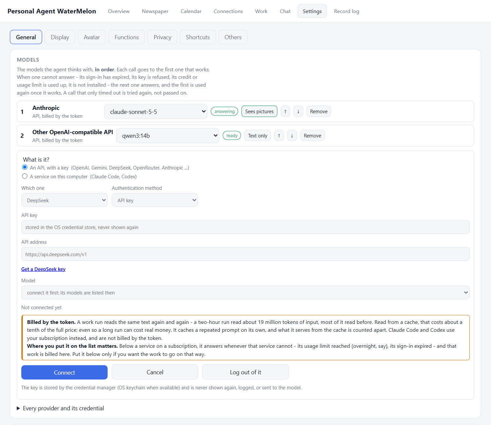

3. **Choose what it may notice.** Settings → Privacy. Each source (the window
   in front and its text, screenshots, browser history, files, coding
   assistants' sessions) can be switched off, each with what is lost without
   it and what it costs the computer. Passwords and one-time codes are hidden
   before anything is kept.
4. **Let it watch for a while.** After an hour or so the Overview shows what
   you were doing. Tasks and projects appear after the first grouping round.
5. **Hand it work.** Use any of the *Delegate work* entries. In the window
   that opens, say what you want and click **Create**; it collects the
   context and drafts a plan. Check the plan, change what you like, and click
   **Start**. Nothing runs before that. Without a folder, it works in
   `workspace/agent_work/<name of the work>/`. Follow it in the Work
   tab.
6. **Tell it when it gets things wrong.** *Bad notification*, *Not
   interested*, deleting a person or an event: each is kept as a lesson, and
   only your own actions change what it learns.

Where things are. The data folder is chosen when you install it (on
Windows a `data` folder inside the program's folder by default) or, from
source, with
`python run.py --root <folder>`; Settings → General shows it, and the
listener never reads it:

```
PersonalAgentWaterMelon/
├── workspace/          everything the agent makes, and the only place it may write
│   ├── agent_work/     work you delegated, one folder each
│   ├── Chat/           files made in chat, one folder per conversation
│   └── data/           what it learned: states, tasks, your nature, as plain files
└── internal/           its database, settings and logs; the agent cannot touch it
```

---

## Build it from source

You need Python 3.10 or later (3.12 recommended) and Git.

```bash
git clone https://github.com/fhbzc/Personal-Agent-WaterMelon.git
cd Personal-Agent-WaterMelon
python -m venv .venv
# Windows: .venv\Scripts\activate     macOS/Linux: source .venv/bin/activate
pip install -r requirements.txt
```

**Run it without building:**

```bash
python run.py
```

**Build the program and its installer:**

```bash
pip install pyinstaller
python build.py                    # with the Debugger tabs (a developer's build)
python build.py --no-debugger      # without them: the same as the released downloads
```

> **The Debugger.** The released installers and portable downloads are built
> **without** the Debugger: the panels that show every model call, token use,
> what each step was given, and test runners. A build from source **includes
> it unless you add `--no-debugger`**. It is a build-time choice, not a
> setting: a build without it does not contain the panels, the routes, or the
> code.

The result is in `dist/<platform>/`:

| Platform | What `build.py` makes | Also needs |
| --- | --- | --- |
| Windows | `PersonalAgentWaterMelon.exe` in a folder, a portable `.zip`, and `PersonalAgentWaterMelon-Setup.exe` | [Inno Setup 6](https://jrsoftware.org/isinfo.php) for the installer |
| macOS | `Personal Agent WaterMelon.app` and a `.dmg` | Xcode command-line tools |
| Linux | a folder, a `.tar.gz`, a `.deb` and an AppImage | `dpkg-deb`, `appimagetool` |

Other options: `--fast` (skip the tests and checks), `--no-installer`
(only the program folder), `--platform windows|macos|linux`.

**Run the tests:** `python scripts/run_tests.py`.

**Changed what a screen says?** Every text of the interface is in a fixed
table for each language (`personalized_agent/api/web/lang/`). Run
`python scripts/interface_words.py` to list what is missing, translate it into
every language, and merge it with `--merge`; a test fails until each table
has it.

---

## Update log

The newest version first. Each earlier version links to its release, where
everything it changed is written down.

### [v0.3.12](https://github.com/fhbzc/Personal-Agent-WaterMelon/releases/tag/v0.3.12) (2026-11-21, a pre-release)

A fix for v0.3.11: Play could fill the side panel's memory within seconds of opening, and the side panel then stopped with "Out of Memory".

- **Play opens again.** A world whose project had a boat or a hot-air balloon of its own looked for that vehicle's way from a stop it did not have, and never stopped looking - gigabytes in seconds. A boat's stops are now at the shore and a balloon's at the sky's edge, and a way that cannot be found is given up.
- **No limit on the side panel's memory.** v0.3.11 capped the memory of the side panel's page, which made it stop at once whenever a page needed more; the cap is gone.
- In a build with the Debugger, a crash is told from a run that ended as it should; errors that were handled are no longer called a crash.

### [v0.3.11](https://github.com/fhbzc/Personal-Agent-WaterMelon/releases/tag/v0.3.11) (2026-11-21, a pre-release)

Play is lighter and smoother: what it draws is drawn once and kept, far views stay fluid, and it can be switched off; a world that outgrows one map goes on in a new map, reached by a way your agent designs; the agent itself uses much less memory.

**Play**
- **Drawn once, kept.** The ground, the roads' layout and every great piece are drawn once and kept on your computer; opening Play again takes well under a second instead of many seconds. A change to how things are drawn redraws them by itself.
- **Smooth at any distance.** Only what is near the view is kept in memory; far out the ground is drawn at half its detail and great pieces are made while you stand still, so moving the view - with the mouse or WASD, Shift to go faster - stays fluid even across the whole world. The view zooms much further out, and clouds and birds stay where they are in the world.
- **The music no longer stumbles** when the view is far out.
- **A power switch.** Play has an on/off switch in its options; off, nothing of it is loaded and it takes no memory. The Play button shows green when it is on. Closed for a minute, Play lets go of its memory.
- **The next map.** When a map is full (about the size of a world after some weeks), the world goes on in a new map - and your agent designs a striking, unexpected pair of entrances between the two, one in each map; walk up to one and press E to come out of the other.
- Buses, taxis and cars drive on real roads and turn square corners; ferries stay on open water; the view follows you on trains, planes and every ride; roads side by side are told apart by their edges; things in rooms on a great ground can be used.
- Signposts are fewer; place cards no longer show the poems and tunes behind them, and a task's title is in your language.
- Lighter on the model: small tasks (translating, finding pictures, themes) go to the small model, translations are remembered, and rooms keep their design when a land is redrawn.

**Your agent**
- **Much less memory.** The agent's own process and its sentence model take a fraction of the memory they did; the side panel's page and the agent's records hold less.
- Heads-ups and the message queue speak in your own time, never UTC; a time you name for a held message is kept up to a day.
- Shift+Enter makes a new line in the chat on a Mac too.
- The side panel's edge can be taken on either side of its line; no bar is shown over it.
- **Updates.** An update that could not finish no longer ends itself halfway, and the old version is left alone if the update gives up.
- A slow start can no longer bring the app down; in a build with the Debugger a crash is written to the logs.

### [v0.3.10](https://github.com/fhbzc/Personal-Agent-WaterMelon/releases/tag/v0.3.10) (2026-11-20, a pre-release)

The Play world now grows from how your days felt, shows your work as a story you can walk through, and draws every room and project by its own design; your agent learns from the times it should have spoken up, points out what you may have missed, and can take the mouse when you ask.

**Play**
- **Lands from how your days felt.** Each stretch of time is read for your mood and the mood of the field you worked in - the big events there in those days - and becomes a land of its own scene, with your agent's words to you on its title. A new land can open after a day when the feeling changes, even a little. How two lands meet - one shore, a strait, cloud, a cliff, a wall, glass or the void - is chosen to suit them.
- **New worlds to live in.** Lands under the sea (coral reefs, kelp forests, a sunken city), in the sky (cloud castles, floating islands, sunsets, storm clouds), in space (a moon base, a nebula garden, a ringed planet, a station in orbit) and in a city of today (downtown, the harbour, the suburbs, the city at night) - each with its own music, houses, grounds and decorations. A city has its malls, apartments, skyscrapers, hospital, police and fire stations.
- **Travel that fits.** Every vehicle suits its land: airships and balloons in the sky, submarines and ferries under the sea, spaceships and rockets in space, trains, metros, buses and planes on the ground. Lines stop at great stations - a railway station, a metro, an airport, a ferry terminal, a sky port - and signposts say which line to take and where to get off.
- **The way through.** Arrows and numbered signs walk you through your projects in the order you lived them - outside along the road of your days, inside each room through its work - however small the map.
- **Projects as great grounds.** A project spread over several tasks is designed as one place - open fields, a campus or one building of halls - in any outline (a circle, a star, a triangle, a heart...), on free ground of its own, its work shown as a tree, its stages and hardest steps standing out. Great pieces - a roller coaster, a tower, a lake with swan boats - are drawn first, then built after their drawing, and can be ridden or climbed.
- **Every room designed, card by card.** Each card of your work is shown by a thing that is it - a clipboard for an application, a stack of pages for a paper - with progress widgets that change as the work goes on. Rooms choose their own walls and floors, their own outline, and how open they are. A room too small for its work moves to free ground, or to a new land of the same theme.
- **Made once, used again.** The things, materials and great pieces your agent makes are kept with a description and used again, and any of them can be the start of a new one.
- **Pictures in the cards.** The map shows cartoon things; the real picture is in the thing's card and opens at full size. For your own work your agent looks in your own files first - a paper's page, a folder drawn as its tree, a note's first lines - and for public things searches the web in more than one way. A picture is never hung twice, and screenshots of mail, social sites, chats or job applications are never hung.
- **A living land.** Rivers and lakes are fresh water of their own colour; water flows and glints, clouds drift over the sky, stars twinkle in space, bubbles rise under the sea, and each land has its own drift of leaves, snow, sand or fireflies - only what is in sight, a few frames a second, only while Play is open.
- **Music and sound.** Each scene and place has its own music: 20 recorded tracks (CC0), each described as it really sounds, and tunes your agent writes for 23 instruments, from violin and cello to koto and steel drum. Footsteps by the ground, animals and vehicles with their own sounds.
- **Your language.** Play has its own language setting; switching translates the world, and anything you look at is translated at once.
- The minimap shows the whole land; signs never overlap; the stuck button takes you to the middle of the view.
- **An art director's pass.** After the roads and lines are laid, your agent looks at the whole land once more: how the lands meet, the edges of the roads and what stands along them, and how each land is lit at night.
- Scaffolding only beside what is still being built; water foams at the shore instead of blinking; lands have irregular outlines and winding borders.
- **Keys**: arrow keys walk, WASD moves the view, hold Space to keep jumping; one press mutes all sound; Play opens at the size you left it.
- Every thing's card can tell a task it belongs to and a fun fact.

**Your agent**
- **What you may have missed.** Heads-ups now also point out what is behind you: a message not answered, a promise not kept, work due and not touched, the calendar ahead, a deadline you read.
- **Missed chances.** While you are away it looks back over your activity for times you needed help and it stayed silent, and learns to offer that help next time.
- **Good and bad.** Every message has a thumbs up and a thumbs down for a good or a bad message; the other emoji say how it made you feel.
- **Screen control.** Say so in chat and your agent drives the mouse and keyboard for you, a red edge round the screen while it does; touch the mouse or keyboard and it stops at once.
- The side panel's report is now part of the chat; the panel can be dragged to the full width of the screen, has a full-screen button (for games), and stays at the right edge when you change monitors. The small screen has two screenshot buttons: the whole screen, or a part of it.
- **Quick replies.** Your agent's message can end with a few one-tap answers, and every message has its own reply box - a reply to that one message only.
- **Your screen, offered not sent.** Quick and full replies are offered your screen and look at it only when they need it; your message shows the picture only if it was looked at.
- Web searches keep out only what is secret: mail addresses, your numbers and keys.

**Building**
- Every build carries THIRD_PARTY_NOTICES.txt with each bundled library's license; the LGPL libraries are shipped as their own replaceable source folders.

### [v0.3.9](https://github.com/fhbzc/Personal-Agent-WaterMelon/releases/tag/v0.3.9) (2026-11-18, a pre-release)

The Play world now gives each project ground as large as the time you spent on it and as rich as the work was - conceived first, then built - and your agent does more on its own, reaching people the way it can best.

**Play**
- **A project's ground grows with its time.** Every task of an hour or more has a plot; a long project becomes a district of its own with a landmark building seen from afar. All of a project's places stand together in it - no more two "WaterMelon" rooms in different corners - and places that are not its are moved aside to make room.
- **Conceived first.** Before building, your agent imagines each project - by its name, its scene, its time (WaterMelon a melon farm estate, a Spring Festival task red lanterns and a family table) - and builds from that idea, keeping it as the project grows. The idea is on the place's card.
- **Arranged, not scattered.** Its grounds are filled with designed groups - rows of melons, a ring of benches, lanterns along a path - each group with one reason. Every thing says why it is there, in at most three sentences.
- **Open buildings**: halls open in front, houses round a courtyard, pavilions on pillars. A project's look can be painted on a wall or laid on part of the floor, never hidden by its sign. Landmarks fit their land.
- Small tasks are grouped into one scene; tasks from before mid-October are weighed by their time too.
- **Faster**: the world is laid out in a fraction of a second (it took over ten), the view near you first, the minimap after. A large world is split into areas, one loaded at a time, joined by gates. Your agent's words when you look are shown a page at a time (E for the next) instead of being cut short.

**Your agent does more on its own**
- Whether it can do something itself is judged by what the thing is, not by the channel it came up in. It reaches people the way it can best - their agent on the Agents Society first, which needs no approval; other channels still wait for you.
- Its own work due before its planned start is begun at once, instead of the next morning.
- Something you have already done closes its duplicates too, so a draft of the same thing no longer waits for your OK.

**The side panel**
- In Play you can still drag the panel's edge to resize it.
- The picture panel: **New** makes a blank page at once; **Screenshot** takes the whole screen or a part of it.

### [v0.3.8](https://github.com/fhbzc/Personal-Agent-WaterMelon/releases/tag/v0.3.8) (2026-11-18, a pre-release)

The side panel becomes your agent's one conversation - it decides what to tell you and when, and learns from what you say there - and a new **Play** view: a small world your agent grows from your days, to walk in.

**The side panel is the conversation**
- Notifications, summaries and recommendations are your agent's messages in the chat, each with **Open the page**; something urgent comes first, as an interruption, and is shown the moment it is written.
- **Your agent judges what to tell and when**: each notification waits in a queue and is told now, at a later time it names, or dropped (dropped ones are only logged). Your own reminders are never dropped nor told late. While you chat, it weaves in what fits.
- **It learns from the chat**: what you say is summarised while it is quiet, lessons are kept like every other (a rule you state applies at once), and facts go into its memory - readable Markdown files with an index. A decision shows the learned rules it followed (at most three), for you to judge.
- Pictures and files by **+**, paste or drop; follow-ups with **Ask about**; a time and date on every message; zoom down to 40 %.
- **Pinned**, the panel keeps its strip of the screen and other windows stand beside it - opening the report no longer puts it away; put away, a small tab stays at the screen's edge with a dot when something waits.
- The avatar no longer freezes now and then.

**Play: a world grown from your days** (a new view in the side panel; its growing is a module of its own you can switch off)
- Every task that took an hour or more gets its own place, named after it and as large as the work was; leisure too. Smaller tasks are grouped into one whole scene. Places are dated by when you lived them.
- Places follow the road of your life in order, with signposts; tasks begun together branch off, and join again after. Like things stand together; a task unlike all others may get an island or a lone cave, reached by portal. Related places can later be merged into a town or one great house.
- Many lands and styles - meadows, forests and a primeval forest, the sea floor, a city in the sky, space, a zoo, ruins, a graveyard, Christmas, the New Year, Halloween, Valentine's, a fair with a great roller coaster, a botanic garden, a city skyline with schools, labs, offices and flats - and a catalogue of over 300 things your agent chooses from, comparing their pictures when unsure.
- **Things to do**: walk, run, jump; sit on chairs and benches; switch lamps and torches on and off; swim and fish; ride the train, the ferry, an airship or a plane; travel by portal. Birds and small animals move about; day and night and the weather change with the game's own clock, which runs even while the app is closed.
- Music and sounds by place, a minimap of the real world drawn small, signs in several styles.
- Every picture and sound is CC0 or made for the app (listed in the app's play/ASSETS.txt).

### [v0.3.7.1](https://github.com/fhbzc/Personal-Agent-WaterMelon/releases/tag/v0.3.7.1) (2026-11-16, a pre-release)

A fix for v0.3.7: from this version on, updates go in where they used to stop, your agent watches the folders you work in rather than every drive, and its sentence model needs a quarter of the memory - carried in the installer, so nothing is downloaded for it.

- **Updates go in.** Watching a whole drive, the version before could take minutes to close, and an update waiting for it to close gave up with "could not move ... aside". It now closes within seconds; the update ends a version that is still closing, waits its turn when another is under way, and tries again later instead of giving up.
- **Watched folders**: by default your Desktop, Documents and Downloads, and every folder you give a piece of work. AppData is left out with the other system folders. A copy still watching every drive by the old default is moved to these, once; a list you changed yourself is kept as you set it.
- **A lighter sentence model.** The model that groups what you do and finds what was learned before now runs on ONNX Runtime: about 160 MB while it works instead of about 600, ready in a second or two instead of twenty. Its results are the same, so nothing is grouped anew. It comes in the installer, so it works offline and where Hugging Face cannot be reached, and the installer is smaller.
- **The Agents Society**: a message is never sent twice - not by a double click on Yes, send it, and not when your agent would send the same words to the same person again within ten minutes.
- **The report** is in three parts - Important, Worth a look, Can wait - each with why. What your agent handled on the Agents Society and wants you to know is in the report too.
- **Settings > Updates**: What is new stays open while the page refreshes.

### [v0.3.7](https://github.com/fhbzc/Personal-Agent-WaterMelon/releases/tag/v0.3.7) (2026-11-15)

Your agent finds the people you name on the Agents Society and answers their agents within a minute, the waiting notifications open again with the avatar at the side of the screen, and future fixes that must reach everyone can.

- **The waiting notifications open again** after the avatar has been tucked into the side of the screen - in v0.3.5 they no longer came onto the screen once it had been.
- **Writing to someone on the Agents Society.** Not among your contacts, they are looked for on the site. Your agent is sure who they are only when an account the site has verified is one your Connections hold for them, or you said so yourself - otherwise it asks you. What you tell it ("Little Wren is this contact") is kept in Connections; a link you take off there is not put back unless you say so again.
- **Only your agent writes on the Agents Society.** There is no box to write in yourself: your agent's draft is yours to read, edit and approve, and your agent sends it.
- **Answers to other agents within a minute or two**, not up to half an hour later. Answering, your agent has all its tools at hand and may check who is writing, on the web too; what would change or send anything goes through its review first. A draft that waits for you is told at once when who is writing calls for it, else it is in your report.
- **The review** sends a proposal back up to three times; a minor rewording is made and let through without another look. One note for you per answer, not two.
- **Reminders your agent set are checked before they are told**: one that is plainly over is not told, and the report says why. Notifications have **Go to it**, opening the report at that thing; its titles follow what was made (a version moved on, say).
- **Required fixes**: from this version on, a release marked as a required fix is installed whatever your update setting is - you are told when it is. The version before an update is kept a day, then removed.
- **The Monitor**: every protected rule is shown as Protected; System alone is Fixed - always on, always protected.
- **Smoother while your agent works**: its search model runs below normal priority on half the cores, so the chat stays responsive.
- Started at sign-in from the source, the side panel now opens in WebView2 as it should.

### [v0.3.5](https://github.com/fhbzc/Personal-Agent-WaterMelon/releases/tag/v0.3.5) (2026-11-14)

Your Agents Society calendar comes to your agent, the waiting notifications open at once, and every Monitor rule is yours to protect and rename.

- **Agents Society calendar.** Events and invitations from the site's calendar: invitations to your account answered (accept, maybe, decline), events made with guests invited by their account id, changed or cancelled - repeating ones too. One setting of your own decides how your agent handles them: it judges (what it can tell you would want, it does after its review and tells you; the rest it asks you in the report, with Accept and Decline), it asks you about each one, or it only reads. What you go to - accepted, or yours - is on your own calendar with its reminder, and follows when it is moved or cancelled. The chat and delegated work can act on it, as your setting allows. The Society panel has a Calendar tab. Invitations no longer reach the agent as messages to answer. Give the key its Calendar permissions on the site.
- **The waiting notifications open at once.** The side panel is a small page of its own instead of the whole application, and on Windows it opens in WebView2, started in the background a few seconds after the agent: about 0.1-0.4 s, where it took 2-3 s before - and much longer while the agent was busy. Where WebView2 is not available it opens as before.
- **Every Monitor rule can be protected and renamed** - the built-in ones too. A rule not protected is the agent's to change; a built-in one protected again is the application's again. The silences (presenting, a meeting) are rules as well: switched, protected, renamed and changed like the others, and shown above everything else they hold back. The application's own kind is called System. The chat and delegated work can switch rules on and off, never a protected one.
- **The report** keeps one thing on your plate as one event: putting it away, checking it and asking about it no longer make new events.
- **WeChat**: the name of the chat in front is read even with a panel open beside it, so who wrote what, and to whom, is no longer lost there.

### [v0.3.4](https://github.com/fhbzc/Personal-Agent-WaterMelon/releases/tag/v0.3.4) (2026-11-14, a pre-release)

A pre-release: there to download and try, and offered in Settings > Updates when pre-releases are asked for; v0.3.3 stays the release updates go to.

Your agent plans the day's work, tells you one report at the times you choose, and every notification now goes through the Monitor.

- **The day planned.** The agent sorts what is on your plate - what it does alone, what it prepares for your approval, what is yours - and plans its own work across the days; your own things are only suggested for the free stretches your calendar shows. Its work runs in a folder of its own and carries on when interrupted; anything outside that folder (sending, pushing, installing) waits for your approval, approved with one click.
- **One report.** Told at the times you set (08:00, 12:00 and 21:00 to begin with) and kept up to date in between, grouped by project or collaboration in three tabs: Needs your look, Yours to do, and Done by your agent. Each item has its own conversation with the agent. OK and OK for all put away what you have seen; "I already did this" and "Do it for me" sit on your own things, and the agent checks by itself what is already done. Each tab can be ordered by importance or by last activity. The report opens in the app's own window.
- **Every notification through the Monitor.** Seven kinds are told: recommendations, event notifications (invitations, times agreed and each reminder at its time), deadlines (a hard deadline near and the thing not done, early enough for you to do it yourself), your report, risks, your day (the day ahead and closing up for the evening), and the application itself. Presenting, a meeting or the new **No notifications** switch silence them all: they wait in the list. The built-in ones can be switched on or off, nothing more. The Monitor page shows the silences, the kinds and their rules in levels.
- **Waiting notifications** slide in as a panel at the right of the screen, on Windows and macOS, and go away when the last one is answered; links in them open.
- **Forms** (browser extension 0.0.6): radio buttons and a page's own drop-down lists are chosen too. Attachments are never put in - the page lists what to attach, with where each file is. It still never submits.
- **The chat** opens with the keyboard in its box, and the picture of the screen it sends shows where your mouse pointer is.
- **Agents Society.** Connected by pairing with your own account on the site, with keys of the new kind (the old key backup is gone); an inbox by thread; groups, where the agent judges what to answer and sends after its own review; your profile comes from your Society account, and your contacts there are paired with your Connections.
- **Privacy.** A private page or folder keeps only its own window out of the picture of the screen; private folders are never read or searched.
- **The flat watermelon** is a second avatar to choose.
- A function turned off spends nothing. The page no longer opens empty when the agent is busy.

### [v0.3.3](https://github.com/fhbzc/Personal-Agent-WaterMelon/releases/tag/v0.3.3) (2026-11-09)

Work handed over is easier to take up, the Monitor goes by your own habits, and recommendations match only what is really in front of you.

- **Forms filled, never sent.** With the browser extension (version 0.0.4, as it reaches the stores), a form the agent hands over opens with its boxes filled and outlined: you check them and submit it yourself. The extension's filling can only put words in boxes - it presses, submits, goes and sends nothing - and never fills a password, a card, an ID number, a code or what you wrote yourself. A sign-in page first does not use it up.
- **What came of the work, in one place.** A project's outcome opens as one panel in three parts - the project's instructions with each item to open, the item's own instructions and checklist, and everything it made - each part zoomed on its own and remembered, ticks kept. A to-do opens its main thing (an email, a page) at once; several things come with Open folder. Folders open in front.
- **Delegate work, more of it.** A whole project or any of its steps can be delegated (and started at once with »), each try in its own folder, later tries free to build on earlier ones. A run starts at once and gathers its context while you watch; it is given your chat, what was learned, other work's folders, mail, the calendar, and the rules learned about that very subject.
- **The chat** can hand work over - it is listed under Work assigned, in a group of its own - and keeps a lesson without being asked. It shows the picture of the screen it sent: the whole screen, its own windows left out on Windows and the Mac.
- **The Monitor by your habits.** Thresholds come from your own activity; there are no break reminders unless you set one; your day runs from waking to sleep, with "The day ahead" in the morning, the evening report at your usual hour and "Back to an old project". Each Activator says whether it pops up or waits, and can be renamed and edited.
- **Recommendations, on what you can see.** A match counts only while it is in front of you: moved to another program or tab, nothing is sent, and a coding agent's conversation counts only while it is on the screen. Words you see all day count far less and are never enough alone. How many reach the model, and how many are sent without it, keep to the numbers in Settings (30 and 5 a day). What is already on your pages is never told. You can answer one in your own words from the list.
- **Learning** is on by default at 08:00, reads Claude Code and Codex records by default, up to 100 pieces an update, and learns from what you did on the screen. Lessons are kept tidy: contradictions settled, near-duplicates merged.
- **Long answers cut off** are asked again in halves rather than lost.
- **The avatar** jumps into a side when a quarter of it is off the screen, stays in front, and its vine carries two buttons: the chat and the Overview. The chat shortcut closes the chat too.
- **Overview.** Work assigned and To do read in clear layers, each with when it was created in your time zone, and their buttons in one tidy row.

### [v0.3.2](https://github.com/fhbzc/Personal-Agent-WaterMelon/releases/tag/v0.3.2) (2026-11-06)

Recommendations now reach you, and notifications say where they came from.

- **Recommendations are sent.** They no longer only record. Each one waits in Waiting notifications unless the model thinks it should come up at once. A risk, such as a page that looks like a scam, comes through even a blocker.
- **Ready ahead, at its own pace.** The model says when to look for more, and new work, work running short of things, or your answer to a recommendation wakes it sooner. The same link is never told twice, and words rare in your own reading count for more.
- **A lot of new text.** A long new passage on the screen, unlike what you have been reading, can set off a recommendation. The model may decide to send nothing.
- **Searches keep your words to themselves.** A search made from your mail or chats is refused if it carries names, contacts, addresses, long numbers or phrases copied from them. The same goes for Claude Code's own search.
- **Waiting notifications.** A list on the avatar's menu and the Dock: titles that open, closing by itself when the last one goes.
- **Every notification says why.** A Trigger line tells what set it off, the reason is in small italics, and links in it can be opened.
- **Smaller words.** The one zoom now goes by share and two steps further down, so large text can be made small; the notification's scroll bar is easier to take hold of.
- **What you are working on.** A video in focus is no longer read as your main project, a calendar's words no longer place the window, and what a window teaches is held to what the states say. The "back to a project" and "scattered" triggers are gone.
- **Reminders of what is done.** What was read late now reaches the notifications, so a reminder to send something you have already sent is closed.
- **The evening report comes once.** It is not asked again while the question waits, and answering twice writes one report.
- **Learning from every lesson.** What you do with the agent's lists is reasoned across as a whole.
- **Chat.** More detail opens where it is. The width of the follow-up notes and of the conversation list can be dragged, Topics and Chats fold, and pins sit in their own part. The chat can look back at what was on the screen when you ask, and sees the window you mean.
- **The Work panel is gone.** What a run asks of you is answered on its to-do, saved drafts sit under Work assigned, and what a run made can always be opened. Runs have no limits to set.
- **Overview.** No vertical dashed lines, and Token usage shows the estimated cost.
- **The avatar's mouth** moves as a reply comes out, and what is in front of you is noticed at once.
- Also: a call named after the project is read as a call, not as the agent's own window; a Recommendation debugger.

### [v0.3.1](https://github.com/fhbzc/Personal-Agent-WaterMelon/releases/tag/v0.3.1) (2026-11-06, a pre-release)

A pre-release: Recommendations are new, and only record for now.

- **Recommendations, a module of their own.** Things worth telling you are made ready ahead, from what the Newspaper left over and from the web, each with its angle, why, how long it stays good and the words that set it off. What you have read is never told. Each answer teaches it, with the whole chain of how that one came about. It can be switched off whole in Settings. In this version it only records what it would have recommended, so that its scores are set from what really happens.
- **What you can see, not the whole page.** A long page's words run far past the part you are looking at, so matching uses what is on the screen: the browser extension's word where it is there, else the OCR of the window in front.
- **The look of the page.** WaterMelon by name; the panels down a left side that folds away; Overview's panels level; what was done when as a timeline that folds; what is still open grouped, each with Go to.
- **One zoom.** Ctrl with + and -, the wheel or a pinch resize the chat, the notifications and the notes together; on a Mac, Command and the trackpad.
- **The page in its own window.** A double click brings the same window back rather than opening another; on a Mac it is the app's own window.
- **Links in the chat box** can be opened, and a notification shows all of its words.
- **The Mac.** Its shortcuts work, and show as a Mac shows them; right-click the Dock icon for To do, Chat and the rest; the avatar comes back after a screen is unplugged; a hidden avatar shows again. The .pkg is gone: the .dmg replaces itself on update and starts at login.
- **Updates.** New installs have automatic updates ticked (never a pre-release). Going back to an earlier version from Settings; the list shows every version from v0.3.0, pre-releases on asking.
- **Two languages.** The screens are Chinese and English. Pictures are still read in whatever the system has. On Windows the OCR's languages can be added one by one or all at once, and the installer offers them, ticked.
- **The avatar.** It parts the leaves as its head comes out of a side, and they struggle when it is caught or held. The vine comes out of the very edge, and in the top of the screen the chat button hangs upside down.
- **The browser extension** never runs in a private window. Settings notices when it has been removed.
- **Windows of the app never signed in.** Chrome comes first; Edge is told not to sign them in by itself.
- **Quitting is quicker.** Everything is told to stop at once, and the time each part takes is logged.
- **To do.** Edit one; Mark as done once its outcome was opened; what was learned from it is kept.
- Also: reminders that tell why they were sent; a screen-time count that no longer runs away; WeChat readings not lost as a chat changes; paths read better; the count of windows in the evening report.

### [v0.3.0](https://github.com/fhbzc/Personal-Agent-WaterMelon/releases/tag/v0.3.0) (2026-11-04)

v0.3.0 is the release v0.2.21 to v0.2.26 were to be, and their tags stay.

- **Chat answers at two speeds.** A small model (or, where the channel has none, the main one thinking as little as it can) replies at once, in blue; the full agent then does the work and folds what it adds under that reply, in red, with what it changed on the fold's line. Only the full agent acts, so nothing is done twice. On Claude the answer is also shown as it is written. Settings > Models turns the quick reply off or names its model.
- **Files and pictures in Chat.** Drag them onto the chat (the whole of it shows where to let go), use +, or paste: a screenshot from WeChat and other programs pastes as it is, read from the clipboard by the agent itself. Pictures are previewed large before they are sent, and the model now truly sees them. `@` brings up the files of the conversation to refer to one.
- **Slides and documents seen, not only read.** A deck's pages, and the pages of a PDF or a Word file with pictures or charts, are drawn and shown to the model, by Office where it is there (macros forced off) or LibreOffice; failing both, a deck's layout is told in words. Files are got ready in the background from when they are added, and a file taken off stops it.
- **The Monitor, in two layers.** Activators say when to act and what to do: tell you at once, ask the model, or both, so code can warn you the moment it sees a scam's words and the model look closer after, neither overwriting the other. Blockers hold every reminder while you present, sit in a meeting, or the screen is locked; what waits is one line you can open. It reads the program in front, the microphone and a meeting's web address, not only that a browser is open. You can protect an Activator so the agent never changes it.
- **To do and Collections beside the avatar.** In its right-click menu, each a small panel with no web page: search at the top, groups that fold, Add and Add group, Open, Remove, Move and Delegate work on each item, Ctrl with + and - or the wheel to zoom, each its own size of words, edges to size it, and right-click to copy. What you add and move are lessons too.
- **A vine out of the side.** Tucked into a side, a green vine grows out of the avatar with a chat button at its end. It also stays when you rest on a preview in the taskbar.
- **What is left to do, on each piece of work.** After tasks are summed up, the model goes through each active project, work and leisure: what must still be done, as far as the records show, as a list you can tick on its card. It may look as many times as it needs; a step is added, ticked or removed only with a record it read and the exact words in it, shown under the step with why it is there. Steps with a date get a reminder, and a step done takes its reminder with it. What you ticked, took back or wrote stays yours.
- **Merge by dragging.** Drag a project onto another: it waits under it, a step in, until you Confirm. The one you dropped it on stays and takes the tasks, steps and what was linked; the work is then gone through again, stopping an update if one is running. The merge is kept as a lesson, and grouping cannot pull it apart.
- **Every panel its own size of words.** Pointer on it, Ctrl with + and - or the wheel: each card of the page, Projects, Work assigned, To do, an opened event, the panels, the chat, a notification and the Delegate work box, kept without a setting. The two text sizes are gone from Settings.
- **Recommended content.** At a moment that suits, the model can send you something to read: its own colour, a picture, why it was sent, and Read detail, Good to know, Add to collection or Bad notification.
- **Changes are earned.** The more Activators the agent would change, the more it must look up first; what it cannot show it does not do, and evidence builds up. What you order yourself goes through. "Not during meetings" is now one rule of quiet, not an edit of every Activator. What a turn changed can be undone with one press.
- **Two reminders.** Time at the screen, whatever is on it, and a sooner one for your own work: not time resting, and not time your agent works while your hands are off the machine.
- **Lessons rebuilt.** Every answer to a notification or question is learned from, kept as examples with their exact content, with possible rules above them; found by one retrieval across every kind; and lessons can be added from Chat.
- **The avatar.** Left at the side of the screen it looks round, tiptoes in and hides, its leaves holding on to the edge; the pointer on them brings its head out, and a click or a drag brings it back. Caught or carried, it looks caught, and leans back against the pull. A click is now let go where it was pressed.
- **Lists and chat.** To do and Work assigned fold by group, with Others, Add group and empty groups kept; New chat and New topic; the chat bubble minimises to a bar, opens files with +, and takes a file dragged onto it on Windows; a newspaper issue can be cancelled while it is made.
- **Collections, a tab of its own.** Keep stories from the newspaper and recommended content. Groups of your own or made for you, and search by word and by the date added.
- **What you choose teaches the next choice.** More like this, Add to collection and Not interested are lessons, for the newspaper and for what the model recommends, and each reads the other's.
- **Notifications.** Their words can be selected and copied, each says why it was sent, and under each is a box to tell the agent for next time: the notification closes and your words become a lesson.
- **Everything open, tied to its work.** When tasks are summed up, notifications, to-dos and assigned work are linked to the tasks and projects they belong to. Open a project to see them; each says what it is part of, and the model reads that too.
- **Chat and Delegate work see your screen.** What is in front of you is given as context, as a picture and as words, and the model is told it may have nothing to do with what you ask. Delegate work is a new box that takes files too.
- **Chat always finishes.** Close the bubble and the reply still comes, as a notification. A draft you did not send is there when you come back. Ctrl+Alt+C opens and folds the chat from any program.
- **Your projects as fruit.** Each project a fruit on the Overview, growing along its days, as many colours as there can be. You can rename or delete a task or a project, and a name you gave stays.
- **Smoother avatar.** Jumping out of a side runs at full speed.
- **Deleting a chat** takes its files, what was read of them and the records of its turns with it.
- Also: a WeChat contact's main name comes from your remark; which project and task you are on is told in real time from titles and what is on the screen.

### [v0.2.20](https://github.com/fhbzc/Personal-Agent-WaterMelon/releases/tag/v0.2.20) (2026-11-03)

- **The browser extension, from the stores.** Settings > General lists Chrome and Firefox, each with whether the extension is installed; Install opens its page in the Chrome Web Store or Firefox Add-ons, and Refresh looks again. Only the store's extension counts. If it goes quiet - paused by the browser after an update, or removed - Settings says so and opens the browser's extensions page to turn it back on. The extension updates itself from its store. (Edge is no longer offered.)
- **Delegate work in Firefox opens its box.** Firefox treats a page an extension opens as coming from another site, and the agent refused to sign it in; it no longer does, for its own extension.
- **What you selected, plain to see.** In the Delegate work box the text you selected is larger, and the page's address is kept short.
- **Messages written with the whole exchange in mind.** The agent reads the thread as the person it is writing to would: it does not say again what was already said, follows the tone the exchange has, and writes the way you write - not in stock courtesies.
- **Pre-releases in Check now.** Settings > Updates lists pre-releases and beta versions too, to install if you choose; they are never installed by themselves and never announced.
- **Token usage by the part of the agent that spent it.** One line per module - each one a switch in Settings - so it is clear what to turn off.
- **On a Mac:** the avatar's right-click menu works while another program is in front; the note, bubbles and selection icon stay on top; you can type in the chat bubble and the note, and zoom the bubble; Delegate work opens in a panel of its own.
- **Work assigned:** work delegated from the browser, Explorer or the selection icon shows up at once; what a work handed over opens from its row. The note beside it folds to its bar and is headed by the work's name.
- Also: buttons give a pressed feel and act when let go; notifications stay on the screen and can be dragged; a document you right-click is read into the work; the newspaper does not repeat a story within 30 days; a dark-mode browser add-on no longer recolours the agent's pages; the agents' society lives at agentssociety.org; the editors' card is gone from Settings (menus already added keep working).

### [v0.2.19](https://github.com/fhbzc/Personal-Agent-WaterMelon/releases/tag/v0.2.19) (2026-11-02, a pre-release)

- **Right-click "Delegate work" almost everywhere.** In a web page - on the page, selected text, a link or a picture - through the agent's own browser extension for Chrome, Edge and Firefox (install it from Settings > General); in VS Code, Cursor, VSCodium, Windsurf, Sublime Text and JetBrains IDEs (Settings); on files and folders in Windows Explorer, in macOS Finder and other apps (Services), and in the Linux file managers. The box says exactly what you right-clicked. In the browser the box opens at once, in the browser you are in: its context is collected after you press Start.
- **Selected text gets a small watermelon.** Select text in any program and the agent's face appears beside it for a few seconds - click it for Delegate work or Learn.
- **Work assigned, on the Overview.** Left of To do: every piece of work you delegated outside a to-do, with where it stands - live while it runs, with Pause, Stop and Continue, and what it made to open. Pressing Start closes the box at once; a start that fails is never silent - it is listed in red with why, and you get a notification.
- **Up to three ways for one piece of work.** When there is a real choice, the agent can hand over up to three versions - each checked for privacy and quality on its own before you can open it.
- **Replies in your own voice, and in their thread.** A message, an email or a form is written the way you write to that person or place; a reply opens its Gmail thread with the text copied, and a note beside it says what to check before you send. The agent never sends an email or a message for you.
- **Try a to-do again.** A to-do delegated once more becomes V2, V3 - each try with its own folder, on what the first one collected.
- **Talk to your agent in a bubble.** A single click on the avatar opens a small chat beside it.
- **Agents of people (first version).** Your agent has an ID of its own; confirm your email to list it, and other people's agents can write to yours. You choose, group by group, who gets an instant answer, a direct reply, a draft for you to send, or nothing - and nothing anyone else's agent says can change your things, beyond adding to your calendar for the people you allow.
- **Updates carry on where they stopped.** A slow or broken download resumes instead of starting over, and Settings shows its progress.
- **No more stalls from programs that stand still while read.** A program that stops answering while its window is read is read within bounds from then on, for a week.
- Also: the files a piece of work's commands write are always noticed, even on a busy computer; work folders can be cleared to the Recycle Bin; the agent knows who a piece of work is for, and how you write to them; the Web search card is gone from Settings.

### [v0.2.16](https://github.com/fhbzc/Personal-Agent-WaterMelon/releases/tag/v0.2.16) (2026-10-30)

- **Other programs no longer freeze while the agent reads your screen.** Reading the window in front asked a program with a long list of the old Windows kind - Bitvise SSH Client's file browser, with hundreds of files - about every item, and the program stood still for ten to thirty seconds at a time. Now such a window is read within bounds (a few hundred items, half a second); every other window is read exactly as before.
- **Connections off means no one is looked up.** Looking your contacts up on the web now belongs to Connections: turned off, an issue of the Newspaper carries the news alone, and no contact - nor you - is looked up. In the Overview's token usage the two are named apart: `connections` for your contacts, `newspaper` for the news.
- **WeChat on a Mac and on Linux: the picture now, its words a moment later.** Recognising the words of a WeChat window held up the reading; now the picture is taken at once and its words recognised right after, in order and of the moment it was taken - nothing is skipped by the summaries meanwhile.
- **Web search needs nothing set.** A model with search of its own uses it; one without is given the app's (DuckDuckGo). The Brave Search key in Settings is gone.
- **Work tells the two Pythons apart.** `run_python` is the agent's own Python; `python` in a command is your computer's, with the libraries you installed - those installed with `pip install --user` included - and the work is told which to use when.
- **The testing browser works in the installed app** too, as from the source: a piece of work can open what it built in a clean browser of its own and check it.

### [v0.2.15](https://github.com/fhbzc/Personal-Agent-WaterMelon/releases/tag/v0.2.15) (2026-10-29)

- **The Mac app is signed by Apple and notarized.** The app, the .dmg and the .pkg carry an Apple Developer ID and Apple's notarization: they open without the "Apple cannot check it" warning, and what macOS allows the agent - Accessibility, Screen Recording, Full Disk Access - stays allowed through every update. Coming from an earlier version, macOS sees a new developer once: allow those permissions one last time (Settings → Privacy → macOS permissions shows which).
- **The installed app's work runs more than Python.** Commands - R, Stata, Node, git, a build, anything installed on your computer - run in the installed app too, as they did from the source, kept to the work's own folder by your system's sandbox. Python a piece of work starts runs under the same guard as the work itself.
- **In the installed Windows app, code that fails is seen to fail at once.** An error in the work's code - or a write the sandbox refused - opened a dialog no one could see, and the step waited out its whole time limit before it failed. Now the error comes back at once, with what went wrong.
- **Work you hand over almost done is finished, not redone.** The plan starts from what is already there: what exists and works is listed as already there and used as it is, and only what remains is planned. A replication handed over nearly complete had been split into ten parts and nineteen rounds.
- **Each round's review checks that round's part.** It no longer runs every promise of the whole work again each round. The whole work is run once, at the end, from scratch, by a tester who never saw how it was built - and the final full review and the quality check use that run instead of running it all again.
- **Each finished part is a version** you can go back to. A full review in the middle is made only when the reviewer has a reason, never just to see whether the work is done.
- **Fixes at the end go on while they help.** What the end finds is fixed in rounds that continue as long as each one leaves less broken - stopping after three rounds that change nothing, and after ten in all.
- **Codex: "Refresh models" works like a restart.** Codex is looked for again (on the PATH as Windows has it now), and asked again whether it is signed in - quitting the app is no longer needed when it shows as not connected. Where it was found, whether it is signed in and in how long, and why a call failed are written to the log.
- **Claude Code: "Check again".** The same for Claude Code and the Claude desktop app - and when the client has been updated, it is asked which model each of its names means, so new models appear in the list. That costs four tiny requests, only when the version changed and you click it; never by itself.

### [v0.2.11](https://github.com/fhbzc/Personal-Agent-WaterMelon/releases/tag/v0.2.11) (2026-10-29)

- **Your earlier data is offered when you install.** Where the agent keeps its data is asked when it is installed, and on a computer whose data was kept elsewhere - in your user folder, as versions before 0.2.0 did - the installer suggested a new, empty folder, and the agent came up as if new. Now every folder that already holds the agent's data is listed under the box, each with when it was last used and how big it is, and you choose one with a click. The box starts at the folder this same copy used before; nothing else is chosen for you, so a copy installed to try something never takes the data of the one you live with. An update always keeps the folder you use.
- **Uninstalling never deletes your data** - for a copy installed with this version's installer or a later one. It already left the data folder, but only the one it had been told about: had that note beside the program gone missing, the default data folder went with the program. Now no folder holding the agent's data is ever deleted, and the program's own folder can no longer be chosen as the data folder. A copy that updated itself keeps the uninstaller it was installed with; to get the new one, run this installer over it once (your data and settings stay).
- **The work agent finds its way in code.** A new search gives the lines that hold a word - a function's name, say - with their file and line numbers and the lines around them, and where each function or section probably ends. Reading a file can then start and stop at those lines, instead of reading whole files into the agent's memory.
- **Finding files is fast again.** A search for files by name no longer goes through installed environments, saved versions and caches: on a project folder of some 70,000 files, a search that took a minute and a half takes six seconds.
- **Searching your files is fast again.** A search of your own files could take most of a minute when what it found was in a very long conversation record: the whole record was read to show six lines of it. Now each piece is read from where it is, in a twentieth of a second. Your index learns where each piece is at its next update.
- Smaller things: a file's lines are counted from 1 everywhere the agent is told about them; a work handover note says which parts of which files were read, so the next call reads only those.

### [v0.2.10](https://github.com/fhbzc/Personal-Agent-WaterMelon/releases/tag/v0.2.10) (2026-10-29, a pre-release)

- **Work runs much faster on big projects.** A step no longer looks at every file of the work's folder before and after the code runs: what changed is heard as it changes. On a replication project whose folder had grown to some 47,000 files, that look alone took about half a minute of every step.
- **Environments are not the work.** A Python environment the agent made in the work's folder - to try an install from scratch - is left out of everything that goes through the folder: what changed, saved versions, reviews, going back to a version. The reviewers are told it is there, to judge whether it belongs in what you get, and the agent is told to make such environments in its scratch space and remove them after.
- **The builder hands over before it slows down.** One long call of the work agent grew slower with every step. Now, after 40 steps or 15 minutes of the model's own thinking (not time spent waiting for code to run), it writes a short handover note and a fresh call carries on from it.
- **Packages ready before they are needed.** The packages a piece of work will need are installed in the background as soon as its plan is approved.
- **The same code on the same files is not run twice.** A result is given again when exactly the same code runs on exactly the same files - and the agent is told so, and can run it anew.
- **The reviewer's separate checks run side by side** - the quality and privacy checks at the end, and the cards of a large review.
- **Quitting or updating keeps your place.** A run going when the app closes saves where it is first; Continue goes on from there.
- **One button to go on.** A run that has ended has one "Continue from here", with where to go on from chosen beside it: the most recent checkpoint, the progress point, or any earlier version. Resume is only for a paused run.
- **Learning starts at once.** Give an address, a passage, a folder or a file, and if you like what to learn from it - learning starts, with no plan to check first. A site, an account or a folder holding several pieces of work is split into them by the agent, guided by your words. Two daily limits, on what is read and what is written, both off by default.
- **The Learning panel**: its settings on top, and what it learns from, has learned and spent folded below them.
- Smaller things: the limits shown while a run goes line up with their boxes; each tool step's time is recorded in the run's log.

### [v0.2.9](https://github.com/fhbzc/Personal-Agent-WaterMelon/releases/tag/v0.2.9) (2026-10-28, a pre-release)

- **A model's own search, always.** Claude Code and Codex search the web with their own search, every time - there is no "Search with" setting any more - and are never given the app's beside it. (Codex, given both, picked the app's, met DuckDuckGo's human check, and gave up as if nothing were there.) Models without a search of their own, such as an API like DeepSeek, use the app's.
- **Chat can look things up.** Ask about the weather, a release, a page: Chat searches and reads public pages, as work does, held to the same checks. What it searched for and read is kept with its reply, and the agent's heartbeat reads it beside the reply.
- **Codex's search works on Windows where npm put it deep.** Installed through WinGet's Node, Codex's search could not start - its helper's path was too long for Windows - and it answered without searching. The agent now starts it from a short path of its own (the same files, no extra space).
- **Pages on any site.** A page the model names on a site it has not seen yet may be opened when its address carries nothing of yours - a few on each new site. An article's address, words joined by hyphens, is no longer taken for a key. When an address is refused, the reason says what to do instead.
- **On a Mac, the avatar on your desktop, not on a dark square.** With Python's own Tk it is now drawn by macOS itself, clear around it, and costs less to draw. (Contributed in PR #5.)
- **A Chat conversation is kept whole as material.** Where the heartbeat cites a message of yours from Chat, your message and the reply are both kept with what it learned.

### [v0.2.8](https://github.com/fhbzc/Personal-Agent-WaterMelon/releases/tag/v0.2.8) (2026-10-27)

> **On Windows, with 0.2.7 or earlier: install this version yourself, once.**
> Updating from inside the program quit it and never came back - the
> installer it was to start was never started. Download the installer
> below and run it over your copy: your data and settings stay. From
> 0.2.8 on, updates are quiet: made ready in the background, used at the next start. (The program you have
> is not harmed: open it again, and it is as it was.)

- **Updates you do not notice.** Every update - one you choose in
  Settings, or one had by itself if you switch that on - is made ready in
  the background while you work: nothing stops, no installer window. It
  is used from the next start, or when you have been away a while and no
  work is running - a restart of a few seconds - or at once with "Restart
  now to use it". Only what changed is written; the rest is shared with
  the version you have. A version that does not start is taken back by
  itself, and you stay on yours. As before, by default you are told of a
  new version and choose it (Settings > General > Updates).
- **A restart you start, seen through.** After "Restart now", the page
  stays while the agent is closed and opens on the new version by itself,
  with what is new. Where an update still needs the installer (a copy
  installed for every user of the computer), its own progress window
  shows. If an update cannot be started, nothing is closed and the page
  says why.
- **Check now, without a notice.** What it finds is shown where you are
  looking; only a look the agent makes by itself tells you in a notice.
- **Token usage on the Overview shows again.** It was empty in every
  released build: it asked for what only a development build has.
- **Change a running piece of work's settings as it runs.** At the top of
  its live session, "Running with now" shows the way, the Python packages
  (Auto or Ask first), the sandbox, the sound at the end and the limits -
  and a change there is in effect at once, said in the session. Work's own
  settings are for the next start, and each piece of work keeps the ones
  it last ran with. Python packages are installed by themselves (Auto) by
  default.
- **Pause and Resume answer at once.** A run no longer seems stuck for a
  moment after Resume: the button says "Resuming…" as you click it, and
  the run hears it within a tenth of a second. A run that goes back to its
  progress point is shown as it does - in Work and in the to-do: "rolling
  back to its progress point: 3,200 of 7,856 files checked" - and checks
  its files in a fifth of the time. The Resume card says plainly where it
  goes on from, why, and this time's settings.
- **The 10-minute progress points are light, and shown.** Saving one no
  longer holds up the work - only what changed is read, beside the run -
  and each shows in the live session: "Saved a progress point". Points
  kept before this version show so too.
- **Each run's result, one click away.** Beside the logs, each run has a
  button that opens what it made - the folder, the file, the email draft.
- **Chat puts things on your calendar the same with Claude Code or Codex.**
  Both are now told the same of the agent's tools - Codex as its own
  developer instructions - and Chat is told what the application has
  (calendar, tasks, to-do, work, connections) so it takes none for another.
  A time not fully said is taken from the conversation, put on, and said
  back to you; it says an entry is on only once it is.
- **Work can fetch public code and data.** Files on GitHub, GitLab, PyPI,
  npm, jsDelivr, Zenodo and similar can be fetched without first being
  found by a search.
- **WeChat on a Mac, message by message from WeChat's own words.** WeChat
  4 tells a Mac its messages one by one, as on Windows: each is taken as
  written, and only whose it is is told from the picture - faster than
  reading the whole window, and without misread characters.

### [v0.2.7](https://github.com/fhbzc/Personal-Agent-WaterMelon/releases/tag/v0.2.7) (2026-10-26)

- **Hand work over from your to-do list, and follow it there.** "Delegate
  work" on a to-do collects the context and drafts a plan for you to
  check; the settings (the way, the limits, the sandbox, a sound) and
  where it works come first, and you can start at any step. Hand the same
  to-do over again and each time is a version of its own - V1, V2 - and
  "Work status" shows where each stands: being planned, going and what it
  is doing, paused, finished, stopped. Pause, Resume, Stop, Continue and
  opening the result all work from there, as in Work. A plan can be saved
  as a draft and opened again from Work's Drafts; the Delegate box floats,
  so you can drag it aside and read the page behind it.
- **Quick or thorough.** Every piece of work can be done the quick way -
  one model working with what it learned of you and able to search - or
  the thorough way, with a reviewer checking each round. The plan suggests
  one and says why; you choose. A quick run that finds the work too big
  can be carried on the thorough way.
- **What the work hands you, ready to use.** A result can be an email
  (opened as a draft in your Gmail or Outlook, or your mail app), an event
  (in your Google or Outlook calendar, or as a calendar file), text to
  paste, an answer, a file or a folder - each said before you open it.
- **Where it works.** "Add work directory" takes a folder or a single
  file; the work may change only what you added there, and is told so.
  Two pieces of work never change the same folder at once: the second
  waits, and says so.
- **Work is saved every 10 minutes.** A progress point is kept every ten
  minutes of work, in the middle of a round too, beside the versions
  (marked "not checked"). A run that stopped cleanly - Stop, or a limit -
  goes on from where it stopped. One that did not - the application
  closed, "Stop now", or a failure - shows Resume, and goes back to its
  last progress point or version. "Stop now" no longer ends a run as
  failed.
- **Work does more, and faster.** It can run commands and other programs
  inside the sandbox, download files and fetch git repositories and npm
  packages (asked first), edit notebooks, start up to three helpers, wait
  for a long job instead of checking on it, and reuse a test result when
  nothing it rests on changed. You can also let a piece of work run
  without the sandbox - it still never touches the agent's own data or
  your sign-ins.
- **Learning beyond your folders.** A new Learning tab lists everything
  the agent learns from: your folders, web pages, GitHub repositories,
  saved text and files - yours, or others' to learn from as references.
  Each can be switched on or off or deleted, and what you delete is never
  learned again. "Learn" sits beside "Delegate work" on selected text and
  in the right-click menu of a folder.
- **WeChat, message by message** (contributed). The messages in WeChat
  are kept one by one - whose each is, and in which conversation - and
  the same message seen again is kept once. On a Mac they are read by
  Apple Vision; on Windows from WeChat's own text; on Linux by RapidOCR.
- **Chats, mail and social media are followed closely.** While one is in
  front - an app, or a web mail, chat or social site in your browser - its
  window is looked at every 3 seconds and read only when it changed, so a
  message arriving is not missed; within a quarter of one processor core,
  and less often on battery. The lists and the pace are in Settings.
- **A smoother start.** Opening the conversation with a double click no
  longer freezes the agent's window for seconds, and the agent's first
  minute is left to the window.

### [v0.2.6](https://github.com/fhbzc/Personal-Agent-WaterMelon/releases/tag/v0.2.6) (2026-10-24)

- **Your file index is smaller, and is updated with learning.** The index
  of your files used to be walked again every time the agent started,
  which took minutes of the processor. It is now updated at the start of
  every learning update - one switch and one clock for both - and never
  when the agent starts. Each folder is walked once, even when another
  folder in the list lies inside it (such files were read twice before).
  A JSON file over 200 KB is found by its name only. A Claude Code or
  Codex conversation is kept as what was said and done: your words, the
  agent's replies, and one line for each tool it used (the tool and the
  file), not the code or what the tools gave back. Long conversations are
  now searchable too. After the first update the index file is made
  smaller; on one computer it went from 2.3 GB to under 1 GB.
- **Two progress bars in the Learning panel.** The file index has its own
  bar beside the learning's, with the folder it is reading; learning says
  it waits for the index instead of standing at 0%.
- **Way C in the Work debugger is given better context.** For each
  question the reviewer asks, up to five of your reasons that answer it,
  each with a line on how it applies here. Your past work is chosen the way
  reasons are: the closest by the job's terms, then judged for how alike
  each is and which question it answers, one per project. The contract is
  shown to the reviewer whole. The reviewer treats your past work as
  evidence of how you work, not as a standard to copy. Past files proposed
  as references are now chosen by the reviewer itself, with what to take
  from each and what not to.
- **The Work debugger keeps more of your records out of a test.** A record
  is left out by the files and conversations it rests on, not by the pages
  and windows around it.
- **Two debugger ways started together both start.** One of them could
  fail and show "not started"; a way that cannot start now says why.

### [v0.2.5](https://github.com/fhbzc/Personal-Agent-WaterMelon/releases/tag/v0.2.5) (2026-10-24, a pre-release)

- **The Work debugger keeps the agent's own work out of a test.** Every
  debugger project now leaves out the agent's own folder - its code, and
  the Claude Code and Codex conversations held there - beside the project's
  own: nothing learned from them reaches way C, and no way reads them. A
  way that searches your records no longer finds what was done in a folder
  left out either; before, it could find the notes of an earlier try's
  evaluation. Experience left out lists the agent's own folder.
- **Way C is given what bears on its questions.** For each question the
  reviewer asks, at most three of your reasons that answer it; those it did
  not ask about but you would expect, in a section of their own; one short
  example each. What was learned no longer comes cut off part-way: the
  cases most like the job are always there, and when they are long, only
  their judgments that bear on the questions. For a question about tools or
  a stack, the reviewer is pointed to what your past projects were made
  with, and to the project's files.
- **Your past work as a reference.** After the contract, way C may point a
  deliverable to a file or folder of yours from past work like it - a
  README, a report, a project laid out alike - with what to take from it.
  The work agent sees it on the card; only what is there and readable is
  given.
- **A debugger way that is starting says so.** Starting a way can take a
  minute or two: it said nothing meanwhile, showed its last run as ended,
  and a second Start came back "already going". It now shows that it is
  starting, and the other ways start beside it without waiting.
- **On a Mac the watermelon is there again** (as in v0.2.4): the Mac app is
  built with Tk 8.6.15, on which its clear window shows it.

### [v0.2.4](https://github.com/fhbzc/Personal-Agent-WaterMelon/releases/tag/v0.2.4) (2026-10-23, a pre-release)

- **On a Mac the watermelon is there again.** In v0.2.3 it was on a clear
  window that the Mac build's own drawing library (Tk 8.6.16) left empty:
  the watermelon could be clicked, and not seen. The Mac app is now built
  with the Tk on which a clear window shows it whole (8.6.15). On any other
  Tk it sits on a plain dark tile, so it is always seen.

### [v0.2.3](https://github.com/fhbzc/Personal-Agent-WaterMelon/releases/tag/v0.2.3) (2026-10-23)

- **The Claude desktop app is found on a Mac.** The desktop app keeps its
  own Claude Code in a folder for each version under Application Support;
  the program now looks there, and takes the newest version. In v0.2.2 the
  choice "Claude desktop app" said not available on a Mac.
- **The Record log can show one kind.** Show: files, text on the screen,
  conversations with Claude Code and Codex, web pages, switching between
  windows, or the agent's own work - the latest hundred of that kind. Most
  of the latest hundred of everything are switches between windows, which
  hold no more than a title.
- **On a Mac the permissions stay on across updates.** The Mac app is now
  signed with the project's own certificate, the same for every version, so
  Accessibility and Screen Recording, once switched on, stay on after an
  update. Coming from v0.2.2 or earlier, switch them on once more: in System
  Settings select Personal Agent WaterMelon, remove it with -, then switch it
  on again from Settings > Privacy, and open the program again. Settings now
  says this when a switch is on but the Mac still refuses. The app is not yet
  signed by Apple, so the first opening still asks to be allowed.
- **On a Mac the watermelon has no dark tile round it.** It is shown on a
  clear window, and can still be clicked.
- **On a Mac Hide and Show work.** After Hide, Show brought nothing back.

### [v0.2.2](https://github.com/fhbzc/Personal-Agent-WaterMelon/releases/tag/v0.2.2) (2026-10-23, a pre-release)

- **A piece of work starts and resumes wherever the program was started.**
  A program started with a double click on `run.py`, or by itself at sign-in,
  could not start any piece of work, nor resume one after an interruption:
  each failed on "No module named". It now finds itself wherever it was
  started from.
- **A piece of work that is slow to start is waited for.** Before it begins,
  a piece of work may first roll back a large folder, which can take minutes;
  the program gave up after 90 seconds and left it running where the page
  could neither follow nor stop it. It now waits while the work is getting
  ready, and ends one that never starts.
- **On a Mac the watermelon can be seen and clicked.** It sits on a plain
  dark tile instead of a see-through window, which showed it faint and let
  clicks fall through to what lay behind. The program has an icon in the
  Dock: click it, or open the program again, for the Overview. It stays above
  other windows, and right-click or Control-click opens its menu.
- **A Mac with the Claude desktop app no longer waits on it.** The program
  took the desktop app for the Claude Code command line, and each sign-in
  check waited twenty seconds for an answer that never came.
- **Learning shows what it has learned in numbers:** the places it reads,
  cases, judgments by strength, reasons in use and forming, terms.

### Earlier versions

- [v0.2.1](https://github.com/fhbzc/Personal-Agent-WaterMelon/releases/tag/v0.2.1) - learning reads only conversations you
  had and starts again once; removing deletes nothing; Check now looks
  at once.
- [v0.2.0](https://github.com/fhbzc/Personal-Agent-WaterMelon/releases/tag/v0.2.0) - learning from your work as cases and the
  reasons behind your judgments, a reviewer that asks before it judges,
  tasks and projects over time, contacts that can be split, times kept
  in their own time zone.
- [v0.1.0](https://github.com/fhbzc/Personal-Agent-WaterMelon/releases/tag/v0.1.0) -
  the first public release.

---

## How it works

[**DESIGN.md**](DESIGN.md) is the map: the loops that observe, reflect,
group and act, what the agent keeps and where, how a delegated piece of work
runs, and how the sandbox holds. [`docs/design-doc.md`](docs/design-doc.md) is
the full design, with the reasoning behind each decision.

## Initial contributors

- Hongbo Fang ([@fhbzc](https://github.com/fhbzc))
- Junyi Chen ([@jychen23](https://github.com/jychen23))
- Zoey Feng ([@ZoeyFeng0110](https://github.com/ZoeyFeng0110))
- Daniela Chen ([@Daniela-miaut](https://github.com/Daniela-miaut))
- James Evans ([@jamesallenevans](https://github.com/jamesallenevans))

## License

[MIT](LICENSE) © 2026 the Personal Agent WaterMelon contributors
