<p align="center">
  
</p>

<h1 align="center">Personal Agent WaterMelon</h1>

<p align="center">
<b>An agent that learns you.</b> It watches how you work - with as little
instruction from you as possible - learns your patterns and habits, keeps
refining its understanding of you, and in time learns to work for you the
way you would want it done. All on your own computer.
</p>

<p align="center">
<b>Download v0.2.11:</b> <a href="https://github.com/fhbzc/Personal-Agent-WaterMelon/releases/latest/download/PersonalAgentWaterMelon-Setup-windows-x64.exe"><b>Windows</b></a> ·
<a href="https://github.com/fhbzc/Personal-Agent-WaterMelon/releases/latest/download/PersonalAgentWaterMelon-macos.dmg"><b>macOS</b></a> ·
<a href="https://github.com/fhbzc/Personal-Agent-WaterMelon/releases/latest/download/PersonalAgentWaterMelon-linux-x86_64.deb"><b>Linux</b></a>
<sub>(<a href="#install">other formats</a> · <a href="#versions">every version</a>)</sub>
</p>

<p align="center">
<a href="#your-privacy">Privacy</a> ·
<a href="#install">Install</a> ·
<a href="#using-it">Using it</a> ·
<a href="#build-it-from-source">Build from source</a> ·
<a href="#check-that-a-download-is-genuine">Verify a download</a> ·
<a href="#update-log">Update log</a> ·
<a href="DESIGN.md">How it works</a>
</p>

---

## The idea

Most assistants wait to be told. This one learns by watching, and needs
very little telling.

1. **It learns your patterns and habits, not your commands.** From the
   windows, documents and pages you work with (only the sources you allow),
   it writes down what you were doing, groups it into your tasks and
   projects, and learns *how* you work: how you break work into steps, how
   you judge a result, what you want a finished piece to look like.
2. **Its understanding of you keeps evolving.** Every day of activity adds
   to it, and so does every small thing you do with what it shows you: a
   notification kept or called bad, a story you want more of, a contact
   corrected, a plan changed. Only your own actions change what it has
   learned. You never have to write a profile or a prompt about yourself.
3. **In time, it works for you the way you would.** Hand it a piece of work
   and it plans from what it has learned; a second agent reviews the result
   against how *you* judge your own work. The more it has seen, the closer
   its work comes to your taste.

Everything it learns stays on your computer, in plain files you can read,
and goes only to the model you choose.

## What it does

**It learns what you are doing, not what you type.** It notices which
applications, documents and web pages you work with, only the sources you
leave switched on. Every 15 minutes it writes down, in a sentence or two,
what you were doing; every 12 hours it writes those notes up as the tasks
you did, groups them into the projects they serve, and follows each project
over time, under a name the model gives it. What it learns is stored only on
your computer, as plain files you can open, and sent only to the model you
choose ([Your privacy](#your-privacy)).

**An Overview of your work.** Your projects as bars over time, with how
long you worked on each, and a **To do** list you keep yourself, each with a
**Delegate work** button.

<p align="center">
  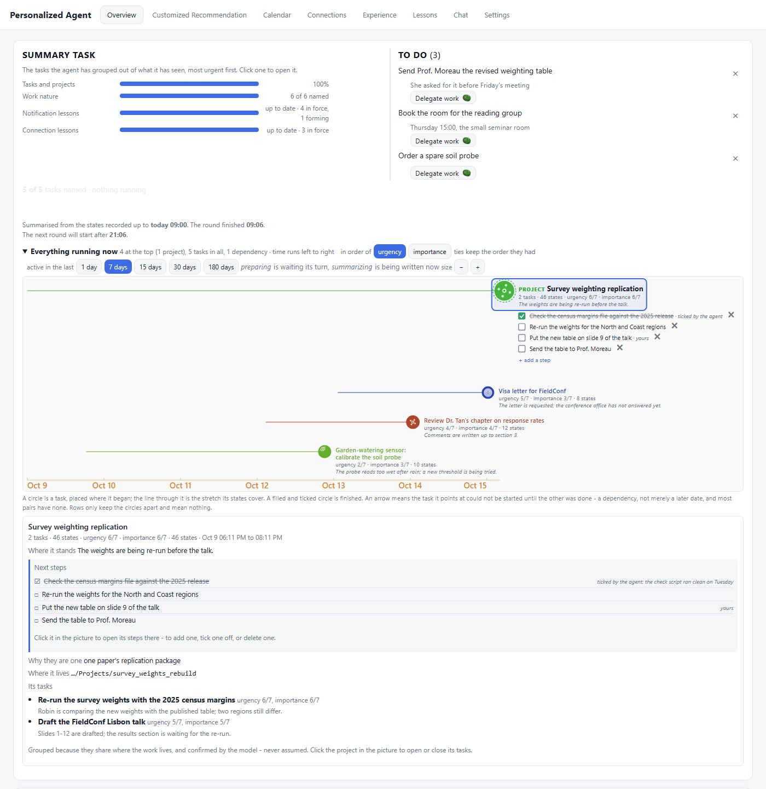<br>
  <sub>The Overview: your projects over the last week, longest worked on first and leisure apart, one opened to read it, and your To do list.</sub>
</p>

**Calendar and notifications that learn from you.** It adds reminders it
thinks you need (an invitation in an email, a deadline in a document) and
says why each was worth interrupting you for. Every notification's buttons say
exactly what they do: *Got it*, *Remind me in N minutes*, *Add to to-do*, or
*Bad notification*. What you do with them, and only what *you* do, teaches it
which notifications to send next time.

<p align="center">
  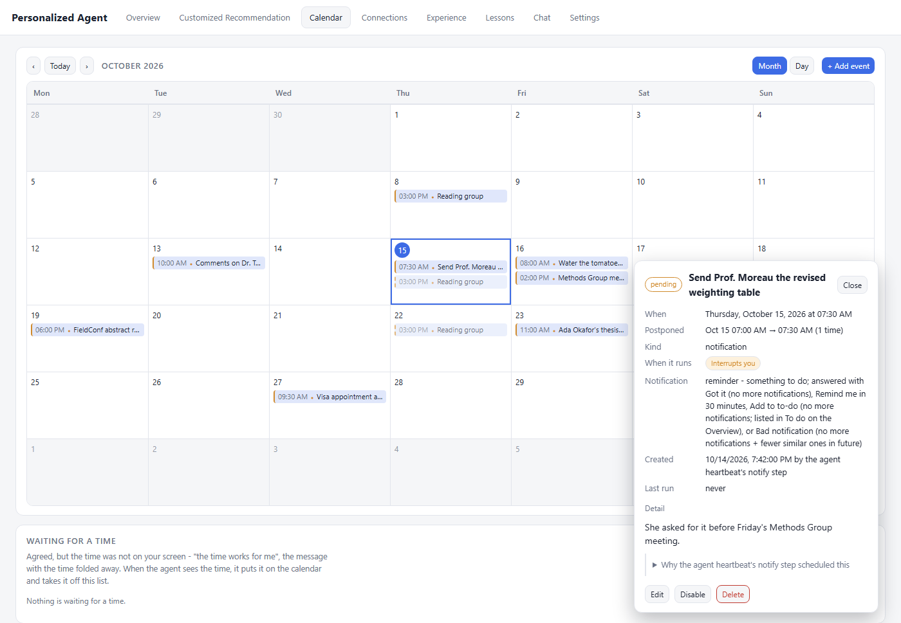<br>
  <sub>A reminder the agent added: why it was scheduled, and when you postponed it.</sub>
</p>
<p align="center">
  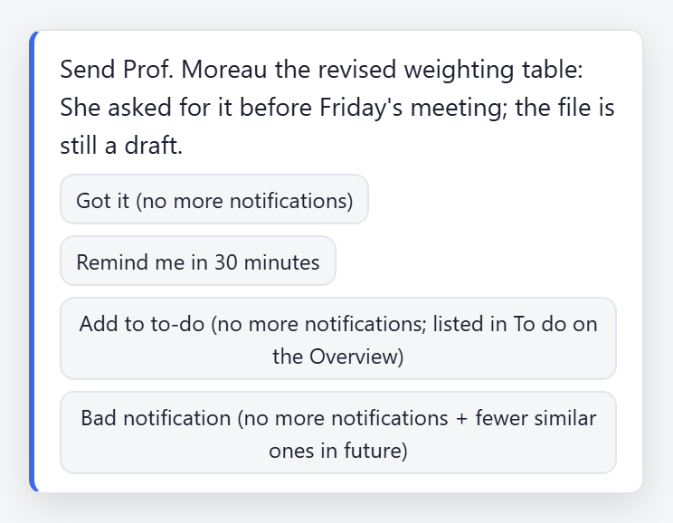<br>
  <sub>Every button on a notification says what it does.</sub>
</p>

**Delegate work.** Hand it a piece of work from wherever you are:

- right-click a folder, a file or the desktop → **Delegate work** (Windows;
  on Windows 11 it is under **Show more options**, or right-click with
  **Shift** held),
- select text in any window and click the small Watermelon button beside it,
- the avatar's menu, or the **Delegate work** button in To do.

<p align="center">
  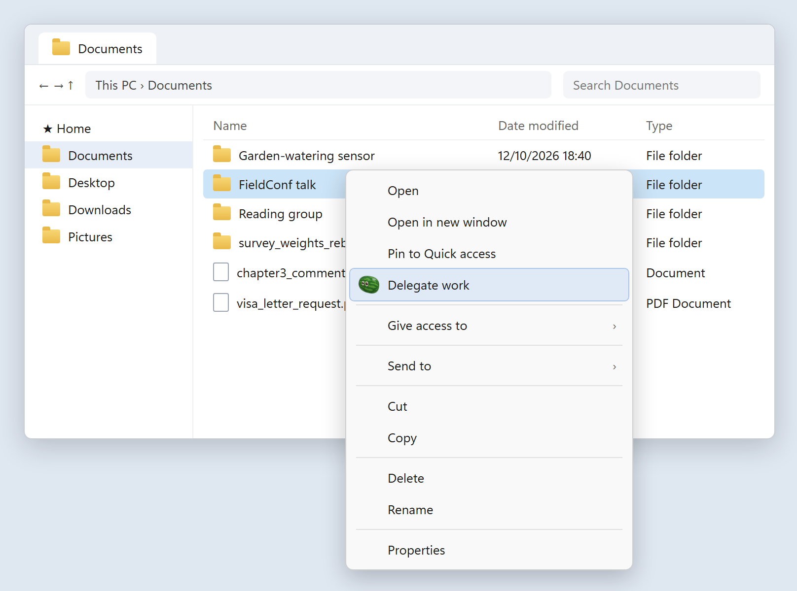<br>
  <sub>Right-click a folder → <b>Delegate work</b>.</sub>
</p>

A small **Delegate work** window opens, always in three steps:

1. **Your instruction.** What you handed over is shown, with a box for what
   you want done (or anything to add).
2. **Create.** It looks through its own records of your work for what is
   relevant, and drafts a short plan: the goal, the steps, what you will get,
   what is left out. You can change any of it.
3. **Start.** Nothing runs before you press it.

<p align="center">
  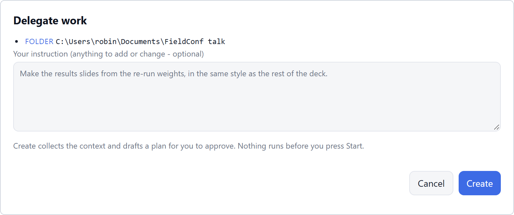
  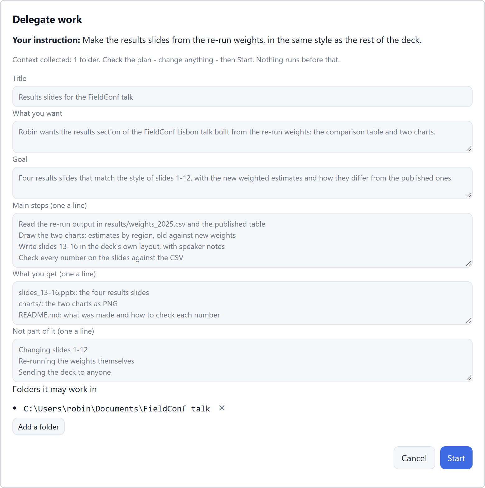<br>
  <sub>Left: your instruction for what was handed over. Right, after <b>Create</b>: the drafted plan, to change and then <b>Start</b>.</sub>
</p>

Two agents
then take turns, one doing the work and one reviewing it against how you
judge your own work. You see the run live, can pause or stop it, can go back
to any saved version, and get a `README.md` with the result saying what was
made and how to check it.

**Work.** Your projects, and what the agent learns from your own work. It
reads your Work projects, the folders you list, and your Claude Code and
Codex conversations - only the ones you had, never one a program started -
into cases: what you made, how, and how you judged it, with the reasons
behind those judgments. When the agents work for you, their reviewer asks
of these before it checks the work. Learning runs when you press **Update
now**, or by itself at the times you set; you can pause it and cap the
tokens it spends a day. A project can be handed to the agents from here.

<p align="center">
  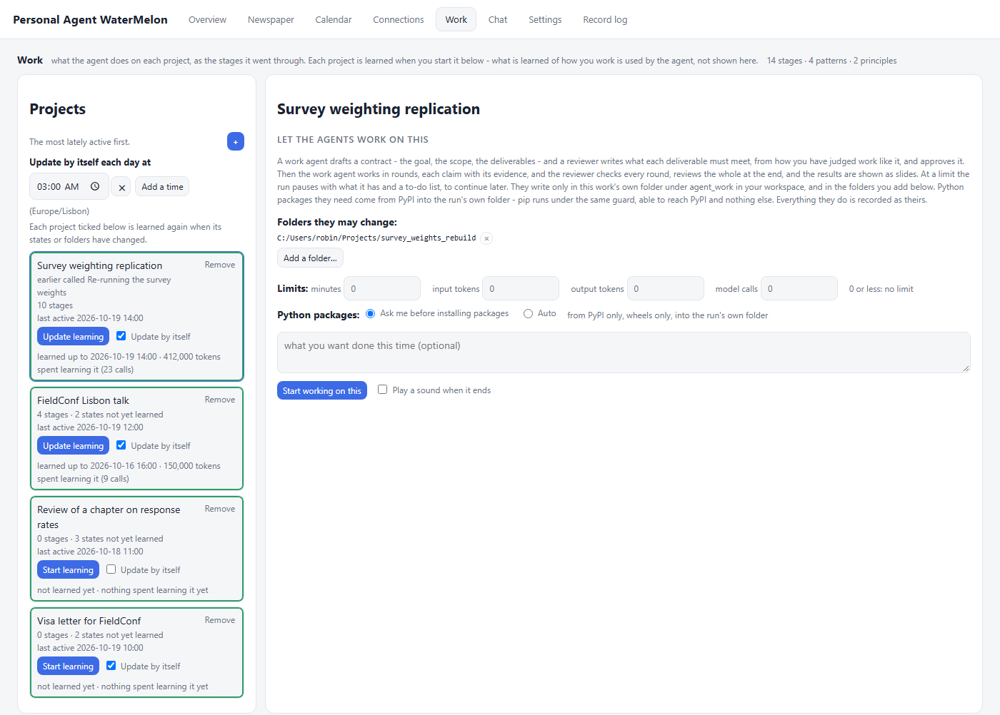<br>
  <sub>The Work tab: your projects, one opened to let the agents work on it, and below them Learning - an update going, where it reads, and what it spent.</sub>
</p>

**Connections.** The people in your work and what they are doing, from what
you had in front of you and from public pages only. It never signs in to
any of your accounts.

<p align="center">
  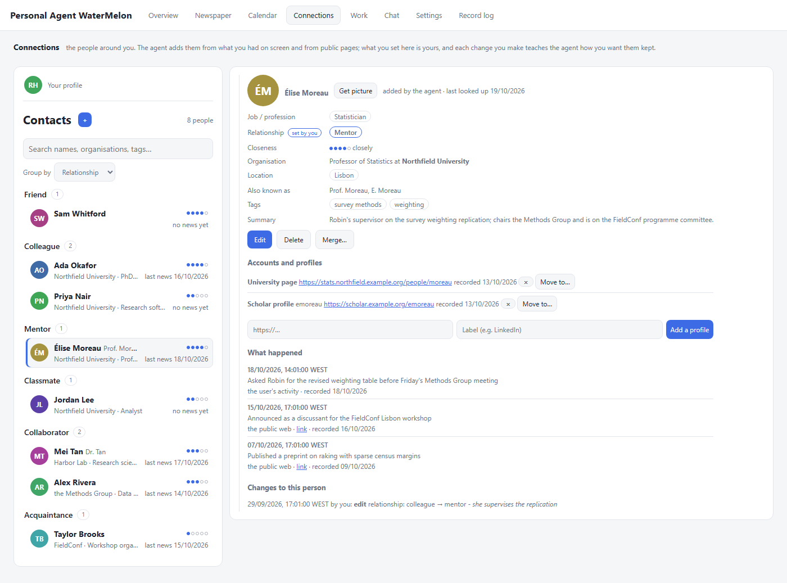<br>
  <sub>The people in your work, and one person's card: public profiles, what happened, and the changes you made.</sub>
</p>

**Newspaper.** Each day, things worth reading for your
current projects and interests, chosen to tell you something you do not already
know. *More like this* and *Not interested* tune it.

<p align="center">
  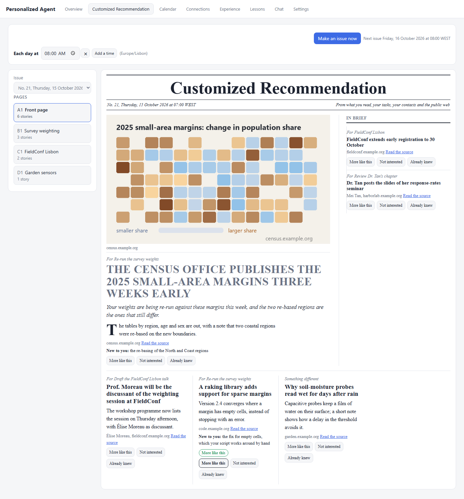<br>
  <sub>Today's issue: the front page, a page for each project, how each story ties to your work and what in it is new to you.</sub>
</p>

**Chat.** Ask it about your work, or ask it to do something. Files it makes
in a conversation are kept in `workspace/Chat/<conversation title>/`. The ×
beside a conversation in the list deletes it, after asking once; the files it
made stay.

<p align="center">
  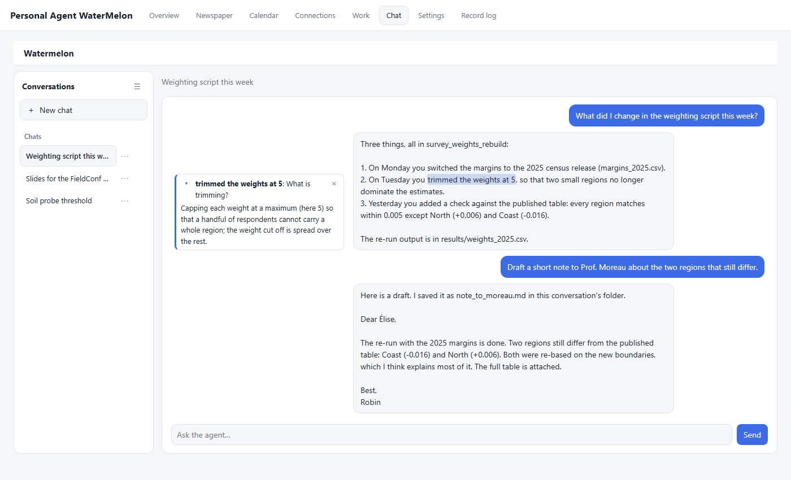<br>
  <sub>Ask about your work, or ask it to do something; select words in a reply to ask about them in the margin.</sub>
</p>

**The Watermelon.** A small avatar on your desktop. It shows notifications in
a speech bubble, looks at your pointer, and turns to face the middle of the
screen. You can rename it, move it, or hide it.

<p align="center">
  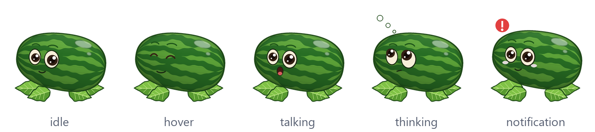
</p>
<p align="center">
  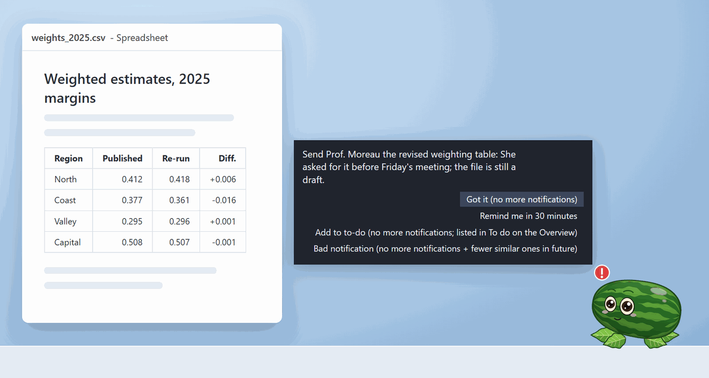<br>
  <sub>Its moods, and a notification in its speech bubble, waiting until you answer.</sub>
</p>

**In your language.** English, 中文, Español, 日本語, 한국어, Русский, Français,
Deutsch and Italiano, chosen when you install and changeable in Settings. The
whole interface changes with it: every tab, menu, button and explanation, the
avatar's and the tray's menus, and the notifications' buttons. The agent
writes and speaks in it too.

<p align="center">
  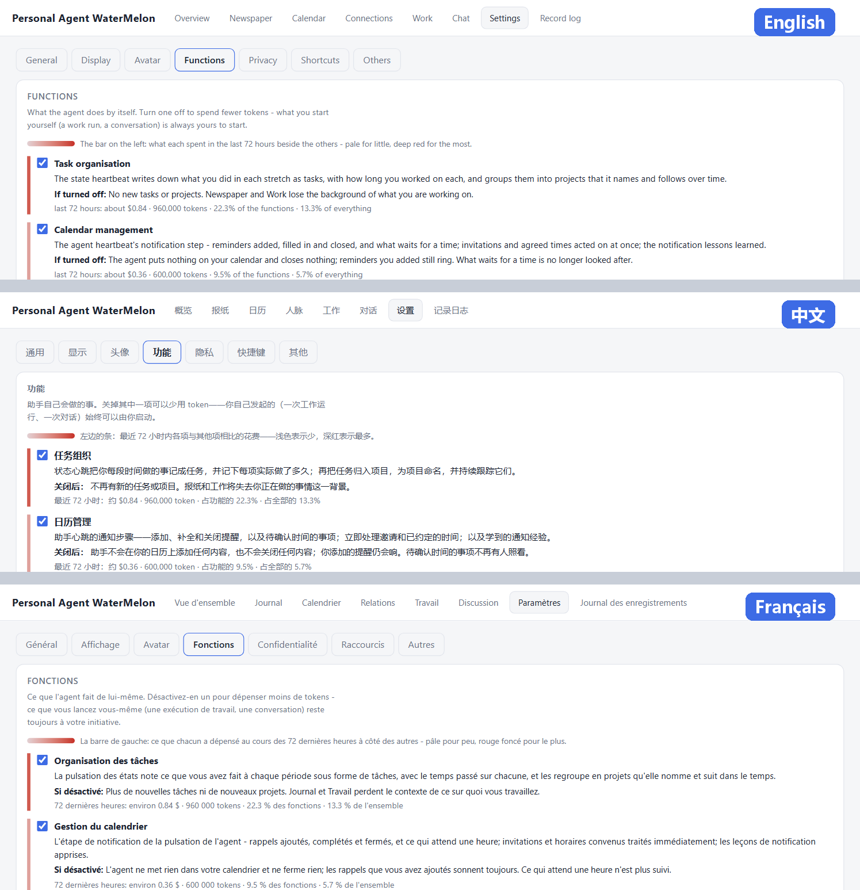<br>
  <sub>The same screen in English, 中文 and Français.</sub>
</p>

---

## Your privacy

An agent that sees your work has to earn that. Personal Agent is built so
that your data is **stored only on your computer** and **sent only to the
model you choose**, never to any server of ours or anyone else's. **You
choose what it watches and what it does**, passwords and codes are
**filtered out before anything is kept or sent**, and **it cannot act
outside the limits you set**. All of this comes from how it is built, not
from a promise.

### Stored only on your computer

- **No account, no server of ours, no telemetry.** There is no service your
  data is uploaded to, and nothing is collected about you or about how you
  use it.
- **Everything it keeps is in one folder you own** (`PersonalAgentWaterMelon/`;
  an installation from before v0.2.0 keeps `PersonalizedAgent/`):
  what it learned as plain Markdown files in `workspace/data/` that you can
  open, edit or delete, and its database and settings in `internal/`. Delete
  the folder, and everything it ever kept is gone.
- **Raw activity is short-lived.** What the listener records is deleted after
  8 days; only the short notes made from it are kept.
- **Comparing and reading happen on your computer**: the embedding model that
  groups your notes runs locally, and pictures and scanned documents are read
  by your system's own OCR.

### Sent only to the model you choose

To understand your activity, the agent has to show it to a model: every 15
minutes, the text it read in that window of time is sent to **the model you
picked** to be summarised, and so are your chat messages and the files a
piece of work uses. That model is your choice, in **Settings → Models**:

- **A service you trust**: Anthropic, OpenAI, Google, DeepSeek, Mistral or
  any other you add, under its own privacy terms; or the Claude Code or Codex
  tool already signed in on your computer.
- **A model on your own machine** (Ollama, LM Studio, or anything with an
  OpenAI-compatible address): then your activity is never sent to a model
  service. **The only thing that still goes out is web searches**:
  Connections and Newspaper look things up on the web on
  their own, with search words drawn from your current tasks and the people
  in them, so a search engine can see those topics. Turn those two off in
  Settings → Functions, and with a local model **nothing leaves your
  computer at all**.

Before anything is sent, the **smart filter** has already taken out
passwords, one-time codes and keys (see below).

### Exactly what leaves your computer

| What | Where to | When |
| --- | --- | --- |
| The text a step needs (a window of recent activity, your chat message, the files a piece of work uses), with passwords and codes already filtered out | **Only the model you chose**: nowhere, with a local model | When a step runs |
| Pictures | Only to a model that can see pictures | A model that reads text only gets the words, read locally |
| Web searches (the words come from your current tasks and the people in them) and the public pages they find | Brave Search (with your key) or DuckDuckGo, then the pages themselves, **with no cookies and no sign-in** | When Connections or Newspaper run (turn them off and they stop), or when a piece of work you started needs the web |
| One-time downloads | Hugging Face (the embedding model, once), Google (the testing browser), PyPI (packages a piece of work needs) | Only the first time, or **only when you click Install / Approve** |

### You choose what it watches

**Settings → Privacy** has one switch per source, each saying what the agent
loses without it and what it costs your computer:

- the window in front (which program, which title),
- the text in that window,
- screenshots (the words in slides and pictures),
- your browser's history,
- files created and changed,
- coding assistants' sessions, and, separately, what was said in them.

Beyond the switches:

- **Windows it never reads**: password managers, private and incognito
  browsing, authenticators, banking and payment pages, by default, and any
  you add.
- **Folders it never watches**, and the agent's own folders are never
  watched at all, so its work is never mistaken for yours.
- **The smart filter for passwords, one-time codes and keys** takes them out
  of everything the listener records (screen text, window titles,
  addresses, assistant conversations, the words read off a picture) **before
  it is stored or sent to any model**. It finds them by their labels, in all
  nine languages, and by the shapes keys and tokens have, on your computer,
  so no password is ever shown to a model to ask whether it is one. The
  value becomes `[hidden]` and the label stays, so the agent still knows a
  sign-in happened, not what was typed. A screenshot showing one is not kept
  at all. On by default (*Hide passwords and codes*).
- **Never its own folder.** The data folder is never listened to, whatever
  the list of excluded folders says; Settings shows it there, locked.

<p align="center">
  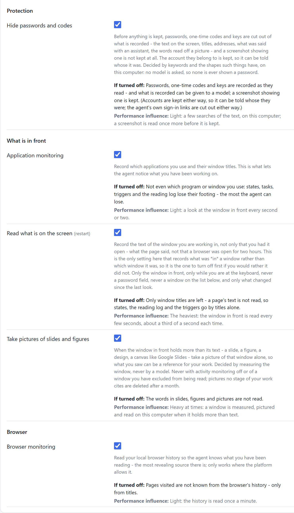<br>
  <sub>Settings → Privacy: one switch per source, each saying what the agent loses without it and what it costs your computer.</sub>
</p>

<p align="center">
  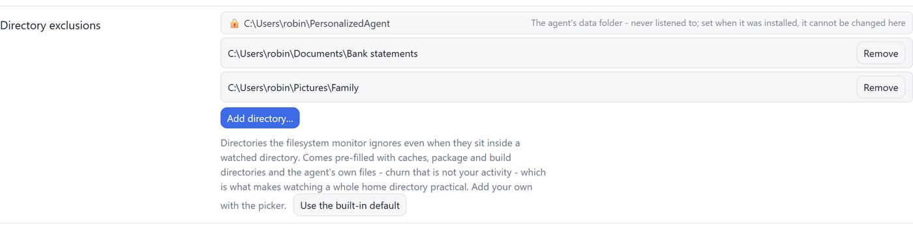<br>
  <sub>Settings → Others: the folders it never watches. Its own data folder is always first, locked.</sub>
</p>

### You choose what it does

**Settings → Functions** lists what runs by itself, each with its own switch
and **what it cost over the last 72 hours**:

- **Task organisation**: writing down what you did as tasks and grouping them into projects.
- **Calendar management**: notifications and reminders.
- **Connections**: the people in your work.
- **Newspaper**: the daily reading.
- **Work learning**: your own work read into cases and the reasons behind how you judge it.

Turn one off and it stops, along with its model calls. Only the core
(noting what you are doing) is always on, because everything else is built
on it. What you start yourself (chat, a piece of work) is counted apart.

<p align="center">
  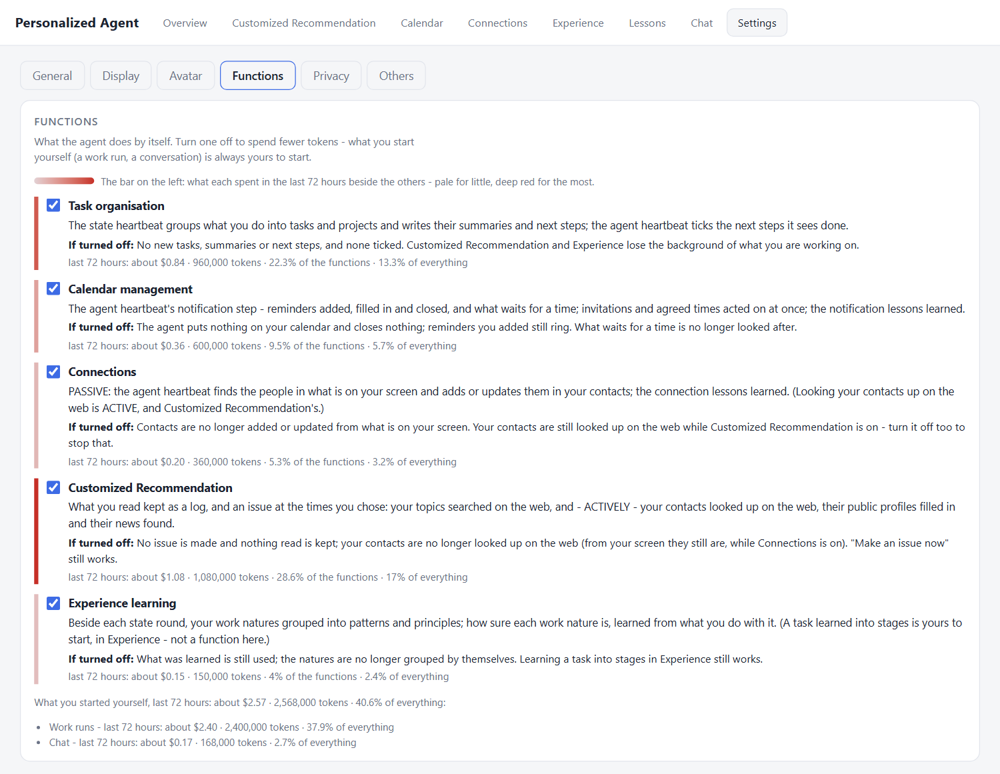<br>
  <sub>Settings → Functions: each with its own switch and what it cost over the last 72 hours.</sub>
</p>

### What it will never do

- **Sign in as you.** It never signs in to your accounts, never clicks
  anything in them, and never posts, sends or replies for you. What it knows
  about other people comes from what you had in front of you and from public
  pages.
- **Write anywhere you did not allow.** The agent writes only in its own
  workspace and in folders you add to a piece of work. This is enforced by
  code and, around every piece of code it runs, by the operating system's
  own sandbox (AppContainer on Windows, Seatbelt on macOS, bubblewrap on
  Linux). Your other files are read-only to it, and its own database and
  credentials are closed to it.
- **Start work by itself.** Every piece of work waits for your instruction
  and your approval of its plan.
- **Learn from itself.** Only what *you* do (a notification you call bad, an
  event or a person you delete, a story you are not interested in) changes
  what it learns about you.
- **Be reached by anything else.** Its page is served on `127.0.0.1` only,
  and answers only with this installation's key, so other programs and
  websites cannot read it.

### What you need

- Windows 10/11, macOS 11 or later (Apple Silicon), or Linux (x86-64).
- A model to think with: an API key for Anthropic (Claude), OpenAI, Google
  Gemini, DeepSeek, Kimi, Qwen, GLM, Mistral, OpenRouter or any
  OpenAI-compatible service, **or** the Claude Code or Codex command-line
  tool signed in on this computer. You add it in Settings → Models on first
  start. Several can be added in order; when one cannot answer, the next does.

---

## Install

The newest version is **[v0.2.11](https://github.com/fhbzc/Personal-Agent-WaterMelon/releases/tag/v0.2.11)**:

> **On Windows, with 0.2.7 or earlier: install this version yourself, once.** Updating from inside the program quit it and never came back - the installer was never started. Run the installer below over your copy: your data and settings stay. From 0.2.8 on, updates are quiet: made ready in the background, used at the next start.

| System | Installer (recommended) | Portable (no install) |
| --- | --- | --- |
| **Windows** 10/11, x64 | [PersonalAgentWaterMelon-Setup-windows-x64.exe](https://github.com/fhbzc/Personal-Agent-WaterMelon/releases/latest/download/PersonalAgentWaterMelon-Setup-windows-x64.exe) | [PersonalAgentWaterMelon-portable-windows-x64.zip](https://github.com/fhbzc/Personal-Agent-WaterMelon/releases/latest/download/PersonalAgentWaterMelon-portable-windows-x64.zip) |
| **macOS** 11+, Apple Silicon | [PersonalAgentWaterMelon-macos.dmg](https://github.com/fhbzc/Personal-Agent-WaterMelon/releases/latest/download/PersonalAgentWaterMelon-macos.dmg): open it and drag the app into Applications | [PersonalAgentWaterMelon-macos.pkg](https://github.com/fhbzc/Personal-Agent-WaterMelon/releases/latest/download/PersonalAgentWaterMelon-macos.pkg): an installer instead, which needs your password and cannot update itself |
| **Linux** x86-64 | [PersonalAgentWaterMelon-linux-x86_64.deb](https://github.com/fhbzc/Personal-Agent-WaterMelon/releases/latest/download/PersonalAgentWaterMelon-linux-x86_64.deb) | [PersonalAgentWaterMelon-linux-x86_64.AppImage](https://github.com/fhbzc/Personal-Agent-WaterMelon/releases/latest/download/PersonalAgentWaterMelon-linux-x86_64.AppImage) · [tar.gz](https://github.com/fhbzc/Personal-Agent-WaterMelon/releases/latest/download/PersonalAgentWaterMelon-portable-linux-x86_64.tar.gz) |

### Versions

Every version, the newest first. The program offers the latest release as an
update by itself.

| Version | Published | Status | Downloads |
| --- | --- | --- | --- |
| [v0.2.13](https://github.com/fhbzc/Personal-Agent-WaterMelon/releases/tag/v0.2.13) | 2026-10-29 | pre-release, being built | on [its release page](https://github.com/fhbzc/Personal-Agent-WaterMelon/releases/tag/v0.2.13) |
| [v0.2.11](https://github.com/fhbzc/Personal-Agent-WaterMelon/releases/tag/v0.2.11) | 2026-10-29 | release (the latest) | above, or on [its release page](https://github.com/fhbzc/Personal-Agent-WaterMelon/releases/tag/v0.2.11) |
| [v0.2.10](https://github.com/fhbzc/Personal-Agent-WaterMelon/releases/tag/v0.2.10) | 2026-10-29 | pre-release | on [its release page](https://github.com/fhbzc/Personal-Agent-WaterMelon/releases/tag/v0.2.10) |
| [v0.2.9](https://github.com/fhbzc/Personal-Agent-WaterMelon/releases/tag/v0.2.9) | 2026-10-28 | pre-release | on [its release page](https://github.com/fhbzc/Personal-Agent-WaterMelon/releases/tag/v0.2.9) |
| [v0.2.8](https://github.com/fhbzc/Personal-Agent-WaterMelon/releases/tag/v0.2.8) | 2026-10-27 | release | [Windows](https://github.com/fhbzc/Personal-Agent-WaterMelon/releases/download/v0.2.8/PersonalAgentWaterMelon-Setup-windows-x64.exe) · [macOS](https://github.com/fhbzc/Personal-Agent-WaterMelon/releases/download/v0.2.8/PersonalAgentWaterMelon-macos.dmg) · [Linux](https://github.com/fhbzc/Personal-Agent-WaterMelon/releases/download/v0.2.8/PersonalAgentWaterMelon-linux-x86_64.deb) · [all files](https://github.com/fhbzc/Personal-Agent-WaterMelon/releases/tag/v0.2.8) |
| [v0.2.7](https://github.com/fhbzc/Personal-Agent-WaterMelon/releases/tag/v0.2.7) | 2026-10-26 | release | [Windows](https://github.com/fhbzc/Personal-Agent-WaterMelon/releases/download/v0.2.7/PersonalAgentWaterMelon-Setup-windows-x64.exe) · [macOS](https://github.com/fhbzc/Personal-Agent-WaterMelon/releases/download/v0.2.7/PersonalAgentWaterMelon-macos.dmg) · [Linux](https://github.com/fhbzc/Personal-Agent-WaterMelon/releases/download/v0.2.7/PersonalAgentWaterMelon-linux-x86_64.deb) · [all files](https://github.com/fhbzc/Personal-Agent-WaterMelon/releases/tag/v0.2.7) |
| [v0.2.6](https://github.com/fhbzc/Personal-Agent-WaterMelon/releases/tag/v0.2.6) | 2026-10-24 | release | [Windows](https://github.com/fhbzc/Personal-Agent-WaterMelon/releases/download/v0.2.6/PersonalAgentWaterMelon-Setup-windows-x64.exe) · [macOS](https://github.com/fhbzc/Personal-Agent-WaterMelon/releases/download/v0.2.6/PersonalAgentWaterMelon-macos.dmg) · [Linux](https://github.com/fhbzc/Personal-Agent-WaterMelon/releases/download/v0.2.6/PersonalAgentWaterMelon-linux-x86_64.deb) · [all files](https://github.com/fhbzc/Personal-Agent-WaterMelon/releases/tag/v0.2.6) |
| [v0.2.5](https://github.com/fhbzc/Personal-Agent-WaterMelon/releases/tag/v0.2.5) | 2026-10-24 | pre-release | on [its release page](https://github.com/fhbzc/Personal-Agent-WaterMelon/releases/tag/v0.2.5) |
| [v0.2.4](https://github.com/fhbzc/Personal-Agent-WaterMelon/releases/tag/v0.2.4) | 2026-10-23 | pre-release | on [its release page](https://github.com/fhbzc/Personal-Agent-WaterMelon/releases/tag/v0.2.4) |
| [v0.2.3](https://github.com/fhbzc/Personal-Agent-WaterMelon/releases/tag/v0.2.3) | 2026-10-23 | release | [Windows](https://github.com/fhbzc/Personal-Agent-WaterMelon/releases/download/v0.2.3/PersonalAgentWaterMelon-Setup-windows-x64.exe) · [macOS](https://github.com/fhbzc/Personal-Agent-WaterMelon/releases/download/v0.2.3/PersonalAgentWaterMelon-macos.dmg) · [Linux](https://github.com/fhbzc/Personal-Agent-WaterMelon/releases/download/v0.2.3/PersonalAgentWaterMelon-linux-x86_64.deb) · [all files](https://github.com/fhbzc/Personal-Agent-WaterMelon/releases/tag/v0.2.3) |
| [v0.2.2](https://github.com/fhbzc/Personal-Agent-WaterMelon/releases/tag/v0.2.2) | 2026-10-23 | pre-release | on [its release page](https://github.com/fhbzc/Personal-Agent-WaterMelon/releases/tag/v0.2.2) |
| [v0.2.1](https://github.com/fhbzc/Personal-Agent-WaterMelon/releases/tag/v0.2.1) | 2026-10-22 | release | [Windows](https://github.com/fhbzc/Personal-Agent-WaterMelon/releases/download/v0.2.1/PersonalAgentWaterMelon-Setup-windows-x64.exe) · [macOS](https://github.com/fhbzc/Personal-Agent-WaterMelon/releases/download/v0.2.1/PersonalAgentWaterMelon-macos.dmg) · [Linux](https://github.com/fhbzc/Personal-Agent-WaterMelon/releases/download/v0.2.1/PersonalAgentWaterMelon-linux-x86_64.deb) · [all files](https://github.com/fhbzc/Personal-Agent-WaterMelon/releases/tag/v0.2.1) |
| [v0.2.0](https://github.com/fhbzc/Personal-Agent-WaterMelon/releases/tag/v0.2.0) | 2026-10-21 | release | [Windows](https://github.com/fhbzc/Personal-Agent-WaterMelon/releases/download/v0.2.0/PersonalAgentWaterMelon-Setup-windows-x64.exe) · [macOS](https://github.com/fhbzc/Personal-Agent-WaterMelon/releases/download/v0.2.0/PersonalAgentWaterMelon-macos.dmg) · [Linux](https://github.com/fhbzc/Personal-Agent-WaterMelon/releases/download/v0.2.0/PersonalAgentWaterMelon-linux-x86_64.deb) · [all files](https://github.com/fhbzc/Personal-Agent-WaterMelon/releases/tag/v0.2.0) |
| [v0.1.0](https://github.com/fhbzc/Personal-Agent-WaterMelon/releases/tag/v0.1.0) | 2026-10-16 | release | [Windows](https://github.com/fhbzc/Personal-Agent-WaterMelon/releases/download/v0.1.0/PersonalizedAgent-Setup-windows-x64.exe) · [macOS](https://github.com/fhbzc/Personal-Agent-WaterMelon/releases/download/v0.1.0/PersonalizedAgent-macos.dmg) · [Linux](https://github.com/fhbzc/Personal-Agent-WaterMelon/releases/download/v0.1.0/PersonalizedAgent-linux-x86_64.deb) · [all files](https://github.com/fhbzc/Personal-Agent-WaterMelon/releases/tag/v0.1.0) |

Every release also has **`SHA256SUMS.txt`**, the checksum of each file; see
[Check that a download is genuine](#check-that-a-download-is-genuine).

**Updates.** Once a day the program looks for newer releases here and tells
you. **Settings → General → Updates** lists every newer version with what it
says is new; press **Install this version** on the one you want, and it is
downloaded, checked against that release's `SHA256SUMS.txt`, and installed -
never while a piece of work is running - and the program starts again on it
and shows what is new. Only published releases count: nothing reaches you
from the code until it is released. You can instead have the newest
installed by itself (also a box in the Windows installer, unticked), or
nothing looked for. The Windows installer, the macOS app dragged in from the
`.dmg` and the Linux AppImage update themselves; the portable folder, the
`.deb` and the macOS `.pkg` are told there is a new version and where it is.

### Installer or portable?

They are the **same program**, built from the same commit by the same
workflow. Only how it gets onto your computer differs.

| | Installer | Portable |
| --- | --- | --- |
| How | Run it. It asks for your language and where to keep your data, installs, and adds a Start menu / Applications entry | Unzip anywhere and run `PersonalAgentWaterMelon` |
| Language, start at sign-in, Explorer's *Delegate work* entry | Set up by the installer | Set up by the program on its first start |
| Removing it | Uninstall from Settings → Apps (Windows) or the usual way; the extra entries go with it | Delete the folder. Turn off *Start at sign-in* in Settings first, or the entry stays |
| Best for | Most people | Trying it out, or keeping it on a USB drive |

**Your data folder.** The installer asks where to keep your data: one folder
for everything the agent learns and makes.

- **By default it is the folder this copy used before** - and for a copy
  installed anew, a `data` folder inside the program's folder. A folder
  that needs administrator rights to write to (Program Files, the Windows
  folder) cannot be used, because the program works as you, without them: the
  installer says so and will not go on until you choose another.
- **Choose an empty folder, or one that holds only an earlier Personal
  Agent's data** (its `workspace` and `internal` folders). Everything in the
  data folder belongs to the agent and is never listened to, so a folder with
  other things in it (Documents, a whole drive, a project) would hide the
  work kept there. The installer refuses such a folder, and the program will
  not start in one.
- **Reusing earlier data:** every folder found that already holds the
  agent's data is listed under the box, each with when it was last used and
  its size; click one to use it. Nothing else is chosen for you, so a copy
  installed to try something never takes the data of the one you use. If the
  folder in the box holds an earlier agent's data, the installer asks whether
  to use it; say No and pick another folder. An update always keeps the
  folder you use.
- **A different folder is a different agent**, with its own calendar,
  contacts and keys, so you can try a new version on a fresh folder without
  touching your usual one.
- Uninstalling never deletes the agent's data: the data folder stays where
  it is, even inside the program's folder (for a copy installed with the
  0.2.11 installer or later; a copy that updated itself gets this by running
  the installer over it once). The program's own folder cannot be the data
  folder.
- **Where your API keys are kept.** On Windows, in Windows' own credential
  store. On macOS and on Linux without a keyring, they are kept encrypted in the data folder, with the key that
  opens them beside them. So keep that folder out of iCloud Drive, Dropbox
  and other synced folders, and don't send it to anyone whole.
- **One copy starts at sign-in.** If another copy of the program already
  does (one run from the source, say), the installer's last page will not
  finish with *Start at sign-in* ticked, and Settings will not save it on,
  until you untick it or turn it off in the other copy.

Neither contains the developer **Debugger** tabs; see
[Build it from source](#build-it-from-source) if you want them.

### First start: the "unknown publisher" warning

The Windows build is **not code-signed** (that needs a paid Windows
certificate), so Windows warns once. The macOS build is signed by Apple:

- **Windows.** SmartScreen shows *"Windows protected your PC"*. Click
  **More info → Run anyway**. Some antivirus programs are wary of unsigned
  Python applications; you can check the file as below.
- **macOS.** From v0.2.13 the app, the `.dmg` and the `.pkg` are signed with
  an Apple Developer ID and notarized by Apple: they open with no warning.
  (Up to v0.2.11: *"Apple cannot check it"* - right-click the app or the
  `.pkg` → **Open** → **Open**.) Then **Settings → Privacy →
  macOS permissions** lists what macOS needs you to allow, with a button to
  each; allow **Full Disk Access** first, and macOS will not ask about your
  Desktop, Documents and Downloads folders one by one. Up to v0.2.2 macOS
  forgot these permissions after each update, and the same page shows which
  to allow again. From v0.2.3 the app is signed with the project's own
  certificate, the same for every version, so they stay on after an update;
  coming to v0.2.3 from an earlier version, allow them once more. From
  v0.2.13 it is signed by Apple's Developer ID: coming from an earlier
  version, macOS sees a new developer once - allow them one last time, and
  they stay on through every update after.
- **Linux.** No warning. For the AppImage, `chmod +x` it first.

Nothing about the program depends on being signed. To know the file is the
one built from this code, check it.

---

## Check that a download is genuine

Two checks, the second stronger than the first.

**1. The checksum: is this the file that was published?** Compare your
download with `SHA256SUMS.txt` from the same release:

```powershell
# Windows (PowerShell)
Get-FileHash .\PersonalAgentWaterMelon-Setup-windows-x64.exe -Algorithm SHA256
```
```bash
# macOS
shasum -a 256 PersonalAgentWaterMelon-macos.pkg
# Linux
sha256sum PersonalAgentWaterMelon-linux-x86_64.deb
# or check every file you downloaded at once
sha256sum --check --ignore-missing SHA256SUMS.txt
```

The value must match the line for that file exactly. (SHA-256, not MD5: MD5
can be forged, so a matching MD5 proves little.)

**2. The build attestation: was this file built from this source code?**
Every release file is built by GitHub Actions from the tagged commit, in the
open, and GitHub signs a statement of which commit and which workflow made
it. With the [GitHub CLI](https://cli.github.com/):

```bash
gh attestation verify PersonalAgentWaterMelon-Setup-windows-x64.exe --repo fhbzc/Personal-Agent-WaterMelon
```

It prints the commit the file was built from; open that commit on GitHub to
read the exact code. You can also read the build's log under the repository's
**Actions** tab.

> **Why not rebuild it and compare?** A build of a Python application with
> PyInstaller is not byte-for-byte reproducible (it records build times and
> paths), so a file you build yourself will have a different checksum even
> from identical code. The attestation is what ties the published file to the
> code.

---

## Using it

1. **Start it.** The Watermelon appears on your desktop and the app opens in
   your browser (an address on `127.0.0.1` only your computer can reach). The
   tray icon brings it back.
2. **Add a model.** Settings → Models → **Add**. Put the one you prefer
   first.

   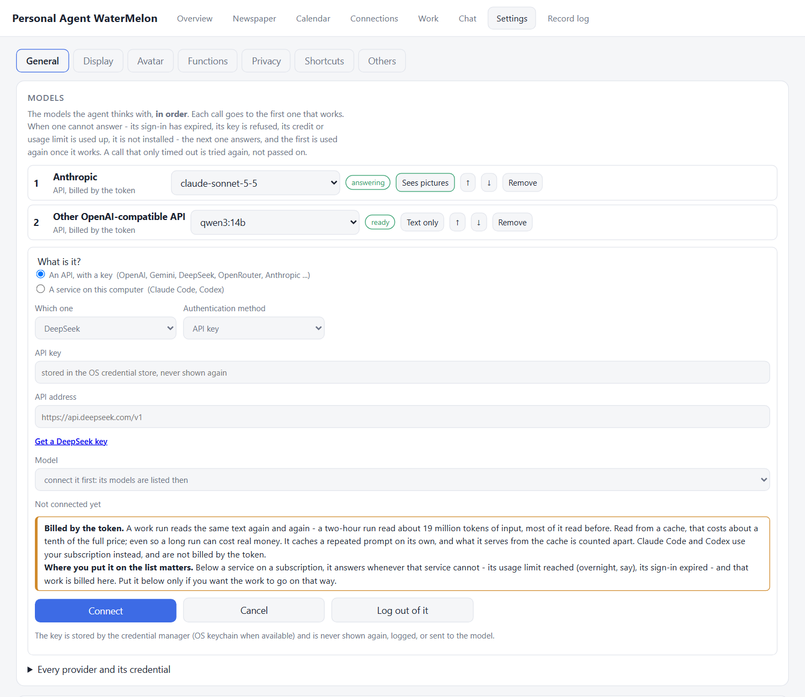

3. **Choose what it may notice.** Settings → Privacy. Each source (the window
   in front and its text, screenshots, browser history, files, coding
   assistants' sessions) can be switched off, each with what is lost without
   it and what it costs the computer. Passwords and one-time codes are hidden
   before anything is kept.
4. **Let it watch for a while.** After an hour or so the Overview shows what
   you were doing. Tasks and projects appear after the first grouping round.
5. **Hand it work.** Use any of the *Delegate work* entries. In the window
   that opens, say what you want and click **Create**; it collects the
   context and drafts a plan. Check the plan, change what you like, and click
   **Start**. Nothing runs before that. Without a folder, it works in
   `workspace/agent_work/<name of the work>/`. Follow it in the Work
   tab.
6. **Tell it when it gets things wrong.** *Bad notification*, *Not
   interested*, deleting a person or an event: each is kept as a lesson, and
   only your own actions change what it learns.

Where things are. The data folder is chosen when you install it (on
Windows a `data` folder inside the program's folder by default) or, from
source, with
`python run.py --root <folder>`; Settings → General shows it, and the
listener never reads it:

```
PersonalAgentWaterMelon/
├── workspace/          everything the agent makes, and the only place it may write
│   ├── agent_work/     work you delegated, one folder each
│   ├── Chat/           files made in chat, one folder per conversation
│   └── data/           what it learned: states, tasks, your nature, as plain files
└── internal/           its database, settings and logs; the agent cannot touch it
```

---

## Build it from source

You need Python 3.10 or later (3.12 recommended) and Git.

```bash
git clone https://github.com/fhbzc/Personal-Agent-WaterMelon.git
cd Personal-Agent-WaterMelon
python -m venv .venv
# Windows: .venv\Scripts\activate     macOS/Linux: source .venv/bin/activate
pip install -r requirements.txt
```

**Run it without building:**

```bash
python run.py
```

**Build the program and its installer:**

```bash
pip install pyinstaller
python build.py                    # with the Debugger tabs (a developer's build)
python build.py --no-debugger      # without them: the same as the released downloads
```

> **The Debugger.** The released installers and portable downloads are built
> **without** the Debugger: the panels that show every model call, token use,
> what each step was given, and test runners. A build from source **includes
> it unless you add `--no-debugger`**. It is a build-time choice, not a
> setting: a build without it does not contain the panels, the routes, or the
> code.

The result is in `dist/<platform>/`:

| Platform | What `build.py` makes | Also needs |
| --- | --- | --- |
| Windows | `PersonalAgentWaterMelon.exe` in a folder, a portable `.zip`, and `PersonalAgentWaterMelon-Setup.exe` | [Inno Setup 6](https://jrsoftware.org/isinfo.php) for the installer |
| macOS | `Personal Agent WaterMelon.app`, a `.dmg` and a `.pkg` | Xcode command-line tools |
| Linux | a folder, a `.tar.gz`, a `.deb` and an AppImage | `dpkg-deb`, `appimagetool` |

Other options: `--fast` (skip the tests and checks), `--no-installer`
(only the program folder), `--platform windows|macos|linux`.

**Run the tests:** `python scripts/run_tests.py`.

**Changed what a screen says?** Every text of the interface is in a fixed
table for each language (`personalized_agent/api/web/lang/`). Run
`python scripts/interface_words.py` to list what is missing, translate it into
every language, and merge it with `--merge`; a test fails until each table
has it.

---

## Update log

The newest version first. Each earlier version links to its release, where
everything it changed is written down.

### [v0.2.13](https://github.com/fhbzc/Personal-Agent-WaterMelon/releases/tag/v0.2.13) (2026-10-29, a pre-release)

- **The Mac app is signed by Apple and notarized.** The app, the .dmg and the .pkg carry an Apple Developer ID and Apple's notarization: they open without the "Apple cannot check it" warning, and what macOS allows the agent - Accessibility, Screen Recording, Full Disk Access - stays allowed through every update. Coming from an earlier version, macOS sees a new developer once: allow those permissions one last time (Settings → Privacy → macOS permissions shows which).
- **The installed app's work runs more than Python.** Commands - R, Stata, Node, git, a build, anything installed on your computer - run in the installed app too, as they did from the source, kept to the work's own folder by your system's sandbox. Python a piece of work starts runs under the same guard as the work itself.
- **Work you hand over almost done is finished, not redone.** The plan starts from what is already there: what exists and works is listed as already there and used as it is, and only what remains is planned. A replication handed over nearly complete had been split into ten parts and nineteen rounds.
- **Each round's review checks that round's part.** It no longer runs every promise of the whole work again each round. The whole work is run once, at the end, from scratch, by a tester who never saw how it was built - and the final full review and the quality check use that run instead of running it all again.
- **Each finished part is a version** you can go back to. A full review in the middle is made only when the reviewer has a reason, never just to see whether the work is done.
- **Fixes at the end go on while they help.** What the end finds is fixed in rounds that continue as long as each one leaves less broken - stopping after three rounds that change nothing, and after ten in all.
- **Codex: "Refresh models" works like a restart.** Codex is looked for again (on the PATH as Windows has it now), and asked again whether it is signed in - quitting the app is no longer needed when it shows as not connected. Where it was found, whether it is signed in and in how long, and why a call failed are written to the log.
- **Claude Code: "Check again".** The same for Claude Code and the Claude desktop app - and when the client has been updated, it is asked which model each of its names means, so new models appear in the list. That costs four tiny requests, only when the version changed and you click it; never by itself.

### [v0.2.11](https://github.com/fhbzc/Personal-Agent-WaterMelon/releases/tag/v0.2.11) (2026-10-29)

- **Your earlier data is offered when you install.** Where the agent keeps its data is asked when it is installed, and on a computer whose data was kept elsewhere - in your user folder, as versions before 0.2.0 did - the installer suggested a new, empty folder, and the agent came up as if new. Now every folder that already holds the agent's data is listed under the box, each with when it was last used and how big it is, and you choose one with a click. The box starts at the folder this same copy used before; nothing else is chosen for you, so a copy installed to try something never takes the data of the one you live with. An update always keeps the folder you use.
- **Uninstalling never deletes your data** - for a copy installed with this version's installer or a later one. It already left the data folder, but only the one it had been told about: had that note beside the program gone missing, the default data folder went with the program. Now no folder holding the agent's data is ever deleted, and the program's own folder can no longer be chosen as the data folder. A copy that updated itself keeps the uninstaller it was installed with; to get the new one, run this installer over it once (your data and settings stay).
- **The work agent finds its way in code.** A new search gives the lines that hold a word - a function's name, say - with their file and line numbers and the lines around them, and where each function or section probably ends. Reading a file can then start and stop at those lines, instead of reading whole files into the agent's memory.
- **Finding files is fast again.** A search for files by name no longer goes through installed environments, saved versions and caches: on a project folder of some 70,000 files, a search that took a minute and a half takes six seconds.
- **Searching your files is fast again.** A search of your own files could take most of a minute when what it found was in a very long conversation record: the whole record was read to show six lines of it. Now each piece is read from where it is, in a twentieth of a second. Your index learns where each piece is at its next update.
- Smaller things: a file's lines are counted from 1 everywhere the agent is told about them; a work handover note says which parts of which files were read, so the next call reads only those.

### [v0.2.10](https://github.com/fhbzc/Personal-Agent-WaterMelon/releases/tag/v0.2.10) (2026-10-29, a pre-release)

- **Work runs much faster on big projects.** A step no longer looks at every file of the work's folder before and after the code runs: what changed is heard as it changes. On a replication project whose folder had grown to some 47,000 files, that look alone took about half a minute of every step.
- **Environments are not the work.** A Python environment the agent made in the work's folder - to try an install from scratch - is left out of everything that goes through the folder: what changed, saved versions, reviews, going back to a version. The reviewers are told it is there, to judge whether it belongs in what you get, and the agent is told to make such environments in its scratch space and remove them after.
- **The builder hands over before it slows down.** One long call of the work agent grew slower with every step. Now, after 40 steps or 15 minutes of the model's own thinking (not time spent waiting for code to run), it writes a short handover note and a fresh call carries on from it.
- **Packages ready before they are needed.** The packages a piece of work will need are installed in the background as soon as its plan is approved.
- **The same code on the same files is not run twice.** A result is given again when exactly the same code runs on exactly the same files - and the agent is told so, and can run it anew.
- **The reviewer's separate checks run side by side** - the quality and privacy checks at the end, and the cards of a large review.
- **Quitting or updating keeps your place.** A run going when the app closes saves where it is first; Continue goes on from there.
- **One button to go on.** A run that has ended has one "Continue from here", with where to go on from chosen beside it: the most recent checkpoint, the progress point, or any earlier version. Resume is only for a paused run.
- **Learning starts at once.** Give an address, a passage, a folder or a file, and if you like what to learn from it - learning starts, with no plan to check first. A site, an account or a folder holding several pieces of work is split into them by the agent, guided by your words. Two daily limits, on what is read and what is written, both off by default.
- **The Learning panel**: its settings on top, and what it learns from, has learned and spent folded below them.
- Smaller things: the limits shown while a run goes line up with their boxes; each tool step's time is recorded in the run's log.

### [v0.2.9](https://github.com/fhbzc/Personal-Agent-WaterMelon/releases/tag/v0.2.9) (2026-10-28, a pre-release)

- **A model's own search, always.** Claude Code and Codex search the web with their own search, every time - there is no "Search with" setting any more - and are never given the app's beside it. (Codex, given both, picked the app's, met DuckDuckGo's human check, and gave up as if nothing were there.) Models without a search of their own, such as an API like DeepSeek, use the app's.
- **Chat can look things up.** Ask about the weather, a release, a page: Chat searches and reads public pages, as work does, held to the same checks. What it searched for and read is kept with its reply, and the agent's heartbeat reads it beside the reply.
- **Codex's search works on Windows where npm put it deep.** Installed through WinGet's Node, Codex's search could not start - its helper's path was too long for Windows - and it answered without searching. The agent now starts it from a short path of its own (the same files, no extra space).
- **Pages on any site.** A page the model names on a site it has not seen yet may be opened when its address carries nothing of yours - a few on each new site. An article's address, words joined by hyphens, is no longer taken for a key. When an address is refused, the reason says what to do instead.
- **On a Mac, the avatar on your desktop, not on a dark square.** With Python's own Tk it is now drawn by macOS itself, clear around it, and costs less to draw. (Contributed in PR #5.)
- **A Chat conversation is kept whole as material.** Where the heartbeat cites a message of yours from Chat, your message and the reply are both kept with what it learned.

### [v0.2.8](https://github.com/fhbzc/Personal-Agent-WaterMelon/releases/tag/v0.2.8) (2026-10-27)

> **On Windows, with 0.2.7 or earlier: install this version yourself, once.**
> Updating from inside the program quit it and never came back - the
> installer it was to start was never started. Download the installer
> below and run it over your copy: your data and settings stay. From
> 0.2.8 on, updates are quiet: made ready in the background, used at the next start. (The program you have
> is not harmed: open it again, and it is as it was.)

- **Updates you do not notice.** Every update - one you choose in
  Settings, or one had by itself if you switch that on - is made ready in
  the background while you work: nothing stops, no installer window. It
  is used from the next start, or when you have been away a while and no
  work is running - a restart of a few seconds - or at once with "Restart
  now to use it". Only what changed is written; the rest is shared with
  the version you have. A version that does not start is taken back by
  itself, and you stay on yours. As before, by default you are told of a
  new version and choose it (Settings > General > Updates).
- **A restart you start, seen through.** After "Restart now", the page
  stays while the agent is closed and opens on the new version by itself,
  with what is new. Where an update still needs the installer (a copy
  installed for every user of the computer), its own progress window
  shows. If an update cannot be started, nothing is closed and the page
  says why.
- **Check now, without a notice.** What it finds is shown where you are
  looking; only a look the agent makes by itself tells you in a notice.
- **Token usage on the Overview shows again.** It was empty in every
  released build: it asked for what only a development build has.
- **Change a running piece of work's settings as it runs.** At the top of
  its live session, "Running with now" shows the way, the Python packages
  (Auto or Ask first), the sandbox, the sound at the end and the limits -
  and a change there is in effect at once, said in the session. Work's own
  settings are for the next start, and each piece of work keeps the ones
  it last ran with. Python packages are installed by themselves (Auto) by
  default.
- **Pause and Resume answer at once.** A run no longer seems stuck for a
  moment after Resume: the button says "Resuming…" as you click it, and
  the run hears it within a tenth of a second. A run that goes back to its
  progress point is shown as it does - in Work and in the to-do: "rolling
  back to its progress point: 3,200 of 7,856 files checked" - and checks
  its files in a fifth of the time. The Resume card says plainly where it
  goes on from, why, and this time's settings.
- **The 10-minute progress points are light, and shown.** Saving one no
  longer holds up the work - only what changed is read, beside the run -
  and each shows in the live session: "Saved a progress point". Points
  kept before this version show so too.
- **Each run's result, one click away.** Beside the logs, each run has a
  button that opens what it made - the folder, the file, the email draft.
- **Chat puts things on your calendar the same with Claude Code or Codex.**
  Both are now told the same of the agent's tools - Codex as its own
  developer instructions - and Chat is told what the application has
  (calendar, tasks, to-do, work, connections) so it takes none for another.
  A time not fully said is taken from the conversation, put on, and said
  back to you; it says an entry is on only once it is.
- **Work can fetch public code and data.** Files on GitHub, GitLab, PyPI,
  npm, jsDelivr, Zenodo and similar can be fetched without first being
  found by a search.
- **WeChat on a Mac, message by message from WeChat's own words.** WeChat
  4 tells a Mac its messages one by one, as on Windows: each is taken as
  written, and only whose it is is told from the picture - faster than
  reading the whole window, and without misread characters.

### [v0.2.7](https://github.com/fhbzc/Personal-Agent-WaterMelon/releases/tag/v0.2.7) (2026-10-26)

- **Hand work over from your to-do list, and follow it there.** "Delegate
  work" on a to-do collects the context and drafts a plan for you to
  check; the settings (the way, the limits, the sandbox, a sound) and
  where it works come first, and you can start at any step. Hand the same
  to-do over again and each time is a version of its own - V1, V2 - and
  "Work status" shows where each stands: being planned, going and what it
  is doing, paused, finished, stopped. Pause, Resume, Stop, Continue and
  opening the result all work from there, as in Work. A plan can be saved
  as a draft and opened again from Work's Drafts; the Delegate box floats,
  so you can drag it aside and read the page behind it.
- **Quick or thorough.** Every piece of work can be done the quick way -
  one model working with what it learned of you and able to search - or
  the thorough way, with a reviewer checking each round. The plan suggests
  one and says why; you choose. A quick run that finds the work too big
  can be carried on the thorough way.
- **What the work hands you, ready to use.** A result can be an email
  (opened as a draft in your Gmail or Outlook, or your mail app), an event
  (in your Google or Outlook calendar, or as a calendar file), text to
  paste, an answer, a file or a folder - each said before you open it.
- **Where it works.** "Add work directory" takes a folder or a single
  file; the work may change only what you added there, and is told so.
  Two pieces of work never change the same folder at once: the second
  waits, and says so.
- **Work is saved every 10 minutes.** A progress point is kept every ten
  minutes of work, in the middle of a round too, beside the versions
  (marked "not checked"). A run that stopped cleanly - Stop, or a limit -
  goes on from where it stopped. One that did not - the application
  closed, "Stop now", or a failure - shows Resume, and goes back to its
  last progress point or version. "Stop now" no longer ends a run as
  failed.
- **Work does more, and faster.** It can run commands and other programs
  inside the sandbox, download files and fetch git repositories and npm
  packages (asked first), edit notebooks, start up to three helpers, wait
  for a long job instead of checking on it, and reuse a test result when
  nothing it rests on changed. You can also let a piece of work run
  without the sandbox - it still never touches the agent's own data or
  your sign-ins.
- **Learning beyond your folders.** A new Learning tab lists everything
  the agent learns from: your folders, web pages, GitHub repositories,
  saved text and files - yours, or others' to learn from as references.
  Each can be switched on or off or deleted, and what you delete is never
  learned again. "Learn" sits beside "Delegate work" on selected text and
  in the right-click menu of a folder.
- **WeChat, message by message** (contributed). The messages in WeChat
  are kept one by one - whose each is, and in which conversation - and
  the same message seen again is kept once. On a Mac they are read by
  Apple Vision; on Windows from WeChat's own text; on Linux by RapidOCR.
- **Chats, mail and social media are followed closely.** While one is in
  front - an app, or a web mail, chat or social site in your browser - its
  window is looked at every 3 seconds and read only when it changed, so a
  message arriving is not missed; within a quarter of one processor core,
  and less often on battery. The lists and the pace are in Settings.
- **A smoother start.** Opening the conversation with a double click no
  longer freezes the agent's window for seconds, and the agent's first
  minute is left to the window.

### [v0.2.6](https://github.com/fhbzc/Personal-Agent-WaterMelon/releases/tag/v0.2.6) (2026-10-24)

- **Your file index is smaller, and is updated with learning.** The index
  of your files used to be walked again every time the agent started,
  which took minutes of the processor. It is now updated at the start of
  every learning update - one switch and one clock for both - and never
  when the agent starts. Each folder is walked once, even when another
  folder in the list lies inside it (such files were read twice before).
  A JSON file over 200 KB is found by its name only. A Claude Code or
  Codex conversation is kept as what was said and done: your words, the
  agent's replies, and one line for each tool it used (the tool and the
  file), not the code or what the tools gave back. Long conversations are
  now searchable too. After the first update the index file is made
  smaller; on one computer it went from 2.3 GB to under 1 GB.
- **Two progress bars in the Learning panel.** The file index has its own
  bar beside the learning's, with the folder it is reading; learning says
  it waits for the index instead of standing at 0%.
- **Way C in the Work debugger is given better context.** For each
  question the reviewer asks, up to five of your reasons that answer it,
  each with a line on how it applies here. Your past work is chosen the way
  reasons are: the closest by the job's terms, then judged for how alike
  each is and which question it answers, one per project. The contract is
  shown to the reviewer whole. The reviewer treats your past work as
  evidence of how you work, not as a standard to copy. Past files proposed
  as references are now chosen by the reviewer itself, with what to take
  from each and what not to.
- **The Work debugger keeps more of your records out of a test.** A record
  is left out by the files and conversations it rests on, not by the pages
  and windows around it.
- **Two debugger ways started together both start.** One of them could
  fail and show "not started"; a way that cannot start now says why.

### [v0.2.5](https://github.com/fhbzc/Personal-Agent-WaterMelon/releases/tag/v0.2.5) (2026-10-24, a pre-release)

- **The Work debugger keeps the agent's own work out of a test.** Every
  debugger project now leaves out the agent's own folder - its code, and
  the Claude Code and Codex conversations held there - beside the project's
  own: nothing learned from them reaches way C, and no way reads them. A
  way that searches your records no longer finds what was done in a folder
  left out either; before, it could find the notes of an earlier try's
  evaluation. Experience left out lists the agent's own folder.
- **Way C is given what bears on its questions.** For each question the
  reviewer asks, at most three of your reasons that answer it; those it did
  not ask about but you would expect, in a section of their own; one short
  example each. What was learned no longer comes cut off part-way: the
  cases most like the job are always there, and when they are long, only
  their judgments that bear on the questions. For a question about tools or
  a stack, the reviewer is pointed to what your past projects were made
  with, and to the project's files.
- **Your past work as a reference.** After the contract, way C may point a
  deliverable to a file or folder of yours from past work like it - a
  README, a report, a project laid out alike - with what to take from it.
  The work agent sees it on the card; only what is there and readable is
  given.
- **A debugger way that is starting says so.** Starting a way can take a
  minute or two: it said nothing meanwhile, showed its last run as ended,
  and a second Start came back "already going". It now shows that it is
  starting, and the other ways start beside it without waiting.
- **On a Mac the watermelon is there again** (as in v0.2.4): the Mac app is
  built with Tk 8.6.15, on which its clear window shows it.

### [v0.2.4](https://github.com/fhbzc/Personal-Agent-WaterMelon/releases/tag/v0.2.4) (2026-10-23, a pre-release)

- **On a Mac the watermelon is there again.** In v0.2.3 it was on a clear
  window that the Mac build's own drawing library (Tk 8.6.16) left empty:
  the watermelon could be clicked, and not seen. The Mac app is now built
  with the Tk on which a clear window shows it whole (8.6.15). On any other
  Tk it sits on a plain dark tile, so it is always seen.

### [v0.2.3](https://github.com/fhbzc/Personal-Agent-WaterMelon/releases/tag/v0.2.3) (2026-10-23)

- **The Claude desktop app is found on a Mac.** The desktop app keeps its
  own Claude Code in a folder for each version under Application Support;
  the program now looks there, and takes the newest version. In v0.2.2 the
  choice "Claude desktop app" said not available on a Mac.
- **The Record log can show one kind.** Show: files, text on the screen,
  conversations with Claude Code and Codex, web pages, switching between
  windows, or the agent's own work - the latest hundred of that kind. Most
  of the latest hundred of everything are switches between windows, which
  hold no more than a title.
- **On a Mac the permissions stay on across updates.** The Mac app is now
  signed with the project's own certificate, the same for every version, so
  Accessibility and Screen Recording, once switched on, stay on after an
  update. Coming from v0.2.2 or earlier, switch them on once more: in System
  Settings select Personal Agent WaterMelon, remove it with -, then switch it
  on again from Settings > Privacy, and open the program again. Settings now
  says this when a switch is on but the Mac still refuses. The app is not yet
  signed by Apple, so the first opening still asks to be allowed.
- **On a Mac the watermelon has no dark tile round it.** It is shown on a
  clear window, and can still be clicked.
- **On a Mac Hide and Show work.** After Hide, Show brought nothing back.

### [v0.2.2](https://github.com/fhbzc/Personal-Agent-WaterMelon/releases/tag/v0.2.2) (2026-10-23, a pre-release)

- **A piece of work starts and resumes wherever the program was started.**
  A program started with a double click on `run.py`, or by itself at sign-in,
  could not start any piece of work, nor resume one after an interruption:
  each failed on "No module named". It now finds itself wherever it was
  started from.
- **A piece of work that is slow to start is waited for.** Before it begins,
  a piece of work may first roll back a large folder, which can take minutes;
  the program gave up after 90 seconds and left it running where the page
  could neither follow nor stop it. It now waits while the work is getting
  ready, and ends one that never starts.
- **On a Mac the watermelon can be seen and clicked.** It sits on a plain
  dark tile instead of a see-through window, which showed it faint and let
  clicks fall through to what lay behind. The program has an icon in the
  Dock: click it, or open the program again, for the Overview. It stays above
  other windows, and right-click or Control-click opens its menu.
- **A Mac with the Claude desktop app no longer waits on it.** The program
  took the desktop app for the Claude Code command line, and each sign-in
  check waited twenty seconds for an answer that never came.
- **Learning shows what it has learned in numbers:** the places it reads,
  cases, judgments by strength, reasons in use and forming, terms.

### Earlier versions

- [v0.2.1](https://github.com/fhbzc/Personal-Agent-WaterMelon/releases/tag/v0.2.1) - learning reads only conversations you
  had and starts again once; removing deletes nothing; Check now looks
  at once.
- [v0.2.0](https://github.com/fhbzc/Personal-Agent-WaterMelon/releases/tag/v0.2.0) - learning from your work as cases and the
  reasons behind your judgments, a reviewer that asks before it judges,
  tasks and projects over time, contacts that can be split, times kept
  in their own time zone.
- [v0.1.0](https://github.com/fhbzc/Personal-Agent-WaterMelon/releases/tag/v0.1.0) -
  the first public release.

---

## How it works

[**DESIGN.md**](DESIGN.md) is the map: the loops that observe, reflect,
group and act, what the agent keeps and where, how a delegated piece of work
runs, and how the sandbox holds. [`docs/design-doc.md`](docs/design-doc.md) is
the full design, with the reasoning behind each decision.

## Initial contributors

- Hongbo Fang ([@fhbzc](https://github.com/fhbzc))
- Junyi Chen ([@jychen23](https://github.com/jychen23))
- Zoey Feng ([@ZoeyFeng0110](https://github.com/ZoeyFeng0110))
- Daniela Chen ([@Daniela-miaut](https://github.com/Daniela-miaut))
- James Evans ([@jamesallenevans](https://github.com/jamesallenevans))

## License

[MIT](LICENSE) © 2026 the Personal Agent WaterMelon contributors
